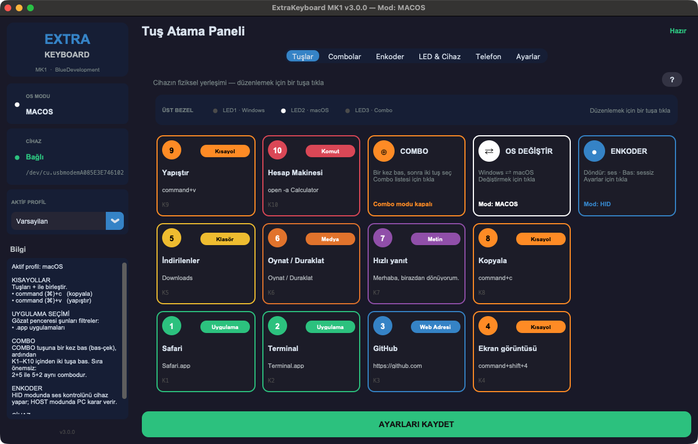
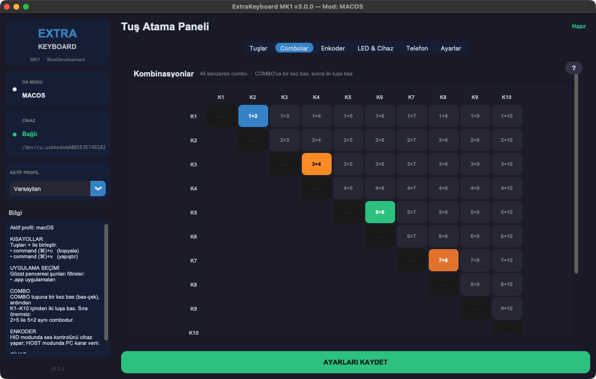
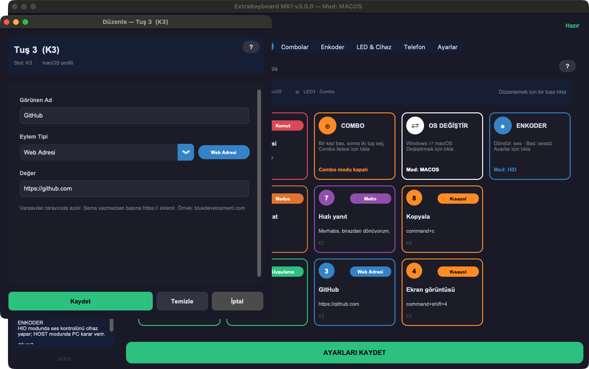
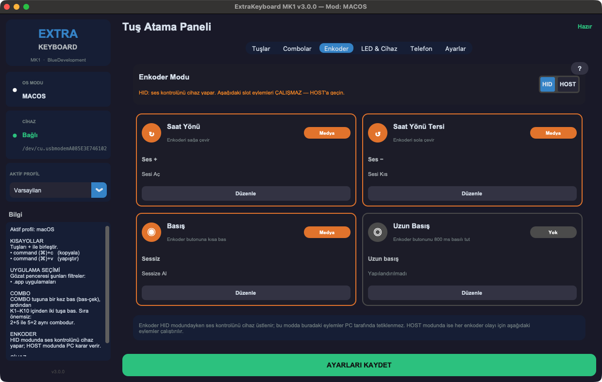
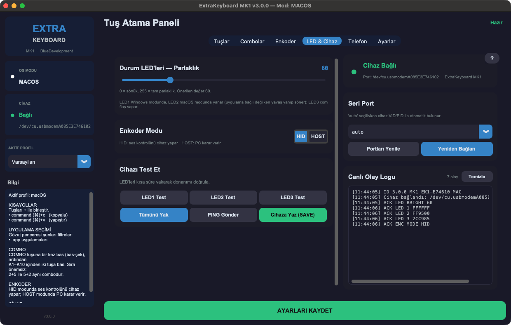
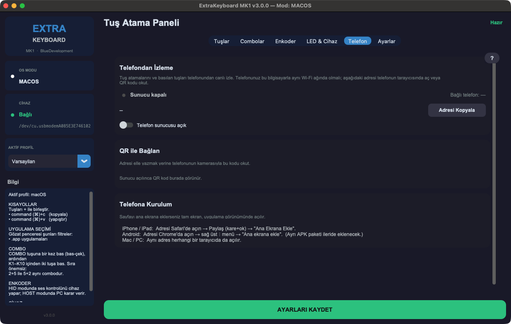
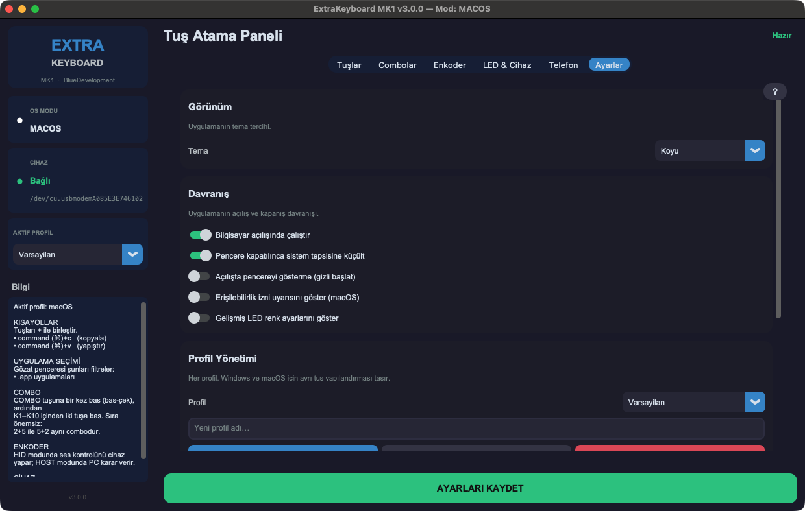

# ExtraKeyboard MK1

**ESP32-S3 tabanlı, USB'den çalışan, kendin yapabileceğin bir makro klavye — ve onu yöneten masaüstü uygulaması.**

`Firmware 3.0.0` · `ESP32-S3` · `macOS + Windows` · `Türkçe arayüz` · `Açık yapım tarifi`



---

## İçindekiler

- [Bu nedir?](#bu-nedir)
- [Öne çıkan özellikler](#öne-çıkan-özellikler)
- [Ekran görüntüleri](#ekran-görüntüleri)
- [Klavye ve Numpad: iki varyant](#klavye-ve-numpad-iki-varyant)
- [Nasıl çalışır](#nasıl-çalışır)
- [Kendin yap](#kendin-yap)
  - [1. Malzeme](#1-malzeme) · [2. Kablolama](#2-kablolama) · [3. Gövde](#3-gövde) · [4. Firmware](#4-firmware) · [5. Test](#5-test)
- [Masaüstü uygulaması](#masaüstü-uygulaması)
- [Sorun giderme](#sorun-giderme)
- [Teknik özet](#teknik-özet)
- [Dosya düzeni](#dosya-düzeni)
- [Belgeler](#belgeler)
- [Sürüm notları](#sürüm-notları)
- [Lisans](#lisans)

---

## Bu nedir?

ExtraKeyboard, ana klavyenizin yanında duran ve sık yaptığınız işleri tek tuşa
indiren bir yardımcı cihazdır. Uygulama açın, klasör açın, kısayol gönderin,
metin yazın, kabuk komutu çalıştırın, sesi ayarlayın — hepsi parmağınızın altında.

Projenin temel kararı şudur: **mantık cihazda değil bilgisayardadır.**
Cihaz yalnızca *"hangi tuşa basıldı"* bilgisini gönderir; *"ne yapılacağına"*
bilgisayardaki uygulama karar verir. Bir tuşun görevini değiştirmek için firmware
yüklemek gerekmez, uygulamada tuşa tıklayıp yeni eylemi seçmek yeterlidir.

---

## Öne çıkan özellikler

- **10 işlev tuşu + COMBO + OS tuşu + döner enkoder.** Enkoder varsayılan olarak
  sesi ayarlar; basınca sessize alır.
- **45 kombinasyon.** COMBO'ya bir kez basın, sonra iki işlev tuşuna dokunun.
  Sıra önemsizdir: `2+5` ile `5+2` aynı comboyu çalıştırır. C(10, 2) = 45.
- **10 eylem tipi:** uygulama, web adresi, kısayol, metin, kabuk komutu, dosya,
  klasör, medya tuşu, makro ve "hiçbir şey".
- **Ayrı Windows / macOS profilleri.** Yollar ve kısayollar iki sistemde farklıdır;
  cihazdaki OS tuşuyla anında geçilir. Birden çok profil tutulabilir.
- **Uygulama kapalıyken de çalışır.** HID yedek modunda Tuş 1–10 sırasıyla
  `F13`–`F22` gönderir, enkoder sesi doğrudan kontrol eder.
- **Sürücü gerektirmez.** Cihaz standart bir HID klavye + seri port olarak görünür.
- **Kutuyu açmadan firmware güncelleme.** Kart, uygulamadan gelen kasıtlı bir
  komutla kendini indirme moduna alır; BOOT/RST düğmelerine erişmek gerekmez.
- **Kendi kendini toparlayan bağlantı.** Kart tarafında bekçiler, uygulama tarafında
  otomatik yeniden bağlanma ve her olayı nedeniyle kaydeden bir günlük.
- **Telefondan izleme.** Uygulama, yerel ağda jetonla korunan bir sayfa sunarak tuş
  atamalarını ve basılan tuşları telefonda canlı gösterebilir (varsayılan: kapalı).
- **Numpad varyantı.** 16 tuşlu, gerçek sayısal tuş takımı kodları gönderen ikinci
  bir cihaz; aynı kart, ayrı firmware.
- **Baştan sona Türkçe.** Arayüz, belgeler ve hata mesajları Türkçedir.

---

## Ekran görüntüleri

<table>
<tr>
<td width="50%"><br><b>Combolar</b> — 45 kombinasyonun tamamı tek matriste; renkler eylem tipini gösterir.</td>
<td width="50%"><br><b>Eylem düzenleyici</b> — bir tuşa tıklayınca açılır: ad, eylem tipi ve değer.</td>
</tr>
<tr>
<td><br><b>Enkoder</b> — HID modunda sesi cihaz yönetir, HOST modunda dört hareket ayrı eylem çalıştırır.</td>
<td><br><b>LED &amp; Cihaz</b> — parlaklık, LED testi, port seçimi ve cihazdan gelen satırların canlı günlüğü.</td>
</tr>
<tr>
<td><br><b>Telefon</b> — yerel ağdan izleme sunucusu ve QR ile bağlanma.</td>
<td><br><b>Ayarlar</b> — tema, açılış davranışı ve profil yönetimi.</td>
</tr>
</table>

> Görüntüler örnek atamalarla çekilmiştir; kendi kurulumunuzda tuşlar boş gelir.

---

## Klavye ve Numpad: iki varyant

| | **Klavye (MK1)** | **Numpad** |
|---|---|---|
| Tuş | 12 — 10 işlev + COMBO + OS | 16 |
| Enkoder | EC11 (ses) | yok |
| Durum LED'i | 3 — Windows / macOS / COMBO | 2 — Windows / macOS |
| Tuşlar ne gönderir | Olayı uygulamaya; uygulama yoksa `F13`–`F22` | Gerçek keypad kodları: `0–9  .  ⏎  +  −  *  /` |
| Windows ⇄ macOS | OS tuşuna kısa bas | **0'ı basılı tut + Enter** |
| Firmware | [`firmware/`](firmware/) | [`firmware-numpad/`](firmware-numpad/) |

### Fiziksel yerleşim

Uygulama tuşları cihazdaki düzeniyle aynı biçimde gösterir:

```
   KLAVYE (MK1)                                      NUMPAD
   ┌────────┬────────┬────────┬────────┐   ( )       ┌───┬───┬───┬───┐
   │ Tuş 9  │ Tuş 10 │ COMBO  │   OS   │  enkoder    │ 7 │ 8 │ 9 │ / │
   ├────────┼────────┼────────┼────────┤             ├───┼───┼───┼───┤
   │ Tuş 5  │ Tuş 6  │ Tuş 7  │ Tuş 8  │             │ 4 │ 5 │ 6 │ * │
   ├────────┼────────┼────────┼────────┤             ├───┼───┼───┼───┤
   │ Tuş 1  │ Tuş 2  │ Tuş 3  │ Tuş 4  │             │ 1 │ 2 │ 3 │ − │
   └────────┴────────┴────────┴────────┘             ├───┼───┼───┼───┤
   Üst bezel: LED1 Windows · LED2 macOS · LED3 COMBO  │ 0 │ . │ ⏎ │ + │
                                                     └───┴───┴───┴───┘
```

**LED'ler (klavye):** LED1 Windows, LED2 macOS modunda yanar. Aktif modun LED'i
uygulama bağlıyken sabit, bağlı değilken yavaş yanıp söner. LED3 combo modunda yanar.

---

## Nasıl çalışır

```
   ┌──────────────────────┐         USB-C          ┌──────────────────────────┐
   │  ExtraKeyboard MK1   │◄──────────────────────►│        Bilgisayar        │
   │  (ESP32-S3)          │                        │                          │
   │                      │   HID Klavye           │  ┌────────────────────┐  │
   │  12 tuş ──┐          ├───────────────────────►│  │ İşletim sistemi    │  │
   │  enkoder ─┤ firmware │   HID Tüketici (ses)   │  │ (F13–F22, ses)     │  │
   │  3 LED ◄──┘          ├───────────────────────►│  └────────────────────┘  │
   │                      │                        │                          │
   │                      │   CDC seri             │  ┌────────────────────┐  │
   │  "EV KEY 3 DOWN"     ├───────────────────────►│  │ ExtraKeyboard      │  │
   │  "EV COMBO 2 5"      │                        │  │ uygulaması         │  │
   │  "HB 120117"         │◄───────────────────────┤  │  → config.json     │  │
   │                      │   "CMD LED BRIGHT 60"  │  │  → eylemi çalıştır │  │
   └──────────────────────┘                        │  └────────────────────┘  │
                                                   └──────────────────────────┘
```

1. Tuşa basılır; cihaz seri porttan `EV KEY 3 DOWN` satırını gönderir.
2. Uygulama satırı okur ve etkin profildeki **Tuş 3** slotuna bakar.
3. Slottaki eylem (uygulama aç / kısayol / metin …) çalıştırılır.
4. Uygulama kapalıysa cihaz bunu fark eder ve doğrudan `F15` tuşunu gönderir.

Cihaz saniyede bir `HB` (kalp atışı) yollar; uygulama da her saniye `CMD PING`
gönderir. İki taraf da karşısının yaşadığını böyle anlar.

---

## Kendin yap

> **Adım adım tek dosyalık kılavuz:** [`docs/BASIT-YAPIM.md`](docs/BASIT-YAPIM.md) —
> 3 katmanlı yapı (plaka / delikli kart / gövde), 3D baskı ölçüleri, kablolama ve
> montaj sırası. PCB tasarımı gerekmez. Aşağısı özet ve güncel donanıma göre
> doğrulanmış başvuru bilgisidir.

### 1. Malzeme

| Parça | Klavye | Numpad | Not |
|---|---|---|---|
| ESP32-S3-DevKitC-1 | 1 | 1 | **N16R8 önerilir**; 8 MB flash + 2 MB PSRAM'li kart da çalışır |
| MX uyumlu mekanik anahtar | 12 | 16 | Örn. Cherry MX Blue |
| 1U tuş başlığı (keycap) | 12 | 16 | |
| EC11 döner enkoder + knob | 1 | — | Butonlu, M7 burç |
| Düz LED (3 veya 5 mm) | 3 | 2 | Tek renk, renk serbest |
| 330 Ω direnç | 3 | 2 | Her LED'e bir tane |
| 10 kΩ direnç + 100 nF kondansatör | 2 + 2 | — | Enkoder A/B için RC filtresi |
| 26 AWG çok telli silikon tel | ~2 m | ~2 m | |
| USB-C **veri** kablosu | 1 | 1 | Şarj kablosu çalışmaz |
| Gövde | 3D baskı | 3D baskı | PETG önerilir — bkz. [Gövde](#3-gövde) |

Fiyatlı tam liste: [`hardware/BOM.csv`](hardware/BOM.csv) (klavye için zorunlu
malzeme ≈ 2.400 TL, 2026 tahmini).

### 2. Kablolama

**Kural:** her anahtarın bir bacağı kendi GPIO'suna, diğer bacağı **ortak GND**'ye.
Matris yok, diyot yok. Firmware pinleri `INPUT_PULLUP` yapar; basılan tuş LOW okunur.

**Klavye** (varsayılan derleme: `[env:quad]` / `[env:n16r8]`):

| Tuş | GPIO | | Tuş | GPIO | | Diğer | GPIO |
|---|---|---|---|---|---|---|---|
| Tuş 1 | 4 | | Tuş 6 | 16 | | Enkoder A | 11 |
| Tuş 2 | 5 | | Tuş 7 | 17 | | Enkoder B | 12 |
| Tuş 3 | 6 | | Tuş 8 | 18 | | Enkoder buton | 13 |
| Tuş 4 | 7 | | Tuş 9 | 10 | | LED1 Windows | 14 |
| Tuş 5 | 15 | | Tuş 10 | 9 | | LED2 macOS | 42 |
| | | | COMBO | 8 | | LED3 COMBO | 41 |
| | | | OS | 21 | | | |

**Numpad:**

| GPIO → tuş | | | |
|---|---|---|---|
| 11 → `7` | 12 → `8` | 13 → `9` | 14 → `/` |
| 8 → `4` | 9 → `5` | 10 → `6` | 21 → `*` |
| 15 → `1` | 16 → `2` | 17 → `3` | 18 → `−` |
| 4 → `0` | 5 → `.` | 6 → `⏎` | 7 → `+` |

LED'ler: GPIO42 Windows, GPIO41 macOS.

**LED devresi:** `GPIO ── 330 Ω ── LED anot (uzun bacak)`, katot (kısa bacak) → GND.

**Enkoder:** A ve B kanallarının her birine 10 kΩ çekme direnci + GND'ye 100 nF
(τ = 1 ms donanım debounce). Ortak bacak GND'ye.

> **Bu pinlere bir şey bağlamayın:** 0, 3, 45, 46 (strapping), 19–20 (USB),
> 26–37 (flash / PSRAM). Kabloyu kart üzerindeki **"USB"** yazan sokete takın,
> "UART" yazana değil.

> **Üst sıra tuşları karışık mı çıktı?** Kabloyu sökmeyin. Tuşların rolü
> [`firmware/src/keys.cpp`](firmware/src/keys.cpp) içindeki `KEY_PINS` sırasıyla
> belirlenir; sırayı değiştirip yeniden yükleyin. Tüm ayrıntı ve birim farkları:
> [`PIN-HARITASI.md`](PIN-HARITASI.md).

### 3. Gövde

[`mechanical/`](mechanical/) klasöründe OpenSCAD kaynakları var: gövde
(`case.scad`), üst plaka (`plate.scad`), knob (`knob.scad`), montaj görünümü
(`assembly.scad`) ve tüm ölçülerin tek yerden değiştiği `parameters.scad`.
Plakayı lazer/CNC ile kestirmek için `plate.dxf` ve onu üreten `gen_dxf.py`
da burada. Baskı ve montaj notları: [`mechanical/OKU-ONCE.md`](mechanical/OKU-ONCE.md),
[`docs/02-MEKANIK-TASARIM.md`](docs/02-MEKANIK-TASARIM.md).

### 4. Firmware

Gerekenler: [PlatformIO](https://platformio.org/) ve `esptool`
(`pip install esptool` ya da PlatformIO'nun içindeki).

**4.1 Kartını tanı.** ESP32-S3 modülleri aynı görünse de bellek tipleri farklı
olabilir ve **yanlış ayar kartı hiç açılmaz hâle getirir.** BOOT'u basılı tutup
RST'ye basıp bırak, BOOT'u bırak (indirme modu), sonra:

```bash
esptool.py --chip esp32s3 flash_id
```

| Çıktıda | Ortam |
|---|---|
| `Embedded PSRAM 2MB` + `Detected flash size: 8MB` | `quad` |
| `Embedded PSRAM 8MB` + `Detected flash size: 16MB` (N16R8) | `n16r8` |

**4.2 Derle.**

```bash
cd firmware && pio run -e quad          # ya da: -e n16r8
cd firmware-numpad && pio run           # numpad (8 MB flash + 2 MB PSRAM)
```

**4.3 İlk yükleme.** Kart indirme modundayken (4.1'deki gibi):

```bash
cd firmware
esptool.py --chip esp32s3 --port <PORT> --baud 460800 \
  --before no_reset --after hard_reset write_flash \
  --flash_mode dio --flash_freq 40m --flash_size 8MB \
  0x0     .pio/build/quad/bootloader.bin \
  0x8000  .pio/build/quad/partitions.bin \
  0xe000  ~/.platformio/packages/framework-arduinoespressif32/tools/partitions/boot_app0.bin \
  0x10000 .pio/build/quad/firmware.bin
```

`n16r8` için `--flash_size 16MB` ve `.pio/build/n16r8/` kullanın. `<PORT>`, macOS'ta
`/dev/cu.usbmodem…`, Windows'ta `COM…` olur. Yazma bitince kart açılmazsa RST'ye
bir kez basın ya da kabloyu çıkarıp takın.

> **⚠️ `pio run -t upload` kullanmayın.** PlatformIO imajı QIO / 80 MHz yazar; bu
> kartlarda kullanılan bazı flash çipleri (Boya) bu ayarla okunamaz ve kart **boot
> döngüsüne** girer (seri çıktıda `ets_loader.c 78`). `--flash_mode dio
> --flash_freq 40m` her çipte güvenlidir.

**4.4 Sonraki güncellemeler — kutuyu açmadan.** Bu firmware'de kart, uygulama
portundan gelen `CMD BOOTLOADER CONFIRM` komutuyla kendini indirme moduna alır.
[`tools/yukle-kutusuz.py`](tools/yukle-kutusuz.py) tüm zinciri tek komutta yürütür:
kartı USB seri numarasından tanır → kendi ortamını derler → indirme moduna alır →
DIO / 40 MHz ile yazar → indirme bayrağını temizleyip resetler → kalp atışını
doğrular. Kendi kartınızı önce dosyadaki `BIRIMLER` tablosuna ekleyin; tanımadığı
kartı bilerek reddeder.

```bash
python tools/yukle-kutusuz.py
```

### 5. Test

Uygulamayı açın → **LED & Cihaz** sekmesi → **Canlı Olay Logu**. Her tuşa basın:
doğru `EV KEY n` satırının geldiğini görün. Enkoderi çevirin, COMBO ve OS'a basın.
**LED1 / LED2 / LED3 Test** düğmeleriyle LED'leri sınayın.

---

## Masaüstü uygulaması

### macOS — hazır uygulama

1. [Sürümler](https://github.com/MusaCanBacak/ExtraKeyboard-MK1/releases) sayfasından
   `ExtraKeyboard-MK1-KURULUM.zip` dosyasını indirin.
2. `1-BILGISAYAR-UYGULAMASI/macOS/Kur-macOS.command` dosyasına çift tıklayın;
   uygulamayı **Uygulamalar** klasörüne kopyalar ve açar.
3. **Sistem Ayarları → Gizlilik ve Güvenlik** altında **Erişilebilirlik** ve
   **Girdi İzleme** izinlerini verin, sonra uygulamayı **kapatıp yeniden açın.**
   İzin verilmezse kısayol ve metin eylemleri sessizce hiçbir şey yapmaz.

> Paketteki `2-FIRMWARE` ve `3-DONANIM` klasörleri eskidir. Firmware'i ve donanım
> belgelerini bu depodan alın.

### Kaynaktan (macOS / Windows)

Python **3.10 veya üstü**, **Tk 8.6** ile birlikte gerekir.

```bash
git clone https://github.com/MusaCanBacak/ExtraKeyboard-MK1.git
cd ExtraKeyboard-MK1
python3 -m venv .venv
source .venv/bin/activate          # Windows: .venv\Scripts\activate
pip install -r requirements.txt
python run_app.py
```

> **macOS:** Sistemle gelen Python 3.9, eski Tk 8.5 ile gelir ve uygulama **boş
> beyaz pencere** açar. [python.org](https://www.python.org/downloads/) Python'unu
> kullanın. **Windows:** Kurulum paketindeki `Windows/Baslat.bat` aynı adımları
> kendisi yapar.

### Kullanım

- **Tuş atamak:** Tuşlar sekmesinde bir tuşa tıklayın → eylem tipini ve değeri seçin
  → **Kaydet**. Sürükle-bırak ile uygulama veya dosya da atanabilir.
- **Combo:** COMBO'ya bir kez basın (LED3 yanar), sonra iki işlev tuşuna dokunun.
  Mod açık kalır; kapatmak için COMBO'ya tekrar basın. Uygulama bağlı değilken
  10 sn işlem yapılmazsa kendiliğinden kapanır.
- **OS tuşu:** kısa basış Windows ⇄ macOS; **3 sn basılı** tutmak HID yedek modunu
  açar/kapatır.
- **Enkoder:** `HID` modunda sesi doğrudan cihaz ayarlar; `HOST` modunda çevirme,
  basma ve uzun basma uygulamada ayrı eylemler çalıştırır.

---

## Sorun giderme

| Belirti | Neden / çözüm |
|---|---|
| Bağlantı kopup geliyor | Uygulamanın olay günlüğüne bakın: macOS'ta `~/Library/Logs/ExtraKeyboard.log` (Windows: `%LOCALAPPDATA%\ExtraKeyboard\`). Kart her resetten sonra nedenini oraya yazar (`DBG BOOT reset=…`). Aynı USB hub'ında **sürekli resetlenen başka bir cihaz** varsa ayrı bir porta takın. |
| Uygulama bağlanamıyor | Portu başka bir program tutuyor olabilir (Arduino / PlatformIO seri monitörü). Seri port aynı anda tek programa açılır. |
| Kart hiç açılmıyor, yalnızca `USB JTAG/serial debug unit` görünüyor | Yanlış ortam ya da QIO yazımı. 4.1'deki gibi kartı tanıyıp DIO / 40 MHz ile yeniden yazın. |
| Seri port var ama klavye olarak görünmüyor | `ARDUINO_USB_MODE=0` bayrağı eksik ya da kablo "UART" soketinde. |
| Üst sıradaki tuşlar yer değiştirmiş | `keys.cpp` → `KEY_PINS` sırası ([PIN-HARITASI.md](PIN-HARITASI.md)). |
| macOS'ta kısayollar çalışmıyor | Erişilebilirlik + Girdi İzleme izni verip uygulamayı yeniden açın. |
| Uygulama boş beyaz pencere açıyor | Tk 8.5'li Python (macOS sistem Python'u). python.org Python'u kullanın. |
| Türkçe karakterler yazılmıyor | `metin` eylemi ASCII dışı karakterleri pano üzerinden yapıştırır; hedef uygulama yapıştırmayı desteklemiyor olabilir. |

Daha fazlası: [`docs/08-SORUN-GIDERME.md`](docs/08-SORUN-GIDERME.md) ve
[`docs/06-ONEMLI-NOTLAR.md`](docs/06-ONEMLI-NOTLAR.md).

---

## Teknik özet

| Konu | Değer |
|---|---|
| MCU | ESP32-S3-DevKitC-1 (N16R8 ya da 8 MB flash + 2 MB Quad PSRAM) |
| USB | HID Klavye + HID Tüketici + CDC seri, tek kablo (TinyUSB, `ARDUINO_USB_MODE=0`). Görünen ürün `ExtraKeyboard MK1`, üretici `BlueDevelopment` |
| Protokol | Satır tabanlı ASCII. Cihaz → PC: `EV KEY / EV COMBO / EV OS / EV ENC / HB / ID / ACK`. PC → cihaz: `CMD ID / PING / OS / LED / ENC MODE / HIDFB / SAVE / BOOTLOADER CONFIRM`. Ayrıntı: [`docs/03-PROTOKOL.md`](docs/03-PROTOKOL.md) |
| Tuş okuma | Matris yok, diyot yok, `INPUT_PULLUP`; yazılım debounce 8 ms |
| Enkoder | EC11, RC donanım debounce (10 kΩ + 100 nF) + durum tablosu |
| Güvenilirlik | DTR/RTS ile istemsiz bootloader'a düşme kapalı; döngü bekçisi 10 sn; USB gönderim tıkanma bekçisi 5 sn; uygulamada otomatik yeniden bağlanma |
| Uygulama | Python 3.10+ (Tk 8.6), CustomTkinter, pyserial, pyautogui, pystray, Pillow, pyperclip, tkinterdnd2, qrcode |
| Ayar dosyası | `config.json`, şema 3, atomik yazma. macOS: `~/Library/Application Support/ExtraKeyboard/` |

---

## Dosya düzeni

```
ExtraKeyboard-MK1/
├── README.md                 # bu dosya
├── PIN-HARITASI.md           # güncel pin haritası (klavye + numpad) — donanımdan doğrulandı
├── run_app.py                # uygulamayı kaynaktan başlatır
├── requirements.txt
├── ExtraKeyboard-*.command   # macOS başlatma / kurulum betikleri
├── Kaldir-*.bat|command      # kaldırma betikleri
│
├── app/                      # masaüstü uygulaması
│   ├── main.py               # tek örnek kontrolü, tepsi simgesi, başlatma
│   ├── core/                 # config, cihaz bağlantısı (device.py), eylemler, telefon sunucusu
│   └── ui/                   # ana pencere, tuş ızgarası, combo matrisi, eylem düzenleyici
│
├── firmware/                 # klavye firmware'i (PlatformIO: quad / n16r8 / e74610)
├── firmware-numpad/          # numpad firmware'i
│
├── hardware/                 # BOM, şematik, kablolama tablosu
├── mechanical/               # OpenSCAD gövde/plaka/knob + DXF üretici
├── docs/                     # ayrıntılı belgeler + ekran görüntüleri
├── tools/                    # kutusuz yükleme, .app paketleme (PyInstaller), öz kontrol
├── varliklar/                # uygulama simgesi
└── dagitim/                  # kurulum paketi iskeleti (zip'ler Sürümler sayfasında)
```

`Main.py` ve `macro_config.json`, eski v2 sürümünden kalmadır; v2 ayarları ilk
çalıştırmada otomatik olarak taşınır.

---

## Belgeler

| Belge | İçerik |
|---|---|
| [`docs/BASIT-YAPIM.md`](docs/BASIT-YAPIM.md) | **Buradan başla.** Tek dosyada yapım: katmanlar, ölçüler, kablolama, montaj sırası. |
| [`PIN-HARITASI.md`](PIN-HARITASI.md) | Güncel pin haritası, birim farkları, bellek/flash ayarı. |
| [`docs/00-CEKIRDEK-SPEC.md`](docs/00-CEKIRDEK-SPEC.md) | Çekirdek şartname: pinler, protokol, JSON şeması, ölçüler. |
| [`docs/01-DONANIM-PIN-SEMASI.md`](docs/01-DONANIM-PIN-SEMASI.md) | Elektronik şema ve pin seçimlerinin gerekçeleri. |
| [`docs/02-MEKANIK-TASARIM.md`](docs/02-MEKANIK-TASARIM.md) | Gövde ve plaka ölçüleri, OpenSCAD parametreleri, baskı ayarları. |
| [`docs/03-PROTOKOL.md`](docs/03-PROTOKOL.md) | Cihaz ⇄ uygulama protokolü, satır satır. |
| [`docs/04-FIRMWARE-KURULUM.md`](docs/04-FIRMWARE-KURULUM.md) | Firmware geliştirme ortamı ve derleme. |
| [`docs/05-UYGULAMA-KULLANIMI.md`](docs/05-UYGULAMA-KULLANIMI.md) | Uygulamanın tüm ekranları ve eylem tipleri. |
| [`docs/06-ONEMLI-NOTLAR.md`](docs/06-ONEMLI-NOTLAR.md) | İncelikler ve tuzaklar: risk, neden, çözüm, belirti. |
| [`docs/07-MONTAJ-KILAVUZU.md`](docs/07-MONTAJ-KILAVUZU.md) | Adım adım montaj ve ölçüm kontrolleri. |
| [`docs/08-SORUN-GIDERME.md`](docs/08-SORUN-GIDERME.md) | Belirtiden teşhise sorun giderme akışı. |
| [`docs/09-GENISLETME.md`](docs/09-GENISLETME.md) | Tuş eklemek ve projeyi genişletmek. |

> Bazı derin başvuru belgeleri tasarımın önceki aşamalarında yazıldı (11 tuş,
> WS2812B LED). Bu README ve `PIN-HARITASI.md` ile çeliştikleri yerde **güncel
> donanımı bu ikisi anlatır.**

---

## Sürüm notları

### 2026-09 — bağlantı güvenilirliği

Uzun süren "bağlandı / koptu" sorunu kart ve uygulama tarafında kökünden çözüldü:

- **Firmware:** USB seri hatlarının (DTR/RTS) kartı istemeden bootloader'a atması
  kapatıldı; kalıcı USB gönderim tıkanması giderildi; iki işaretsiz tamsayı taşması
  düzeltildi (biri kartın ~10 sn'de bir "uygulama koptu" sanmasına, diğeri gereksiz
  resetlere yol açıyordu); döngü ve gönderim bekçileri eklendi; kutuyu açmadan
  güncelleme için `CMD BOOTLOADER CONFIRM`.
- **Uygulama:** gönderim sırasında okuyucunun donması, kart resetlenince ölü
  bağlantıda kalma ve ROM indirme portuna bağlanma hataları giderildi; otomatik
  yeniden bağlanma, 3 sn'de hızlı toparlanma ve kalıcı olay günlüğü eklendi.
- **Yapım:** modül bellek tipine göre derleme ortamları (`quad`, `n16r8`) ve
  DIO / 40 MHz yazma kuralı.

### v3.0.0

Sıfırdan yeniden tasarım. v2'de cihaz sıradan bir klavye gibi `Ctrl+Shift+Alt+F13`
gönderiyor, uygulama da bunu global bir klavye dinleyicisiyle yakalıyordu. Bu yöntem
tuşları her uygulamaya sızdırıyor, özel izin istiyor ve cihazdan bilgisayara veri
taşıyamıyordu. v3'te ayrı bir **CDC seri kanalı** kullanılır: girdi akışına karışmaz,
iki yönlüdür ve genişletilebilir. v2'nin `macro_config.json` ayarları otomatik taşınır.

### Bilinen sınırlamalar

- Combo, HID yedek modunda (uygulama kapalıyken) çalışmaz.
- Windows'ta yönetici yetkisiyle çalışan pencerelere kısayol gönderilemez (UIPI).
- macOS'ta `medya` eylemlerinin oynat/duraklat kısmı çalan uygulamaya bağlıdır.
- Bluetooth yoktur; bu bilinçli bir tasarım kararıdır.

---

## Lisans

Bu depoda ayrı bir lisans dosyası bulunmamaktadır; tüm hakları saklıdır.
Kişisel ve eğitim amaçlı kullanım, çoğaltma ve değiştirme serbesttir.
Ticari kullanım için **BlueDevelopment** ile iletişime geçin.

Üçüncü taraf bileşenler kendi lisanslarına tabidir (Arduino-ESP32, TinyUSB,
CustomTkinter, pyserial, pyautogui, pystray, Pillow, pyperclip, tkinterdnd2, qrcode).

---

<sub>ExtraKeyboard MK1 · Firmware 3.0.0 · Uygulama 3.0.0 · BlueDevelopment</sub>
