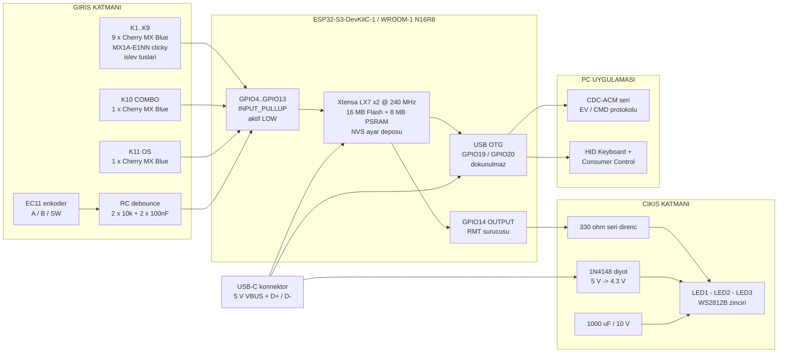

# ExtraKeyboard MK1 — Donanım ve Pin Şeması (v3.0.0)

> **Bu doküman `docs/00-CEKIRDEK-SPEC.md` dosyasına tabidir.**
> Buradaki tüm GPIO numaraları, renkler, ölçüler ve isimler çekirdek
> spesifikasyonun 2. ve 3. bölümlerinden **birebir** alınmıştır.
> Bir çelişki görürsen çekirdek spesifikasyon kazanır.

| Alan | Değer |
|---|---|
| Donanım revizyonu | `MK1` |
| Firmware sürümü | `3.0.0` |
| MCU | ESP32-S3-DevKitC-1 (ESP32-S3-WROOM-1, N16R8) |
| Anahtarlar | **Cherry MX Blue `MX1A-E1NN`** — clicky, 3 pinli plate-mount, 50 g (bkz. 5.1) |
| Besleme | USB-C, 5 V VBUS |
| Kullanılan GPIO sayısı | 15 (11 tuş + 3 enkoder + 1 LED veri) |
| Toplam lehim teli | 42 adet (bkz. `hardware/kablolama-tablosu.md`) |

**İlgili dosyalar**
- `hardware/sematik.md` — ASCII ve Mermaid şematikler
- `hardware/kablolama-tablosu.md` — tel tel lehimleme sırası
- `hardware/BOM.csv` — malzeme listesi ve maliyet

---

## 1. Blok Diyagram

Sistem üç mantıksal katmandan oluşur: **giriş** (tuşlar + enkoder),
**işlem** (ESP32-S3), **çıkış** (WS2812B zinciri + USB HID/CDC).
Cihazda karar mantığı yoktur; olay üretir, PC uygulaması yorumlar.



**Veri akışı özeti**

| Yön | Yol |
|---|---|
| Tuşa basış | Cherry MX Blue → GPIO (LOW) → **8 ms** debounce → `EV KEY n DOWN/UP` → CDC → PC |
| Enkoder tık | EC11 → RC filtre → GPIO11/12 → 4 adımlı durum tablosu → `EV ENC CW/CCW` |
| LED komutu | PC → `CMD LED i RRGGBB` → CDC → RMT → GPIO14 → WS2812B |
| HID yedek | CDC DTR düşük → cihaz doğrudan F13–F21 / Consumer Control gönderir |

---

## 2. Tam Pin Tablosu

Aşağıdaki tablo çekirdek spesifikasyon **bölüm 3.1** ile birebir aynıdır.
**Değiştirilemez.**

| # | İşlev | GPIO | Yön / Mod | Bağlı Eleman | Dinlenme Seviyesi | Aktif Seviye |
|---|---|---|---|---|---|---|
| 1 | K1 | **GPIO4** | `INPUT_PULLUP` | MX anahtar bacak 1 → GND | HIGH (3.3 V) | LOW (0 V) |
| 2 | K2 | **GPIO5** | `INPUT_PULLUP` | MX anahtar bacak 1 → GND | HIGH | LOW |
| 3 | K3 | **GPIO6** | `INPUT_PULLUP` | MX anahtar bacak 1 → GND | HIGH | LOW |
| 4 | K4 | **GPIO7** | `INPUT_PULLUP` | MX anahtar bacak 1 → GND | HIGH | LOW |
| 5 | K5 | **GPIO15** | `INPUT_PULLUP` | MX anahtar bacak 1 → GND | HIGH | LOW |
| 6 | K6 | **GPIO16** | `INPUT_PULLUP` | MX anahtar bacak 1 → GND | HIGH | LOW |
| 7 | K7 | **GPIO17** | `INPUT_PULLUP` | MX anahtar bacak 1 → GND | HIGH | LOW |
| 8 | K8 | **GPIO18** | `INPUT_PULLUP` | MX anahtar bacak 1 → GND | HIGH | LOW |
| 9 | K9 | **GPIO8** | `INPUT_PULLUP` | MX anahtar bacak 1 → GND | HIGH | LOW |
| 10 | K10 (COMBO) | **GPIO9** | `INPUT_PULLUP` | MX anahtar bacak 1 → GND | HIGH | LOW |
| 11 | K11 (OS) | **GPIO10** | `INPUT_PULLUP` | MX anahtar bacak 1 → GND | HIGH | LOW |
| 12 | ENC_A | **GPIO11** | `INPUT_PULLUP` | EC11 A pini + RC debounce | HIGH | LOW |
| 13 | ENC_B | **GPIO12** | `INPUT_PULLUP` | EC11 B pini + RC debounce | HIGH | LOW |
| 14 | ENC_SW | **GPIO13** | `INPUT_PULLUP` | EC11 buton pini → GND | HIGH | LOW |
| 15 | LED_DATA | **GPIO14** | `OUTPUT` | 330 Ω → WS2812B `DIN` | LOW | darbe dizisi |

### 2.1 Neden matris yok, neden diyot yok

Klasik klavyelerde tuşlar satır/sütun matrisine dizilir ve her tuşa bir
1N4148 diyot konur. Bunun tek sebebi **GPIO tasarrufudur**.

Bu projede:

- Toplam 11 tuş var, ESP32-S3-DevKitC-1'de bol GPIO var → tasarrufa gerek yok.
- **Combo özelliği aynı anda 3 tuş basılı olmasını gerektirir** (K10 + iki işlev
  tuşu). Matriste 3 tuş aynı anda basıldığında *hayalet tuş* (ghosting) ve
  *maskeleme* (masking) oluşur; diyotlar bunu ancak her tuşa birer diyot
  eklenerek çözer. Doğrudan bağlantıda bu sorun **hiç doğmaz**.
- Doğrudan bağlantı = 11 tel + 1 ortak GND hattı. Matris = 4 satır + 3 sütun
  teli + 11 diyot + tarama kodu. Bu ölçekte matris daha karmaşık ve daha pahalı.

**Sonuç:** her anahtarın bir bacağı kendi GPIO'suna, diğer bacağı ortak GND
hattına gider. Tam N-key rollover, sıfır ek eleman.

---

## 3. ESP32-S3-DevKitC-1 Fiziksel Pin Yerleşimi

Bu bölüm lehimleme için **zorunludur**. GPIO numarası ile header üzerindeki
fiziksel konum farklı şeylerdir.

### 3.1 Kartın yönü

Kartı, **iki USB-C konnektör aşağıda**, **anten (metal kalkanlı modülün
çıkıntısı) yukarıda** ve serigrafi yazıları okunur şekilde tutun.

- Sol sıradaki 22 pinlik header = **J1**
- Sağ sıradaki 22 pinlik header = **J3**
- Her iki header'da pin numarası **yukarıdan aşağıya** 1'den 22'ye sayılır.

```
                    ANTEN / MODUL UCU  (UST)
        J1 (SOL)                                     J3 (SAG)
   +--------------------------------------------------------------+
 1 | 3V3   (o)                                          (o)   GND  | 1
 2 | 3V3   (o)                                          (o)   TX43 | 2
 3 | RST   (o)                                          (o)   RX44 | 3
 4 | GPIO4 (o) <-- K1                                   (o)   IO1  | 4
 5 | GPIO5 (o) <-- K2                                   (o)   IO2  | 5
 6 | GPIO6 (o) <-- K3          +--------------+         (o)   IO42 | 6
 7 | GPIO7 (o) <-- K4          |  ESP32-S3-   |         (o)   IO41 | 7
 8 | GPIO15(o) <-- K5          |   WROOM-1    |         (o)   IO40 | 8
 9 | GPIO16(o) <-- K6          |    N16R8     |         (o)   IO39 | 9
10 | GPIO17(o) <-- K7          |              |         (o)   IO38 |10
11 | GPIO18(o) <-- K8          +--------------+         (o)   IO37 |11
12 | GPIO8 (o) <-- K9                                   (o)   IO36 |12
13 | GPIO3 (o)  ## YASAK                                (o)   IO35 |13
14 | GPIO46(o)  ## YASAK                                (o)   IO0  |14  ## YASAK
15 | GPIO9 (o) <-- K10 COMBO                            (o)   IO45 |15  ## YASAK
16 | GPIO10(o) <-- K11 OS                               (o)   IO48 |16  (kart LED)
17 | GPIO11(o) <-- ENC_A                                (o)   IO47 |17
18 | GPIO12(o) <-- ENC_B                                (o)   IO21 |18
19 | GPIO13(o) <-- ENC_SW                               (o)   IO20 |19  ## USB D+
20 | GPIO14(o) --> LED_DATA (cikis)                     (o)   IO19 |20  ## USB D-
21 | 5V    (o) --> 1N4148 anot                          (o)   GND  |21
22 | GND   (o) --> mantik GND donusu                    (o)   GND  |22 --> LED GND
   +--------------------------------------------------------------+
   ALT KENARDA IKI ADET USB-C KONNEKTOR VARDIR.
   Hangisinin kullanilacagini KONUM degil, KONNEKTORUN YANINDAKI
   SERIGRAFI YAZISI belirler:

        serigrafide "UART"  --> CH343 USB-Seri kopru, sadece flash/konsol
        serigrafide "USB"   --> native ESP32-S3 OTG
                                <<< FIRMWARE + URUN BU PORTU KULLANIR >>>
```

> **Doğrulama uyarısı:** Konnektörlerin **sol/sağ sırası kart revizyonuna ve
> klon üretimlere göre değişebilir**; bağlayıcı olan tek şey konnektörün
> yanındaki serigrafi yazısıdır. Ürün kablosunu **üzerinde `USB` yazan**
> konnektöre takın, `UART` yazana **değil**. İlk teli lehimlemeden önce
> kartın üzerindeki yazıları gözle kontrol edin; multimetre ile 3V3 ve GND
> pinlerini doğrulayın (J1-1 ile J1-22 arası ≈ 3.3 V olmalı, kart USB'ye
> takılıyken).

### 3.2 Proje sinyallerinin header konumları

Tüm 15 sinyal **tek bir sırada, J1 üzerinde** toplanmıştır. Bu tesadüf
değildir: kablolama tek taraftan yapılır, kart ters çevrilmez, teller
birbirini kesmez.

| İşlev | GPIO | Header sırası | Üstten kaçıncı pin | Kısa gösterim | Tel rengi önerisi |
|---|---|---|---|---|---|
| K1 | GPIO4 | **J1 — sol** | **4** | `J1-4` | sarı |
| K2 | GPIO5 | **J1 — sol** | **5** | `J1-5` | sarı |
| K3 | GPIO6 | **J1 — sol** | **6** | `J1-6` | sarı |
| K4 | GPIO7 | **J1 — sol** | **7** | `J1-7` | yeşil |
| K5 | GPIO15 | **J1 — sol** | **8** | `J1-8` | yeşil |
| K6 | GPIO16 | **J1 — sol** | **9** | `J1-9` | yeşil |
| K7 | GPIO17 | **J1 — sol** | **10** | `J1-10` | mavi |
| K8 | GPIO18 | **J1 — sol** | **11** | `J1-11` | mavi |
| K9 | GPIO8 | **J1 — sol** | **12** | `J1-12` | mavi |
| K10 (COMBO) | GPIO9 | **J1 — sol** | **15** | `J1-15` | turuncu |
| K11 (OS) | GPIO10 | **J1 — sol** | **16** | `J1-16` | turuncu |
| ENC_A | GPIO11 | **J1 — sol** | **17** | `J1-17` | beyaz |
| ENC_B | GPIO12 | **J1 — sol** | **18** | `J1-18` | beyaz |
| ENC_SW | GPIO13 | **J1 — sol** | **19** | `J1-19` | beyaz |
| LED_DATA | GPIO14 | **J1 — sol** | **20** | `J1-20` | yeşil |
| 3V3 (RC filtresi) | — | **J1 — sol** | **1** | `J1-1` | kırmızı ince |
| 5V (LED beslemesi) | — | **J1 — sol** | **21** | `J1-21` | kırmızı kalın |
| GND (mantık dönüşü) | — | **J1 — sol** | **22** | `J1-22` | siyah |
| GND (RC / enkoder dönüşü) | — | **J3 — sağ** | **1** | `J3-1` | siyah |
| GND (LED güç dönüşü) | — | **J3 — sağ** | **22** | `J3-22` | siyah |

**Sıra bütünlüğü:** J1-4 … J1-12 arası **kesintisiz 9 pin = K1…K9**.
Sonra J1-13 (GPIO3) ve J1-14 (GPIO46) **atlanır** (strapping pini), ardından
J1-15 … J1-20 arası **kesintisiz 6 pin = K10, K11, ENC_A, ENC_B, ENC_SW,
LED_DATA**. Bu düzen pin tablosunun neden böyle seçildiğini açıklar.

### 3.3 Üç ayrı GND dönüşü (yıldız topraklama)

DevKitC-1'de kullanılabilir 4 adet GND pini vardır: J1-22, J3-1, J3-21, J3-22.
Hepsi kart üzerinde aynı bakır alana bağlıdır, ancak **telleri ayırmak**
LED anahtarlama akımının tuş sinyallerine gürültü bindirmesini engeller.

| GND pini | Görev | Taşıdığı akım |
|---|---|---|
| **J1-22** | 11 anahtarın ortak GND papatya dizisi | ≈ 0.3 mA (yalnızca pull-up akımı) |
| **J3-1** | RC filtre kartı + enkoder ortak ucu | ≈ 0.7 mA |
| **J3-22** | WS2812B zinciri güç dönüşü | 45 mA tipik / 180 mA tepe |
| J3-21 | *(yedek — kullanılmıyor)* | — |

---

## 4. KULLANILMAYACAK Pinler

Çekirdek spesifikasyon **bölüm 3.2** ile birebir. Bu pinlere **hiçbir şey
bağlanmayacak**.

| GPIO | Header konumu | Neden yasak | Yanlış kullanılırsa ne olur |
|---|---|---|---|
| **0** | J3-14 | Boot strapping pini | Açılışta LOW ise cihaz bootloader'a düşer, ürün açılmaz |
| **3** | J1-13 | JTAG kaynak seçimi strapping | Hata ayıklama arayüzü kilitlenir, açılış davranışı belirsizleşir |
| **19** | J3-20 | **Yerleşik USB D−** | USB tamamen ölür; HID de CDC de çalışmaz |
| **20** | J3-19 | **Yerleşik USB D+** | USB tamamen ölür; HID de CDC de çalışmaz |
| **26** | header'da yok | SPI Flash `SPICS1` | Kart açılmaz / flash bozulur |
| **27** | header'da yok | SPI Flash `SPIHD` | Kart açılmaz / flash bozulur |
| **28** | header'da yok | SPI Flash `SPIWP` | Kart açılmaz / flash bozulur |
| **29** | header'da yok | SPI Flash `SPICS0` | Kart açılmaz / flash bozulur |
| **30** | header'da yok | SPI Flash `SPICLK` | Kart açılmaz / flash bozulur |
| **31** | header'da yok | SPI Flash `SPIQ` | Kart açılmaz / flash bozulur |
| **32** | header'da yok | SPI Flash `SPID` | Kart açılmaz / flash bozulur |
| **33** | header'da yok | Octal PSRAM (N16R8) | 8 MB PSRAM erişimi bozulur, rastgele çökme |
| **34** | header'da yok | Octal PSRAM (N16R8) | 8 MB PSRAM erişimi bozulur, rastgele çökme |
| **35** | J3-13 | Octal PSRAM (N16R8) | 8 MB PSRAM erişimi bozulur, rastgele çökme |
| **36** | J3-12 | Octal PSRAM (N16R8) | 8 MB PSRAM erişimi bozulur, rastgele çökme |
| **37** | J3-11 | Octal PSRAM (N16R8) | 8 MB PSRAM erişimi bozulur, rastgele çökme |
| **43** | J3-2 | `U0TXD` — seri konsol | Hata ayıklama çıktısı kaybolur, flash aracı bozulabilir |
| **44** | J3-3 | `U0RXD` — seri konsol | Hata ayıklama çıktısı kaybolur, flash aracı bozulabilir |
| **45** | J3-15 | `VDD_SPI` strapping | Flash gerilim seçimi bozulur, kart açılmaz |
| **48** | J3-16 | DevKitC-1 üzerindeki dahili RGB LED | *(isteğe bağlı kullanılabilir — ancak bu projede boş bırakılır)* |

> **Not (GPIO15 / GPIO16):** Bu iki pin yalnızca karta harici 32.768 kHz
> kristal takıldığında `XTAL_32K_P` / `XTAL_32K_N` işlevi üstlenir. Bu projede
> harici kristal **yoktur**; ikisi de normal, tam işlevli GPIO'dur ve
> K5 / K6 için kullanılır.

### 4.1 Bu projede boşta kalan pinler

Aşağıdaki pinler ne kullanılıyor ne de yasak. Gelecekteki genişletmeler
(ek tuş, OLED ekran, I2C çevre birimi) için ayrılmıştır:

`GPIO1`, `GPIO2`, `GPIO21`, `GPIO38`, `GPIO39`, `GPIO40`, `GPIO41`,
`GPIO42`, `GPIO47` → toplam **9 serbest GPIO**.

> Bazı DevKitC-1 v1.1 kartlarında dahili RGB LED `GPIO48` yerine `GPIO38`
> üzerindedir. Genişletme yaparken kart revizyonunuzu kontrol edin.

---

## 5. Alt Devre Şematikleri

### 5.1 Tuş devresi (11 adet, tamamen aynı)

Kullanılan anahtar: **Cherry MX Blue — `MX1A-E1NN`, 3 pinli plate-mount,
clicky (tıklı).** 11 tuşun (`K1…K11`) tamamı aynı anahtardır.

Her MX anahtarın iki kontak bacağı vardır ve **polaritesizdir** (hangi bacağın
GPIO'ya, hangisinin GND'ye gittiği fark etmez).

#### 5.1.1 Anahtar verileri (Cherry MX Blue)

| Büyüklük | Değer |
|---|---|
| Parça no | `MX1A-E1NN` |
| Tip | Clicky (tıklı) — **iki parçalı slider**: gövde içinde stemden ayrı bir **click jacket** (tık ceketi) bulunur; tık sesini ve taktil hissi bu parça üretir |
| Tetikleme kuvveti | **50 g** (0.50 N) |
| Tık / taktil tepe kuvveti | ≈ 60 g |
| Dibe vurma kuvveti | ≈ 60 g |
| Ön hareket (pretravel, tetikleme noktası) | **2.2 mm** |
| Toplam hareket | **4.0 mm** |
| Sıfırlama (reset) noktası | ≈ 1.7 mm → **≈ 0.5 mm histerezis** |
| Kontak sıçraması | Veri sayfası ≤ 5 ms; clicky varyantta bırakışta **ek sıçrama** (bkz. 5.1.4) |
| Montaj | **3 pinli (plate-mount)** — bkz. 5.1.2 |

> **Ölçüler değişmez.** Cherry MX Blue, **boyutsal olarak diğer tüm MX
> anahtarlarıyla birebir aynıdır**: plaka deliği 14.00 mm kare, tuş adımı
> 19.05 mm, gövde flanşı 15.6 mm. MX Brown → MX Blue geçişinde **plaka, kasa,
> iç yükseklik ve DXF ölçülerinin hiçbiri değişmez**; çekirdek spesifikasyon
> 2.1'deki tablo aynen geçerlidir. Değişen tek şey **firmware debounce süresi**
> (5 ms → 8 ms, bkz. 5.1.4) ve **akustik sönümleme ihtiyacıdır** (bkz. 5.1.7).

> **Elektriksel olarak da hiçbir şey değişmez.** Anahtar, GPIO ile GND
> arasındaki kuru (potansiyelsiz) bir mekanik kontaktır. Devre topolojisi,
> pin tablosu, pull-up değeri ve GND papatya dizisi aynı kalır.

#### 5.1.2 Neden 3 pinli (plate-mount) şart

Bu projede **PCB yoktur**; anahtarlar 1.50 mm'lik düz plakaya klipslenir ve
elle kablolanır.

| Varyant | Gövde altında ne var | Bu projede sonuç |
|---|---|---|
| **3 pinli (plate-mount)** | 1 merkez kılavuz burcu + 2 metal kontak pini | ✓ Plakaya tam oturur |
| 5 pinli (PCB-mount) | Yukarıdakilere ek **2 adet plastik konumlandırma ayağı** | ✗ Düz plakada bu ayaklar için delik yoktur; anahtar plakaya tam oturmaz, **eğri durur** |

Yalnızca 5 pinli bulabilirseniz çözüm: **2 plastik ayağı yan keskiyle kesin.**
**Metal kontak pinlerini KESMEYİN** — onlara tel lehimlenecektir. Kestikten
sonra taban yüzeyini düzleyin, plastik çapak kalmasın.

#### 5.1.3 Elektriksel çalışma

```
            ESP32-S3 ic yapisi
       +--------------------------+
       |        3V3               |
       |         |                |
       |       [45k]  <-- dahili pull-up (INPUT_PULLUP)
       |         |                |
       |         +----------------+----------->  GPIOxx  (orn. GPIO4 = K1)
       |         |                |                 |
       |     [Schmitt trigger]    |                 |
       +--------------------------+                 |
                                                    |
                                          MX anahtar bacak 1
                                                    |
                                                 \
                                                  \    <-- mekanik kontak
                                                    |
                                          MX anahtar bacak 2
                                                    |
                                                   GND (ortak papatya hatti)
```

**Çalışma:**

| Durum | Kontak | GPIO gerilimi | Yazılımda okunan |
|---|---|---|---|
| Tuş serbest | açık | 3.3 V (dahili pull-up çeker) | `HIGH` = 1 |
| Tuş basılı | kapalı | 0 V (GND'ye kısa devre) | `LOW` = 0 → **aktif** |

**Dahili pull-up akımı:** ESP32-S3'ün dahili pull-up direnci tipik olarak
45 kΩ'dur.

```
I_pullup = 3.3 V / 45 kΩ = 73.3 uA  (tus basiliyken)
```

11 tuşun **hepsi** aynı anda basılı olsa bile toplam akım
`11 × 73.3 µA = 0.81 mA`. İhmal edilebilir. Bu yüzden harici pull-up direnci
gerekmez.

**Neden harici direnç yok:** 45 kΩ, 100 pF'lik tel kapasitesiyle
`τ = 45k × 100p = 4.5 µs` yükselme sabiti verir. 8 ms'lik yazılım debounce
penceresinin yanında bu tamamen görünmezdir.

**Neden diyot yok:** bkz. bölüm 2.1.

#### 5.1.4 Kontak sıçraması (bounce) ve neden 8 ms debounce

Mekanik kontak kapanırken ve açılırken birkaç kez sekerek arka arkaya birden
fazla kenar üretir. Cherry MX ailesi veri sayfası bu süreyi **≤ 5 ms** olarak
verir.

Ancak MX Blue **clicky**'dir ve bu tek sayı hikâyenin tamamı değildir:

- Gövde içinde, stemden **ayrı** bir **click jacket** (tık ceketi) vardır —
  MX Blue'nun *iki parçalı slider* olması budur.
- **Basışta** jacket stem tarafından aşağı sürüklenir, belli bir noktada
  serbest kalıp alt gövdeye çarpar → tık sesi ve taktil tepe burada doğar.
- **Bırakışta** jacket stemden ayrılıp yukarı fırlar ve geri çarpar. Bu ikinci
  mekanik darbe, kontak yaprağına veri sayfasındaki temel sıçramanın **üstüne
  ek sıçrama** bindirir. Yıpranmış bir anahtarda bırakış tarafındaki bu bileşen
  **10 ms'ye yaklaşabilir** (tipik saha değeri; veri sayfası garantisi değildir).

Karar:

| Girdi | Debounce | `firmware/src/config.h` sabiti | Gerekçe |
|---|---|---|---|
| Tuşlar `K1…K11` | **8 ms** | `EK_KEY_DEBOUNCE_MS` | Click jacket bırakışta ek sıçrama üretir |
| Enkoder butonu `ENC_SW` | **5 ms** *(değişmedi)* | `EK_ENC_SW_DEBOUNCE_MS` | EC11'in gömülü butonu farklı mekanizmadır; click jacket yoktur, bırakışta ek sıçrama üretmez |

**5 ms'de kalınırsa ne olur:** yıpranmış bir mavi anahtarda tek basış **iki kez**
eylem tetikleyebilir. Bir makro klavyede bunun karşılığı, o tuşa atanan
uygulamanın **iki kez açılmasıdır** — arıza gibi görünmeyen ama çok can sıkıcı
bir davranış.

**8 ms'nin bedeli:** yok. Bu bir makro klavyedir, üzerinde hızlı yazı
yazılmaz; tuş başına saniyede birkaç basış olur. 3 ms'lik ek gecikme insan
algısının çok altındadır.

**Tek yerden ayarlanır:** her iki süre de yalnızca `firmware/src/config.h`
içinde tanımlıdır, başka hiçbir dosyada sabit sayı yazılmaz (çekirdek
spesifikasyon 6.1). İleride lineer (MX Red) veya taktil (MX Brown) anahtara
geçilirse tuş değeri 5 ms'e düşürülebilir; sahada hâlâ çift tetikleme
görülürse 12 ms'e çıkarılır.

#### 5.1.5 Neden tuşlara DONANIM RC filtresi gerekmez (enkoderde gerekliydi)

Bu ayrım kritiktir, çünkü aynı doküman enkoder kanalları için RC filtresini
**zorunlu** kılar (bölüm 5.2). Fark, sıçramanın kaç kanalı ilgilendirdiğidir:

| | **Tuşlar `K1…K11`** | **Enkoder `ENC_A` / `ENC_B`** |
|---|---|---|
| Kanal sayısı | **1** — tek hat | **2** — A ve B, aralarında faz ilişkisi var |
| Yazılımın kullandığı bilgi | Tek bitin seviyesi: basılı / serbest | İki bitin **ikilisi** `(A,B)` ve bu ikililerin **sırası** |
| Durum değişimi | Tek yönlü ve ikili: `HIGH → LOW` ya da `LOW → HIGH` | Dört durumlu çevrim: `11 → 01 → 00 → 10 → 11` |
| Sıçramanın etkisi | Aynı geçişin tekrarı. Zaman penceresi bunu yutar, **bilgi kaybı yoktur** | Bir kanal sıçrarken diğeri sabit kalır → **geçersiz durum ikilileri** doğar, faz ilişkisi bozulur, çözücü sahte/ters tık üretir |
| Yeterli çözüm | **Yazılım debounce** (8 ms) | **Donanım RC filtresi ŞART** (τ = 1 ms) + 4 adımlı durum tablosu |

Özetle: **tuşta** sıçrama yalnızca "aynı olay kaç kez görüldü?" sorusudur;
bir zaman penceresi bunu tamamen çözer, çünkü bilginin kendisi bozulmamıştır.
**Enkoderde** sıçrama iki kanal arasındaki **faz ilişkisini** bozar; yazılım
yönü artık doğru bilgiden üretemez, çünkü bilgi MCU'ya girmeden önce
bozulmuştur. Kaybolan bilgi sonradan geri getirilemeyeceği için filtre
**donanımda**, sinyal pine ulaşmadan uygulanmak zorundadır.

`ENC_SW` (enkoder butonu) da tek kanaldır — bu yüzden o da RC filtresi
almaz, yalnızca yazılım debounce kullanır.

#### 5.1.6 Histerezis (≈ 0.5 mm)

Tetikleme noktası **2.2 mm**, sıfırlama (reset) noktası **≈ 1.7 mm**'dir;
aradaki ≈ 0.5 mm histerezistir. Yani tuşun tekrar tetiklenebilmesi için
basıldığı noktadan **≈ 0.5 mm daha yukarı bırakılması** gerekir. Çok hızlı
tekrarlı basışlarda bu hissedilir; **bir makro klavyede sorun değildir**,
yalnızca bilinmesi gerekir. Donanım tarafında hiçbir karşılığı yoktur.

#### 5.1.7 Akustik — 18.00 mm boş kovuk ve sönümleme

**Bu değişikliğin en önemli pratik sonucu budur.** MX Blue yüksek sesli bir
anahtardır ve bu tasarımda plakanın altında **18.00 mm yüksekliğinde,
82.20 × 63.15 mm'lik boş bir kovuk** vardır (çekirdek spesifikasyon 2.1).
Boş kovuk bir **rezonans odası** gibi çalışır: tık sesi içeride yankılanır ve
dışarı "çınlamalı / boşluklu" (hollow, pingy) çıkar.

Bu bir **ölçü** sorunu değil, **dolgu** sorunudur. Plaka, kasa ve DXF
ölçülerinin hiçbiri değişmez.

| # | Ne | Nereye | Kalınlık | Nasıl |
|---|---|---|---|---|
| **1** | Poron veya EVA sünger levha | **Tabanın iç yüzeyi** (2.50 mm tabanın üst yüzü) | **2–3 mm** | Kovuktaki en büyük ve en düz yansıtıcı yüzey burasıdır; tek başına en çok farkı bu yapar. BOM'daki 100 × 100 mm levhadan ≈ 80 × 60 mm kesin; 4 köşedeki M3 insert kolonlarının ve DevKit yuvasının etrafını boşaltın. |
| **2** | Sünger artığı **veya** kesilmiş mutfak dolabı kaymaz altlığı | Kovukta kalan **serbest hacim** — kartın ve tellerin çevresi ve üstü | gevşek dolgu | Boşluğu kapatacak kadar doldurun, **DevKit'i ve kabloları SIKIŞTIRMADAN**. Kart baskı altında kalmamalı, teller ezilmemeli, arka duvardaki `≈ 10 × 6 mm` USB açıklığı kapanmamalıdır. |
| **3** | İnce sünger şerit *(opsiyonel, en zahmetlisi)* | **Plakanın alt yüzeyi**, anahtar delikleri arasındaki boş alanlar | 2–3 mm | Plakanın kendi titreşimini söndürür. Anahtar gövdeleri ve lehimli kontak bacakları plakanın altına doğru uzanır; süngeri **lehim noktalarına değdirmeyin**. |
| **4** | Silikon ayaklar *(BOM'da zaten var)* | Tabanın 4 köşesi | ⌀8 × 2 mm | Gövde–masa yapısal temasını keser. Masa tablası büyük bir rezonatördür; ayaklar olmadan ses masaya iletilir ve belirgin biçimde artar. |

> **Beklenti yönetimi:** sünger, sesin **çınlama/boşluk bileşenini** alır;
> **tık sesinin kendisini almaz.** Click jacket'in ürettiği tık, anahtarın
> tanımıdır. Sessiz bir cihaz isteniyorsa çözüm sönümleme değil, anahtar
> tipini değiştirmektir.

> **Montajda ne zaman:** dolgu, taban kapatılmadan **önce** yerleştirilir;
> vidalar sıkıldıktan sonra kartın oynamadığı ve USB portunun gövde deliğiyle
> hizalı kaldığı kontrol edilir. Bkz. `hardware/kablolama-tablosu.md` bölüm 4.

#### 5.1.8 Güç bütçesine etkisi

**Yoktur.** MX Blue tamamen pasif bir mekanik kontaktır — içinde elektronik,
sürücü veya LED yoktur; akım yalnızca ESP32-S3'ün dahili pull-up'ından akar ve
bu değer anahtar tipinden tamamen bağımsızdır (basılı tuş başına 73.3 µA).
Bölüm 6'daki güç bütçesinin hiçbir satırı MX Brown → MX Blue geçişiyle
değişmez.

### 5.2 EC11 enkoder + RC debounce devresi

EC11, tıklama başına bir tam quadrature çevrimi üreten mekanik bir
enkoderdir. Mekanik kontaklar **her geçişte 0.1–1 ms süren sıçrama
(bounce) üretir** ve bu sıçramalar quadrature çözücüsünü sahte tıklar
üretmeye zorlar. Yazılım debounce'u tek başına yetersizdir çünkü sıçrama
sırasında A ve B kanalları **geçersiz durum ikilileri** üretir.

Çözüm: her kanal için birinci dereceden RC alçak geçiren filtre.

```
   3V3 (J1-1)
      |
     [ R1 ] 10 kohm
      |
      +--------------------------------+-------->  ENC_A  (GPIO11, J1-17)
      |                                |
      |                            EC11 pin A
    [ C1 ]                             |
    100 nF                          \   <-- dahili kontak
      |                                |
      |                            EC11 pin C (ortak)
      |                                |
     GND -----------------------------+---- GND (J3-1)


   ENC_B (GPIO12, J1-18) icin BIREBIR AYNI devre:
   R2 = 10 kohm,  C2 = 100 nF,  EC11 pin B


   ENC_SW (GPIO13, J1-19):  RC YOK
      GPIO13 --- EC11 SW1 ---\--- EC11 SW2 --- GND
      (yalnizca dahili pull-up + yazilim debounce)
```

**Zaman sabiti hesabı**

```
tau = R x C
tau = 10 000 ohm x 100 x 10^-9 F
tau = 1 000 x 10^-6 s
tau = 1 ms
```

**Bu değer neden doğru seçim?**

| Büyüklük | Değer | Sonuç |
|---|---|---|
| EC11 kontak sıçrama süresi | 0.1 – 1 ms | Filtre bunu bastırmalı |
| RC zaman sabiti τ | **1 ms** | Sıçrama bandını tam kapsıyor |
| %90 yükselme süresi (2.2 τ) | 2.2 ms | Kenar yumuşatılır |
| İnsan elinin en hızlı çevirme hızı | ≈ 20 tık/s → tık başına 50 ms | 2.2 ms « 50 ms → **kaçan tık yok** |
| Filtre kesim frekansı `f = 1/(2πRC)` | 159 Hz | Sıçrama enerjisi (kHz bandı) elenir |

Sıçrama darbeleri 1 ms'lik kapasitörü anlamlı ölçüde şarj edemez; GPIO'nun
Schmitt trigger girişi (V_IL ≈ 0.8 V, V_IH ≈ 2.5 V) histerezis sağladığı için
filtrelenmiş sinyal tek ve temiz bir kenar üretir.

**Dahili pull-up'ın etkisi (önemli ayrıntı)**

`ENC_A` ve `ENC_B` yazılımda `INPUT_PULLUP` olarak açılır. Dahili 45 kΩ,
harici 10 kΩ ile **paralel** çalışır:

```
R_esdeger = (10k x 45k) / (10k + 45k) = 450 000 / 55 = 8.18 kohm
tau_gercek = 8.18 kohm x 100 nF = 0.82 ms
```

0.82 ms hâlâ sıçrama bandını kapsar; tasarım geçerlidir. Bu yüzden dahili
pull-up'ı kapatmaya gerek yoktur ve pin tablosu `INPUT_PULLUP` der.

**Deşarj yolu:** kontak kapandığında C1, kontağın kendi direnci
(< 100 mΩ) üzerinden neredeyse anında boşalır. Yani düşen kenar hızlı,
yükselen kenar filtreli olur — mekanik enkoder için ideal davranış.

**Yazılım tarafı:** RC filtresi donanım katmanıdır; üstüne çekirdek
spesifikasyon 6.1'deki **4 adımlı durum tablosu (state table) çözücü**
gelir. EC11 tıklama başına tam bir çevrim ürettiği için `1 tık = 1 event`
garantisi sağlanır.

### 5.3 WS2812B zinciri

Üç adet WS2812B, üst bezeldeki `⌀3.00 mm` pencerelerin arkasında,
`8.00 mm` aralıkla sıralanır (çekirdek spesifikasyon 2.1).
LED sırası **soldan sağa LED1, LED2, LED3**'tür ve veri de bu sırayla akar.

```
 J1-21 (5V)          D1  1N4148
   o------------------|>|-------+------------------+-------------------+
                    anot  katot |                  |                   |
                                |                  |                   |
                              [C3]            LED1 VDD            LED2 VDD ... LED3 VDD
                            1000uF/10V         (4.3 V)
                                |
 J3-22 (GND)                    |
   o----------------------------+------------------+-------------------+
                                              LED1 GND            LED2 GND ... LED3 GND


 J1-20 (GPIO14)   R3 330 ohm
   o-----------[====]-----------> LED1 DIN
                                  LED1 DOUT ------> LED2 DIN
                                                    LED2 DOUT ------> LED3 DIN
                                                                      LED3 DOUT (bos)
```

#### 5.3.1 Neden 1N4148 diyot zorunlu — V_IH hesabı

WS2812B veri sayfası mantık eşiğini **beslemeye oranlı** tanımlar:

```
V_IH (minimum HIGH kabul gerilimi) = 0.7 x VDD
```

**Diyotsuz durum:**

```
VDD      = 5.0 V
V_IH     = 0.7 x 5.0 = 3.50 V
ESP32-S3 GPIO cikis HIGH seviyesi = 3.3 V

Marj = 3.3 - 3.50 = -0.20 V   -->  NEGATIF, HATA
```

3.3 V, gereken 3.5 V eşiğinin **altında** kalır. Bu tipik bir "bazen
çalışıyor" arızasıdır: oda sıcaklığında yeni bir LED ile çalışıyor gibi
görünür, sıcaklık değişince veya farklı üretim partisiyle LED'ler
rastgele renk atar. Kabul edilemez.

**Diyotlu durum (spesifikasyonun zorunlu kıldığı çözüm):**

1N4148'in ileri gerilim düşümü çalışma akımımızda (≈ 45 mA) **nominal
0.70 V**'tur (parti farkına göre 0.65 – 0.80 V arası ölçülebilir).
Çekirdek spesifikasyon bölüm 3.3 bu nominal değeri esas alır.

```
VDD_LED  = 5.0 - 0.70 = 4.30 V
V_IH     = 0.7 x 4.30 = 3.01 V
ESP32-S3 GPIO cikis HIGH seviyesi = 3.3 V

Marj = 3.3 - 3.01 = +0.29 V   -->  POZITIF, GUVENLI
```

> **Tek nominal değer kuralı:** Bu doküman setinde LED besleme rayı
> **4.30 V** olarak anılır (V_F = 0.70 V kabulü). Saha ölçümünde kabul
> bandı **4.20 – 4.40 V**'tur; bu bant V_F'in 0.60 – 0.80 V arası
> parti dağılımını kapsar. `hardware/sematik.md`,
> `hardware/kablolama-tablosu.md` ve `hardware/BOM.csv` aynı değeri kullanır.

Tam beyaz / tam parlaklık (180 mA) senaryosunda diyot düşümü ≈ 0.95 V olur:

```
VDD_LED  = 5.0 - 0.95 = 4.05 V
V_IH     = 0.7 x 4.05 = 2.84 V
Marj     = 3.3 - 2.84 = +0.46 V  -->  daha da guvenli
```

Yani akım arttıkça mantık marjı **iyileşir**. Diyot çözümü her iki uçta da
çalışır.

| Senaryo | LED akımı | 1N4148 V_F | VDD_LED | V_IH | Marj (3.3 V'a göre) | Durum |
|---|---|---|---|---|---|---|
| Diyot yok | — | — | 5.00 V | 3.50 V | **−0.20 V** | ✗ Hatalı |
| Parlaklık 60/255 *(nominal)* | 45 mA | 0.70 V | **4.30 V** | 3.01 V | **+0.29 V** | ✓ Güvenli |
| Tam beyaz 255/255 | 180 mA | 0.95 V | 4.05 V | 2.84 V | **+0.46 V** | ✓ Güvenli |

**LED parlaklığına etkisi:** WS2812B içindeki sürücü sabit akım kaynağıdır,
4.05–4.30 V besleme aralığında parlaklık gözle ayırt edilemeyecek kadar az
düşer. Zaten varsayılan parlaklık 60/255'tir.

**Diyot yönü kritiktir:** 1N4148'in gövdesindeki **siyah bant katottur** ve
**LED tarafına** bakar. Ters takılırsa LED'ler hiç yanmaz (ve zarar görmez).

> **Akım uyarısı:** 1N4148'in sürekli ortalama akım sınırı 150 mA'dır.
> Varsayılan 60/255 parlaklıkta çektiğimiz 45 mA sorunsuzdur. Firmware
> parlaklığı 255'e çıkarıp üç LED'i de tam beyaz yakarsa 180 mA ile bu sınır
> aşılır. Bu senaryoyu kullanacaksanız 1N4148 yerine **1N4001** (1 A,
> V_F ≈ 0.8 V → VDD 4.2 V) takın; hesap ve mantık marjı değişmez.

#### 5.3.2 330 Ω seri direnç

```
 GPIO14 ---[ 330 ohm ]--- LED1 DIN
        ^
        MCU cikisina MUMKUN OLDUGUNCA YAKIN lehimlenir
```

Üç görevi vardır:

1. **Yansıma (ringing) sönümleme.** WS2812B veri sinyali 800 kHz'de,
   ≈ 5 ns kenarlarla çalışır. Kısa tel bile iletim hattı gibi davranır;
   seri direnç hattı sonlandırarak aşım/çınlamayı bastırır.
2. **GPIO koruma.** LED'in giriş pini ESD veya latch-up ile GND'ye ya da
   5 V'a kaçarsa akım `I = 5 V / 330 Ω = 15 mA` ile sınırlanır. ESP32-S3
   GPIO mutlak sınırı 40 mA'dır → pin korunur.
3. **EMI azaltma.** Kenar hızını yumuşatarak yayılan gürültüyü düşürür.

Direnç değeri seçimi: 330 Ω, 220–470 Ω pratik aralığının ortasıdır.
Çok küçük olursa koruma yetersiz, çok büyük olursa (> 1 kΩ) LED giriş
kapasitesiyle birleşip kenarları fazla yavaşlatır ve veri bozulur.

#### 5.3.3 1000 µF / 10 V kondansatör

```
   LED +4.3V rayi ---+--- (+) bacak
                     |
                  [ C3 ]  1000 uF / 10 V elektrolitik
                     |
   LED GND rayi -----+--- (-) bacak  (govdedeki beyaz serit)
```

**Neden gerekli:** WS2812B içindeki üç akım kaynağı PWM ile anahtarlanır.
Üç LED aynı anda söndükten sonra tam beyaza geçtiğinde akım
`3 mA → 180 mA`'ya **mikrosaniyeler içinde** sıçrar. Kablonun kendi
endüktansı (≈ 1 µH/m) bu ani talebi karşılayamaz ve besleme hattında
çöküntü (droop) oluşur; bu da MCU'nun resetlenmesine veya LED'lerin renk
atmasına yol açar.

Kondansatör bu anlık talebi **yerel olarak** karşılar:

```
Delta_I = 180 mA - 3 mA = 177 mA
Kabul edilebilir gerilim dususu Delta_V = 0.1 V
Gereken sure (bir PWM cevrimi, 800 Hz guncelleme) Delta_t = 1.25 ms

C_gerekli = I x t / V = 0.177 A x 0.00125 s / 0.1 V = 2 212 uF
```

Not: bu en kötü senaryodur (üç LED tam beyaz). Varsayılan 60/255
parlaklıkta `ΔI = 42 mA` olur ve gereken değer `525 µF`'a düşer.
**1000 µF** bu çalışma noktası için rahat bir paydır ve spesifikasyonun
zorunlu kıldığı değerdir.

**10 V değeri:** ray gerilimi 4.3 V; en az 2× marj kuralıyla 10 V uygundur.
6.3 V da çalışır ama ömür kısalır.

**Polarite kritiktir:** elektrolitik kondansatörün **beyaz şeritli / kısa
bacaklı** ucu eksidir (GND). Ters takılırsa patlar.

**Yerleşim:** LED1'in besleme pinlerine **mümkün olduğunca yakın** lehimlenir.

#### 5.3.4 Alternatif çözümler (spesifikasyon 3.3'te belirtilen)

| Çözüm | Artı | Eksi |
|---|---|---|
| **1N4148 diyot** *(seçilen)* | 2 TL, tek eleman, yer kaplamaz | 150 mA akım sınırı |
| 74AHCT125 seviye çevirici | 3.3 V → 5 V tam mantık dönüşümü, akım sınırı yok | Ek IC, 8 pin, ek besleme, 28 TL |
| SK6812 (3.3 V uyumlu) | Hiç ek eleman gerekmez | Tedarik daha zor, veri sayfası varyasyonu var |

### 5.4 USB-C güç ve veri

ESP32-S3-DevKitC-1 üzerinde **iki adet USB-C konnektör** vardır. Hangisinin
kullanılacağı üründe kritiktir.

```
  +---------------------------- DevKitC-1 alt kenar ----------------------------+
  |                                                                             |
  |   serigrafi: "UART"                        serigrafi: "USB"                 |
  |        |                                          |                         |
  |   CH343 / CP2102 USB-Seri kopru            DOGRUDAN ESP32-S3 OTG            |
  |        |                                          |                         |
  |   GPIO43 (TX) / GPIO44 (RX)                GPIO19 (D-) / GPIO20 (D+)        |
  |        |                                          |                         |
  |   Sadece flash + konsol                    HID + CDC composite               |
  |                                            <<< URUN BU PORTU KULLANIR >>>   |
  |                                                                             |
  |   NOT: Iki konnektorun SOL/SAG sirasi baglayici DEGILDIR; kart             |
  |   revizyonuna gore degisebilir. Daima serigrafi yazisina bakin.            |
  +-----------------------------------------------------------------------------+
```

**Güç yolu**

```
   USB-C VBUS (5 V, 500 mA)
        |
   [Schottky diyot, kart uzerinde]        <-- iki portun birbirine
        |                                     akim basmasini onler
        +--------> J1-21  "5V" pini  --------> 1N4148 --> WS2812B (4.3 V)
        |
   [ 3.3 V LDO regulator, kart uzerinde ]
        |
        +--------> J1-1 / J1-2  "3V3" pini --> RC filtre pull-up'lari
        |
        +--------> ESP32-S3-WROOM-1 modul beslemesi
```

**Veri yolu**

| Sinyal | GPIO | Header | Açıklama |
|---|---|---|---|
| USB D− | GPIO19 | J3-20 | **Dokunulmaz.** Modül içinde OTG çevre birimine bağlı |
| USB D+ | GPIO20 | J3-19 | **Dokunulmaz.** Modül içinde OTG çevre birimine bağlı |

**USB kimliği** (çekirdek spesifikasyon bölüm 4):

| Alan | Değer |
|---|---|
| VID | `0x303A` |
| PID | `0x82E1` |
| Manufacturer | `BlueDevelopment` |
| Product | `ExtraKeyboard MK1` |
| Serial | `EK1-<MAC son 6 hane>` |
| Sınıf | Composite: HID Keyboard + HID Consumer Control + CDC-ACM |

**CC dirençleri:** USB-C'de bir cihazın "ben aygıtım, bana 5 V ver" demesi
için CC1 ve CC2 hatlarında 5.1 kΩ pull-down direnci gerekir. DevKitC-1
üzerinde bu dirençler **fabrikadan takılıdır**; harici ekleme yapılmaz.
(Özel PCB tasarımına geçilirse bunlar elle eklenmelidir — bkz. bölüm 7.2.)

**Kablo uyarısı:** Ürünle birlikte verilecek kablo **veri destekli**
olmalıdır. Piyasadaki bazı "şarj kabloları" yalnızca VBUS ve GND içerir;
böyle bir kabloyla cihaz açılır, LED'ler yanar ama PC cihazı hiç görmez.
Bu, sahada en sık yaşanan destek sorunudur.

**Muhafaza deliği:** Gövdenin arka duvarında native "USB" portu hizasına
`≈ 10 × 6 mm` bir açıklık bırakılır. Kart yerleşimi mekanik dokümanda
tanımlanır.

---

## 6. Güç Bütçesi

USB 2.0 aygıtı, sayım (enumeration) sonrası **500 mA** çekebilir. Sayım
öncesi sınır 100 mA'dır; ESP32-S3 açılışta LED'leri söndürerek başladığı
için bu sınır aşılmaz.

### 6.1 Tüketici tablosu

| Tüketici | Tipik | En kötü | Not |
|---|---|---|---|
| ESP32-S3-WROOM-1, aktif, WiFi/BLE **kapalı**, USB CDC+HID | **80 mA** | 110 mA | Radyo kapalı olduğu için düşük |
| DevKitC-1 üzerindeki 3.3 V LDO kayıpları + güç LED'i | 6 mA | 8 mA | Kart üstü sabit yük |
| WS2812B ×3 — sürücü IC bekleme akımı | 3 mA | 3 mA | LED sönükken bile IC çalışır (1 mA/adet) |
| WS2812B ×3 — ışık akımı, **parlaklık 60/255** | **42 mA** | 42 mA | Hesap aşağıda |
| WS2812B ×3 — ışık akımı, tam beyaz 255/255 | — | 180 mA | Yalnızca test/kalibrasyon |
| Dahili pull-up akımı, 11 tuş + 3 enkoder hattı | 1 mA | 1 mA | `14 × 73.3 µA = 1.03 mA` |
| **TOPLAM — normal çalışma** | **132 mA** | — | `80 + 6 + 3 + 42 + 1` |
| **TOPLAM — en kötü senaryo** | — | **302 mA** | `110 + 8 + 3 + 180 + 1` |

> **Anahtar tipinin güç bütçesine etkisi yoktur.** MX Blue pasif bir mekanik
> kontaktır; yukarıdaki tabloda MX Brown → MX Blue geçişiyle değişen tek bir
> satır bile yoktur (bkz. bölüm 5.1.8).

### 6.2 WS2812B akım hesabı

Bir WS2812B'nin her renk kanalı (R, G, B) tam açıkken 20 mA çeker.

```
Tek LED, tam beyaz  = 3 kanal x 20 mA = 60 mA
Uc LED, tam beyaz   = 3 x 60 mA       = 180 mA
```

Parlaklık PWM ile ölçeklendiği için akım da doğrusal ölçeklenir.
Varsayılan parlaklık **60/255** (çekirdek spesifikasyon 6.4):

```
I = 180 mA x (60 / 255)
I = 180 mA x 0.2353
I = 42.35 mA  ~=  42 mA
```

Buna LED başına 1 mA sürücü bekleme akımı eklenir:

```
I_toplam_LED = 42.35 + 3 = 45.35 mA  ~=  45 mA
```

**Gerçek hayatta daha da düşüktür:** çekirdek spesifikasyon 6.4'e göre
normal çalışmada LED2 çoğu zaman sönüktür ve LED1 ile LED3 tek renkli
gösterim yapar. Örneğin `LED1 = #1E90FF` (Windows mavisi) + `LED3 = #2CC985`
(bağlantı yeşili) + `LED2 = sönük` durumunda ölçülen akım ≈ **12 mA**'dır.
42 mA değeri "üç LED de beyaz, 60/255" varsayımıyla hesaplanan üst sınırdır.

### 6.3 Toplam ve USB payı

```
Normal calisma:
  MCU + kart      =  86 mA
  LED zinciri     =  45 mA
  Enkoder pull-up + tus pull-up = 1 mA (ihmal edilebilir)
  ------------------------------------
  TOPLAM          = 132 mA

USB siniri        = 500 mA
Kalan pay         = 500 - 132 = 368 mA
Kullanim orani    = 132 / 500 = %26.4
```

```
En kotu senaryo (uc LED tam beyaz, MCU tepe akiminda):
  MCU + kart      = 118 mA
  LED zinciri     = 183 mA
  Pull-up akimlari=   1 mA
  ------------------------------------
  TOPLAM          = 302 mA

Kalan pay         = 500 - 302 = 198 mA
Kullanim orani    = 302 / 500 = %60.4
```

| Ölçüt | Normal | En kötü |
|---|---|---|
| Toplam çekiş | **132 mA** | **302 mA** |
| USB 500 mA sınırına oran | %26.4 | %60.4 |
| Kalan pay | 368 mA | 198 mA |
| Çekirdek spesifikasyon hedefi (< 150 mA) | ✓ **sağlanıyor** | test senaryosu, kalıcı değil |

**Sonuç:** normal çalışmada tasarım spesifikasyondaki 150 mA hedefinin
altındadır ve USB sınırına göre %74 pay bırakır. En kötü senaryoda bile
USB sınırının %60'ında kalınır. Harici besleme, güçlendirilmiş hub veya
USB-PD anlaşması **gerekmez**.

### 6.4 Isı ve gerilim düşümü kontrolü

| Eleman | Güç kaybı (normal) | Yorum |
|---|---|---|
| 1N4148 diyot | `0.70 V × 45 mA = 32 mW` | 500 mW gövde sınırının %6'sı — ısınmaz |
| 330 Ω direnç | `< 1 mW` (yalnızca kenarlarda akım akar) | Isınmaz |
| 26 AWG tel, 30 cm, 45 mA | `0.134 Ω/m × 0.3 m × 45 mA = 1.8 mV` | İhmal edilebilir |
| USB kablosu, 1 m, 132 mA | `≈ 0.1 V` (tipik 28 AWG güç çifti) | VBUS ≈ 4.9 V → V_IH marjı `0.7 × 0.1 = 0.07 V` daha iyileşir (+0.29 → +0.36 V) |

---

## 7. Alternatif Tasarımlar

Aşağıdaki seçenekler **uygulanmayacaktır** — MK1 revizyonu çekirdek
spesifikasyondaki tasarımı kullanır. Bu bölüm gelecekteki revizyonlar ve
tasarım kararının gerekçelendirilmesi için tutulur.

### 7.1 WS2812B yerine 3 ayrı LED

#### Seçenek A — 3 adet tek renkli LED (3 GPIO)

En basit çözüm, ama çekirdek spesifikasyon 6.4'ü **karşılamaz**: LED1'in
mavi ⇄ beyaz, LED2'nin turuncu ⇄ yeşil, LED3'ün yeşil ⇄ kırmızı ⇄ mavi
geçişleri tek renkli LED ile mümkün değildir. Yalnızca "yanıyor / sönük"
bilgisi verilebilir.

Yine de direnç hesabı, referans olarak (3.3 V GPIO, hedef 5 mA):

```
R = (V_GPIO - V_F) / I

Kirmizi  (V_F = 2.0 V): R = (3.3 - 2.0) / 0.005 = 260 ohm  --> E24: 270 ohm --> I = 4.81 mA
Sari     (V_F = 2.1 V): R = (3.3 - 2.1) / 0.005 = 240 ohm  --> E24: 240 ohm --> I = 5.00 mA
Yesil    (V_F = 2.2 V): R = (3.3 - 2.2) / 0.005 = 220 ohm  --> E24: 220 ohm --> I = 5.00 mA
Mavi     (V_F = 3.0 V): R = (3.3 - 3.0) / 0.005 =  60 ohm  --> E24:  68 ohm --> I = 4.41 mA
```

> **Mavi/beyaz uyarısı:** modern InGaN mavi ve yeşil LED'lerin V_F değeri
> 2.8–3.4 V arasında değişir. 3.3 V beslemede kalan pay 0.3 V veya daha
> azdır; direnç değeri LED'in parti farkına aşırı duyarlı hale gelir
> (V_F 3.2 V olursa 68 Ω ile akım 1.5 mA'ya düşer, LED sönük kalır).
> **Mavi ve yeşil 3.3 V'tan doğrudan sürülmemelidir.**

#### Seçenek B — 3 adet RGB LED (9 GPIO)

Spesifikasyon 6.4'teki tüm renkleri karşılayan tek alternatif budur.
Ortak katot RGB LED, her kanal ayrı PWM.

**Pin bütçesi:** bölüm 4.1'de listelenen 9 serbest GPIO tam yeter:

| LED | R kanalı | G kanalı | B kanalı |
|---|---|---|---|
| LED1 | GPIO1 | GPIO2 | GPIO21 |
| LED2 | GPIO39 | GPIO40 | GPIO41 |
| LED3 | GPIO42 | GPIO47 | GPIO38 |

**Direnç hesabı — 3.3 V doğrudan sürüş (önerilmez):**

```
Kirmizi: R = (3.3 - 2.0) / 0.005 = 260 ohm --> 270 ohm
Yesil:   R = (3.3 - 3.2) / 0.005 =  20 ohm --> KRITIK, kullanilamaz
Mavi:    R = (3.3 - 3.2) / 0.005 =  20 ohm --> KRITIK, kullanilamaz
```

**Direnç hesabı — 5 V + N-MOSFET (2N7002) ile sürüş (doğru yöntem):**

MOSFET'in açıkken üzerine düşen gerilim `V_DS(on) ≈ 0.1 V` kabul edilir.

```
R = (5.0 - V_F - 0.1) / I

Kirmizi (V_F = 2.0 V): R = (5.0 - 2.0 - 0.1) / 0.005 = 580 ohm --> E24: 560 ohm
Yesil   (V_F = 3.2 V): R = (5.0 - 3.2 - 0.1) / 0.005 = 340 ohm --> E24: 330 ohm
Mavi    (V_F = 3.2 V): R = (5.0 - 3.2 - 0.1) / 0.005 = 340 ohm --> E24: 330 ohm
```

**PWM kanal darboğazı:** ESP32-S3'ün LEDC çevre biriminde **8 adet**
düşük hızlı kanal vardır. 3 RGB LED = **9 kanal** gerekir. Bir kanalı
MCPWM çevre biriminden veya zamanlayıcı kesmesiyle yazılımsal üretmek
zorunda kalırsınız. Bu, gereksiz bir firmware karmaşıklığıdır.

#### Karşılaştırma

| Ölçüt | WS2812B ×3 *(seçilen)* | RGB LED ×3 + MOSFET |
|---|---|---|
| Kullanılan GPIO | **1** (GPIO14) | 9 |
| Pasif eleman | 1 diyot + 1 direnç + 1 kondansatör = 3 | 9 direnç + 9 MOSFET = 18 |
| Lehim teli sayısı | 11 | ≈ 40 |
| PWM kaynağı | RMT — donanım, MCU yükü sıfır | 8 LEDC + 1 yazılım |
| Renk çözünürlüğü | 24 bit gerçek renk | 24 bit ama kanal başına kalibrasyon gerekir |
| Malzeme maliyeti | ≈ 48 TL | ≈ 75 TL |
| Montaj işçiliği | düşük | yüksek |
| **Karar** | ✓ **MK1'de kullanılır** | ✗ Elenmiştir |

### 7.2 DevKitC-1 yerine özel PCB

MK1 hazır geliştirme kartı kullanır. Seri üretime geçilirse (100+ adet)
özel PCB maliyeti ve montaj süresini ciddi biçimde düşürür.

**Doğrudan modül kullanımına geçerken eklenmesi gereken devreler**

| # | Devre | Detay | Neden |
|---|---|---|---|
| 1 | ESP32-S3-WROOM-1 N16R8 modül | Kenar lehim padleri, anten altında bakır boşluğu (keep-out) | Ana MCU |
| 2 | USB-C dişi konnektör | 16 pinli, SMD | Güç + veri |
| 3 | CC1 / CC2 pull-down | 2 × **5.1 kΩ** GND'ye | Aygıt olarak tanınmak için zorunlu |
| 4 | 3.3 V LDO | ME6211C33 (500 mA, düşük drop) veya AMS1117-3.3 | Modül beslemesi |
| 5 | Giriş/çıkış kondansatörleri | 10 µF giriş + 22 µF çıkış + 100 nF | LDO kararlılığı |
| 6 | EN (reset) devresi | 10 kΩ pull-up + 100 nF GND'ye + tak buton | Güvenilir açılış |
| 7 | BOOT butonu | GPIO0 → GND, 10 kΩ pull-up | Firmware yükleme |
| 8 | ESD koruma | USBLC6-2SC6, D+ / D− hatlarında | USB dayanıklılığı |
| 9 | Modül besleme kondansatörleri | 22 µF + 100 nF, VDD pinine bitişik | Radyo tepe akımı (kullanılmasa da) |
| 10 | Kailh hot-swap soketler | 11 adet, MX ayak izi | Anahtar değiştirilebilirliği |
| 11 | SK6812 MINI-E | LED'ler doğrudan PCB'ye, 3.5 × 3.5 mm | Bezel arkası ince yerleşim |
| 12 | Test noktaları | 3V3, 5V, GND, GPIO14 | Üretim testi |

**PCB özellikleri (öneri)**

| Parametre | Değer |
|---|---|
| Katman sayısı | 2 (4 katman gerekmez, hız düşük) |
| Boyut | 88.20 × 69.15 mm — plaka dış ölçüsüyle aynı (spesifikasyon 2.1) |
| Kalınlık | 1.60 mm |
| Bakır | 1 oz |
| Alt katman | Kesintisiz GND düzlemi |
| Yüzey işlem | HASL yeterli, ENIG tercih edilir |
| Montaj delikleri | 4 × ⌀3.2 mm, köşelerden 6 mm içeride |

**Not:** özel PCB'ye geçilse bile **pin tablosu değişmez.** Çekirdek
spesifikasyon 3.1 firmware'in sözleşmesidir; PCB bu tabloya uymak zorundadır.
Aksi halde aynı firmware iki donanımda çalışmaz.

**Tahmini maliyet farkı (100 adet)**

| Kalem | DevKitC-1 ile | Özel PCB ile |
|---|---|---|
| MCU kartı / modül | 750 TL | ≈ 290 TL (WROOM-1 modül) |
| PCB + pasifler | — | ≈ 120 TL |
| Kablolama işçiliği | ≈ 45 dk / adet | ≈ 0 dk (SMD montaj) |
| Birim toplam | ≈ 750 TL + işçilik | ≈ 410 TL |

### 7.3 ESP32-S3 yerine RP2040

| Ölçüt | **ESP32-S3** *(seçilen)* | RP2040 |
|---|---|---|
| USB | Yerleşik OTG 2.0 Full Speed, TinyUSB, composite HID+CDC ✓ | Yerleşik USB 1.1 Full Speed device, TinyUSB, composite HID+CDC ✓ |
| Çekirdek | 2 × Xtensa LX7 @ 240 MHz | 2 × Cortex-M0+ @ 133 MHz |
| SRAM | 512 KB (+ 8 MB PSRAM) | 264 KB |
| Flash | Modül içinde 16 MB | Harici QSPI gerekir (Pico: 2 MB) |
| Kalıcı ayar saklama | **NVS kütüphanesi hazır** — `CMD SAVE` doğrudan çalışır | Hazır API yok; LittleFS veya elle flash sektör yönetimi |
| WS2812B sürme | RMT çevre birimi — donanım, MCU yükü yok | PIO — donanım, daha esnek, 8 durum makinesi |
| GPIO sayısı | 45 (bu projede 15 kullanılıyor) | 30 (26'sı Pico'da dışarı çıkar) |
| Dahili pull-up | ✓ (≈ 45 kΩ) | ✓ (≈ 55 kΩ) |
| Kablosuz | WiFi + BLE (bu projede **kullanılmıyor**) | Yok (Pico W ile WiFi eklenir) |
| Kart fiyatı (TL) | ≈ 750 (DevKitC-1 N16R8) | ≈ 250 (Raspberry Pi Pico) |
| Toolchain | ESP-IDF / Arduino / PlatformIO | pico-sdk / Arduino / PlatformIO |
| USB VID/PID | Espressif `0x303A` — spesifikasyon 4'te sabit | Raspberry Pi `0x2E8A` — spesifikasyon değişmeliydi |
| Tuş taraması gecikmesi | < 1 ms | < 1 ms |

**Neden ESP32-S3 seçildi**

1. Çekirdek spesifikasyon bölüm 4'te **VID `0x303A`** sabitlenmiştir; bu
   Espressif'in kimliğidir. RP2040'a geçmek USB kimliğini ve dolayısıyla
   PC uygulamasının port bulma mantığını değiştirmeyi gerektirir.
2. `CMD SAVE` komutunun karşılığı olan kalıcı ayar deposu, ESP-IDF'in NVS
   kütüphanesiyle hazır gelir. RP2040'ta bu elle yazılır.
3. WiFi/BLE bu projede kullanılmıyor ama gelecekte OTA firmware güncellemesi
   veya kablosuz mod eklenmek istenirse donanım değişikliği gerekmez.
4. GPIO bolluğu, matrissiz doğrudan bağlantıyı mümkün kılan tasarım
   kararının temelidir (bölüm 2.1).

**RP2040'a geçilirse ne değişir**

- Pin tablosu (spesifikasyon 3.1) **tamamen yeniden yazılmalıdır** — RP2040'ta
  GPIO4…GPIO18 aralığı vardır ama GPIO 23/24/25/29 kart üzerinde dahili
  kullanılır ve yasak listesi bambaşkadır.
- USB VID/PID değişir → `app/core/device.py` içindeki port bulma güncellenir.
- WS2812B sürücüsü RMT yerine PIO programına dönüşür.
- **1N4148 diyot çözümü aynen geçerlidir** — RP2040 GPIO'su da 3.3 V'tur.

**Sonuç:** maliyet birinci öncelik olsaydı RP2040 makul bir seçimdi. MK1'de
öncelik "spesifikasyona uyum ve genişletilebilirlik" olduğu için ESP32-S3
tercih edilmiştir. Maliyet odaklı bir MK2 varyantı için tekrar
değerlendirilebilir.

---

## 8. Montaj Sonrası Doğrulama Listesi

Firmware yüklemeden **önce**, kart USB'ye takılı değilken ve takılıyken
yapılacak ölçümler. Multimetre zorunludur.

### 8.1 Enerjisiz kontroller (USB takılı DEĞİL)

| # | Ölçüm | Beklenen | Başarısızsa |
|---|---|---|---|
| 1 | J1-1 (3V3) ↔ J1-22 (GND) direnç | > 1 kΩ | Kısa devre var, telleri gözden geçir |
| 2 | J1-21 (5V) ↔ J3-22 (GND) direnç | > 100 Ω (1000 µF nedeniyle önce düşük görünüp yükselir) | Kondansatör ters takılmış olabilir |
| 3 | Her GPIO ↔ GND, tuş serbestken | Açık devre (∞) | Anahtar sürekli basılı, tel yanlış |
| 4 | Her GPIO ↔ GND, tuş basılıyken | < 5 Ω | Soğuk lehim veya kopuk GND papatya hattı |
| 5 | K1 GPIO ↔ K2 GPIO | Açık devre | İki sinyal teli birbirine değmiş |
| 6 | GPIO14 ↔ LED1 DIN | ≈ 330 Ω | Direnç eksik veya kısa devre |
| 7 | J1-21 ↔ LED1 VDD (diyot modu) | ≈ 0.6 V ileri yönde, ∞ ters yönde | Diyot ters takılmış |

### 8.2 Enerjili kontroller (USB takılı, firmware yüklü değil)

| # | Ölçüm noktası | Beklenen | Yorum |
|---|---|---|---|
| 1 | J1-1 (3V3) ↔ GND | 3.25 – 3.35 V | Kart LDO'su çalışıyor |
| 2 | J1-21 (5V) ↔ GND | 4.85 – 5.15 V | VBUS geliyor |
| 3 | 1N4148 katodu ↔ GND | **4.2 – 4.4 V** | Diyot düşümü doğru, LED beslemesi hazır |
| 4 | Toplam akım (USB akım ölçer) | 80 – 95 mA | LED'ler henüz sürülmüyor |
| 5 | Her tuş GPIO'su, tuş serbest | 3.3 V | Dahili pull-up firmware'le açılır; öncesinde 0 V okunması normaldir |

### 8.3 Firmware yüklendikten sonra

| # | Test | Beklenen sonuç |
|---|---|---|
| 1 | Seri terminal `115200` aç | Saniyede bir `HB <uptime_ms>` satırı |
| 2 | `CMD ID` gönder | `ID 3.0.0 MK1 EK1-A4C138 WIN` — seri numarası MAC'in son 6 hanesidir, sizde farklı olur |
| 3 | `CMD PING` gönder | `ACK PING` |
| 4 | K1…K9 tek tek bas | `EV KEY 1 DOWN` / `EV KEY 1 UP` … doğru numarayla. **Tek basışta tek çift event gelmeli** — `DOWN`/`UP` çifti iki kez geliyorsa `EK_KEY_DEBOUNCE_MS` yetersizdir (bkz. 5.1.4) |
| 5 | K11'e kısa bas | `EV OS MAC` sonra tekrar `EV OS WIN`; LED1 beyaz ⇄ mavi |
| 6 | K10'a bir kez bas | `EV MODE COMBO_ON`, LED2 turuncu `#FF9500` (tekrar bas → `COMBO_OFF`) |
| 7 | K10 basılıyken K2 + K5 | `EV COMBO 2 5`, LED2 yeşil flaş 150 ms |
| 8 | Enkoderi bir tık sağa çevir | Tek bir `EV ENC CW` — **iki tane gelirse RC filtresi yanlış** |
| 9 | Enkoderi bir tık sola çevir | Tek bir `EV ENC CCW` |
| 10 | Enkodere bas | `EV ENC PRESS` |
| 11 | Enkoderi 800 ms basılı tut | `EV ENC LONG` |
| 12 | `CMD LED 1 1E90FF` | LED1 mavi yanar |
| 13 | `CMD LED BRIGHT 255` sonra üç LED beyaz | Akım ölçer ≈ 300 mA gösterir, LED'ler renk atmaz |
| 14 | Toplam akım, normal çalışma | 120 – 140 mA |

**En sık görülen arızalar**

| Belirti | Muhtemel sebep | Çözüm |
|---|---|---|
| Bir tuş tek basışta iki kez tetikliyor (uygulama iki kez açılıyor) | Debounce süresi yetersiz; MX Blue'nun click jacket'i bırakışta ek sıçrama üretiyor | `firmware/src/config.h` içinde `EK_KEY_DEBOUNCE_MS` **8 ms** mi kontrol et; yıpranmış anahtarda 12 ms'e çıkar (bkz. 5.1.4) |
| Anahtar plakaya tam oturmuyor, eğri duruyor | 5 pinli (PCB-mount) anahtar alınmış | Gövde altındaki **2 plastik konumlandırma ayağını** yan keskiyle kes; metal kontak pinlerine dokunma (bkz. 5.1.2) |
| Tuş sesi çınlamalı / boşluklu (hollow) | Plaka altındaki 18.00 mm kovuk boş, rezonans odası gibi çalışıyor | Taban iç yüzeyine 2–3 mm sünger yapıştır, kovuğu sıkıştırmadan doldur, silikon ayakları tak (bkz. 5.1.7) |
| Enkoder bir tıkta 2–3 event üretiyor | RC kondansatörü takılmamış veya yanlış düğüme lehimlenmiş | C1/C2'nin GPIO düğümü ile GND arasında olduğunu doğrula |
| LED'ler rastgele renk atıyor | 1N4148 atlanmış (VDD 5 V) veya 1000 µF yok | Diyot düşümünü ölç: LED VDD 4.3 V olmalı |
| PC cihazı hiç görmüyor | Şarj-only kablo veya yanlış USB portu | Veri kablosu kullan, **native "USB" portuna** tak |

---

## 9. Sürüm Geçmişi

| Sürüm | Tarih | Değişiklik |
|---|---|---|
| 3.0.0 | 2026-08-04 | İlk yayın. Çekirdek spesifikasyon v3.0.0 ile hizalı. |
| 3.0.1 | 2026-08-04 | Anahtar tipi **Cherry MX Brown → Cherry MX Blue** (`MX1A-E1NN`, clicky, 50 g). Bölüm 5.1 yeniden yazıldı: anahtar verileri, 3 pinli zorunluluğu, click jacket kaynaklı bırakış sıçraması ve **tuş debounce 5 ms → 8 ms**, tuş/enkoder donanım filtresi ayrımı, histerezis, akustik sönümleme. Pin tablosu, devre topolojisi, ölçüler ve güç bütçesi **değişmedi**. |
