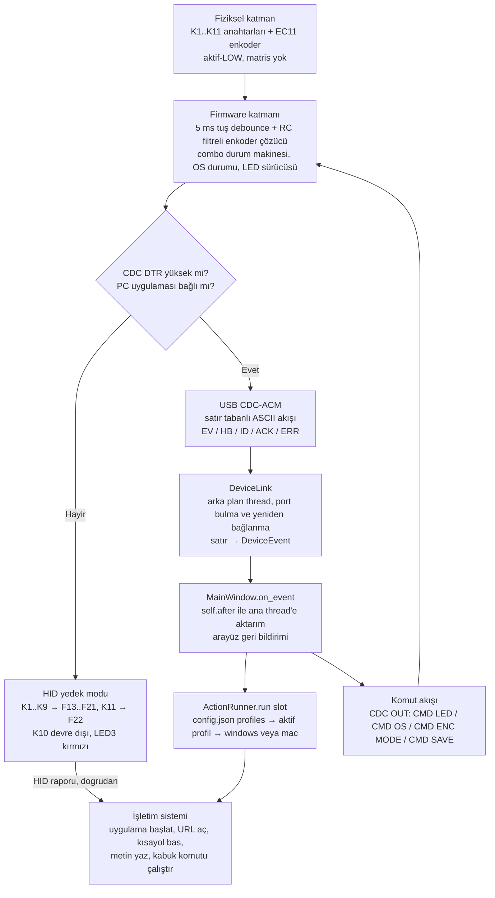
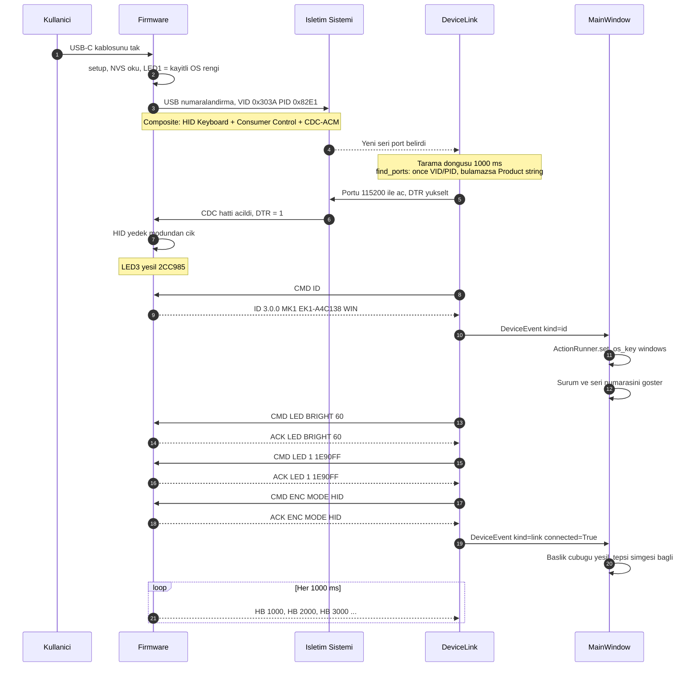
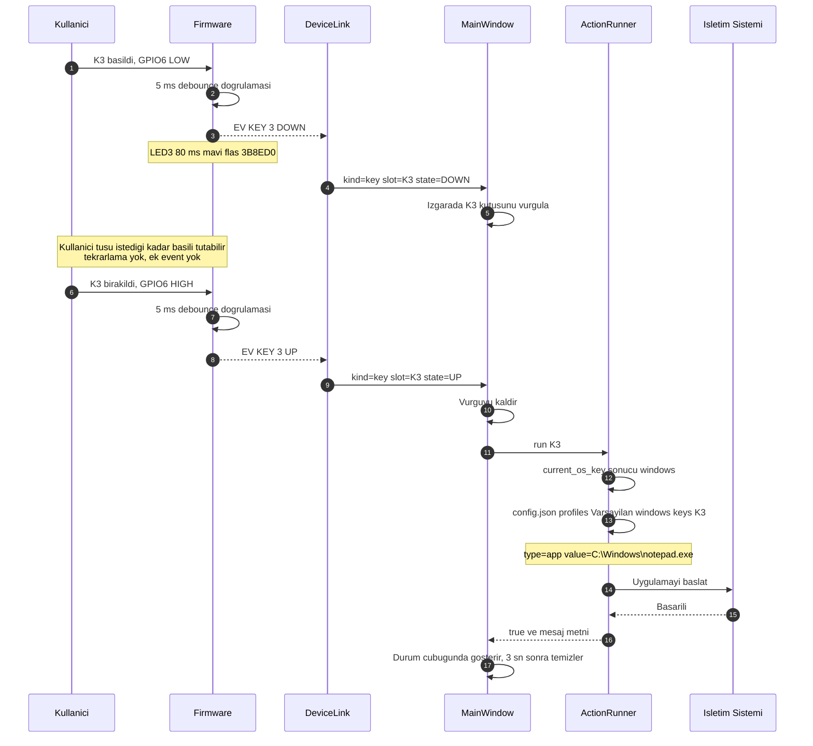
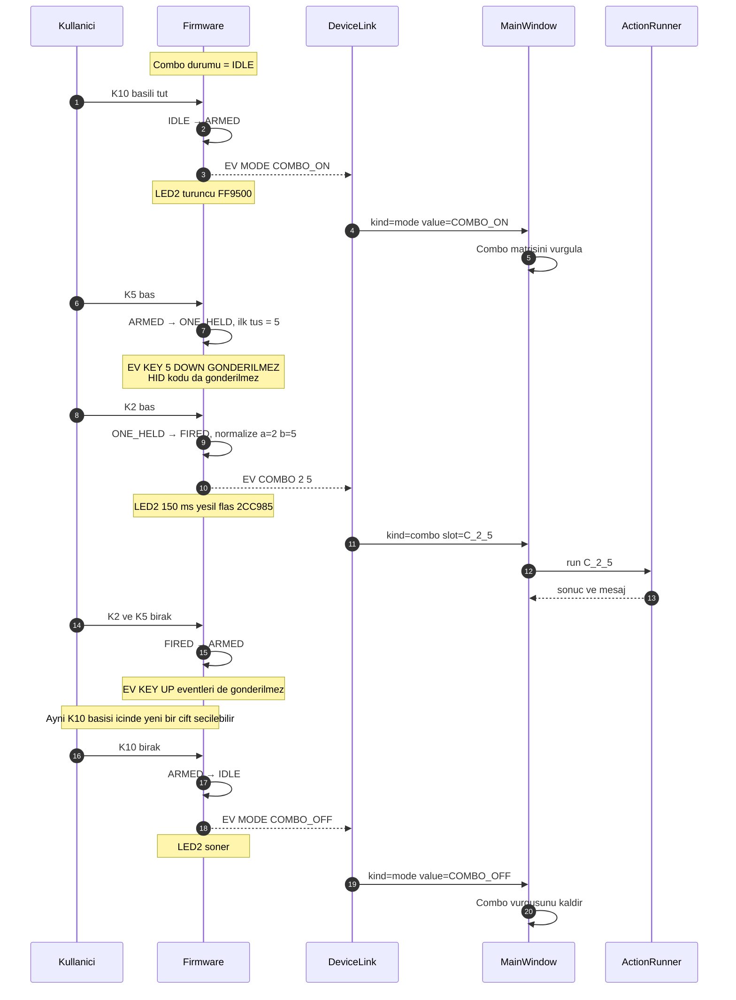
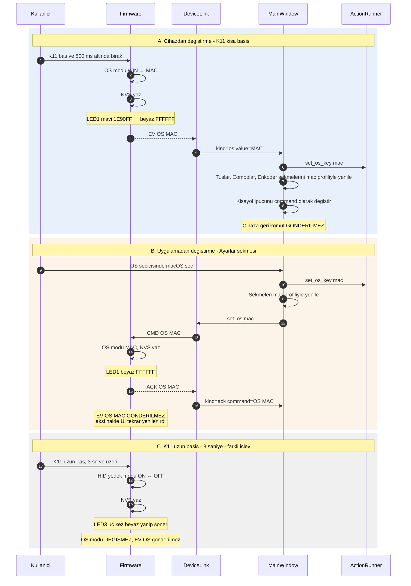
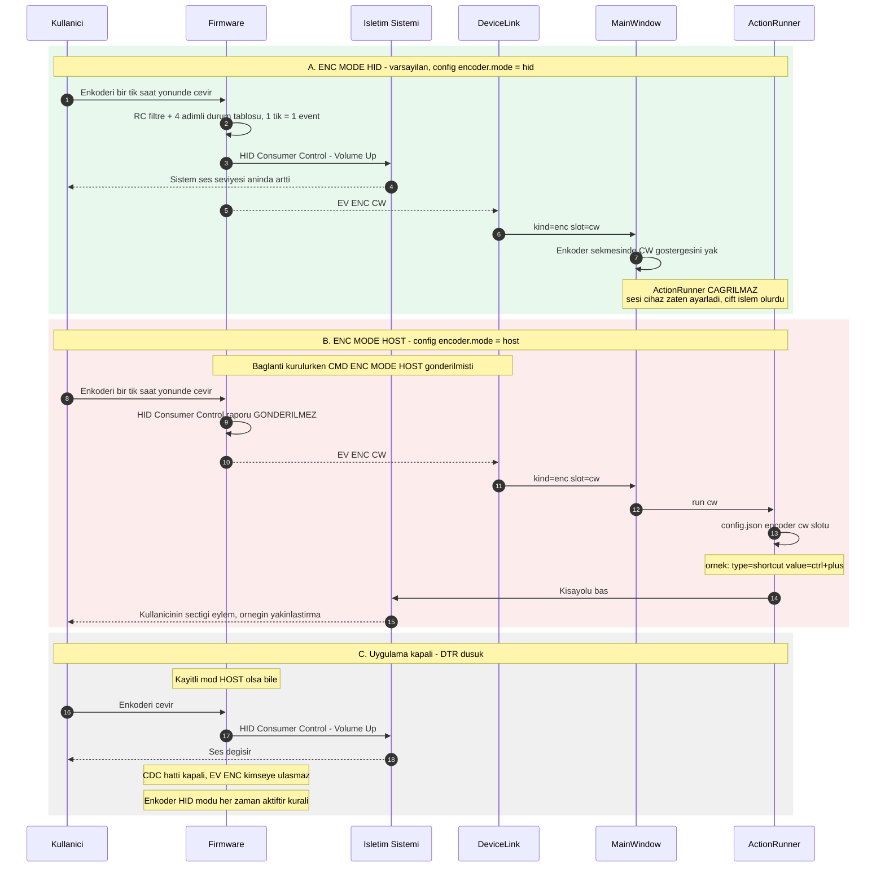
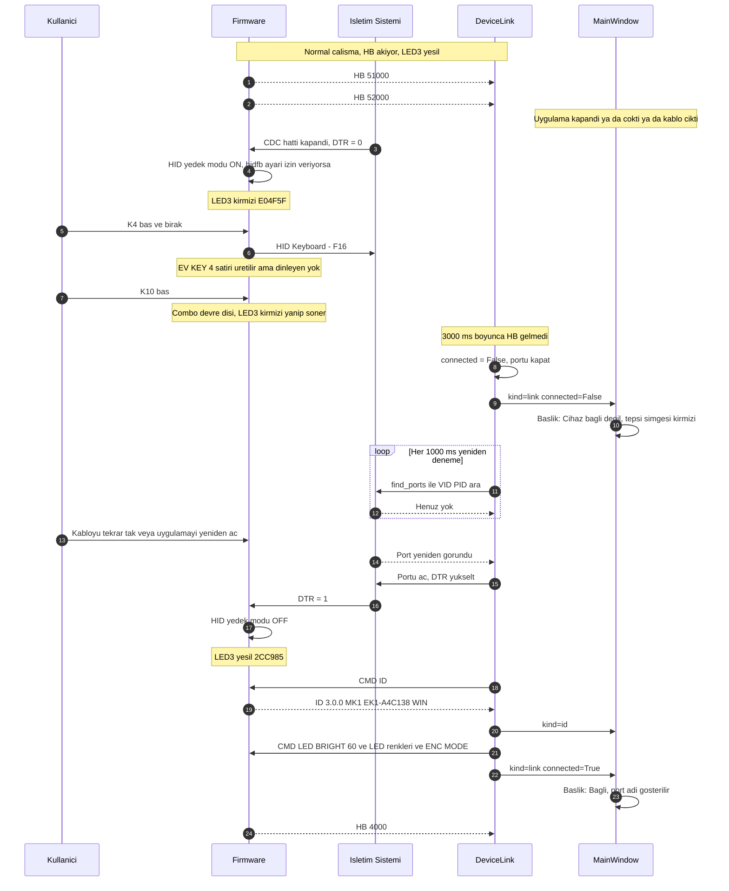

# 03 — Haberleşme Protokolü (CDC Seri + HID Composite)

> **Bağlayıcı kaynak:** [`00-CEKIRDEK-SPEC.md`](00-CEKIRDEK-SPEC.md) bölüm 4, 5 ve 6.
> Bu doküman o bölümlerin **açıklamalı ve genişletilmiş** hâlidir; mesaj
> sözdizimi, alan sırası ve isimlendirme birebir aynıdır. Bir çelişki
> görürsen çekirdek spesifikasyon kazanır.
>
> Sürüm: `3.0.0` · Cihaz: `ExtraKeyboard MK1` · Şema: satır tabanlı ASCII

---

## İçindekiler

1. [Genel bakış — neden CDC + HID composite](#1-genel-bakış--neden-cdc--hid-composite)
2. [Katman diyagramı](#2-katman-diyagramı)
3. [Mesaj referansı](#3-mesaj-referansı)
4. [Zaman çizelgeleri](#4-zaman-çizelgeleri)
5. [Neden eylem UP'ta tetikleniyor](#5-neden-eylem-upta-tetikleniyor)
6. [Hata durumları ve ERR kodları](#6-hata-durumları-ve-err-kodları)
7. [Protokolü elle test etme](#7-protokolü-elle-test-etme)
8. [Protokolü genişletme rehberi](#8-protokolü-genişletme-rehberi)
9. [Spec dışı varsayımlar](#9-spec-dışı-varsayımlar)

---

## 1. Genel bakış — neden CDC + HID composite

ExtraKeyboard MK1'in temel tasarım kararı şudur: **mantık cihazda değil PC'dedir.**
Cihaz "hangi tuşa basıldı" bilgisini gönderir, "ne yapılacağına" PC uygulaması
karar verir. Bu karar tek bir USB kablosu üzerinden **iki ayrı mantıksal kanal**
gerektirir.

ESP32-S3'ün yerleşik USB OTG çevre birimi sayesinde cihaz tek bir USB arayüzünde
**composite** olarak numaralandırılır:

| Arayüz | Sınıf | Ne taşır | Sürücü gerekir mi |
|---|---|---|---|
| `HID Keyboard` | HID | HID yedek modunda `F13`–`F22` tuş kodları | Hayır — işletim sistemi yerleşik |
| `HID Consumer Control` | HID | Enkoderden gelen Volume Up / Down / Mute | Hayır — işletim sistemi yerleşik |
| `CDC-ACM` | CDC | **Asıl protokol**: `EV` / `HB` / `ID` / `ACK` / `ERR` ve `CMD` satırları | Hayır — Windows 10+, macOS ve Linux yerleşik |

### 1.1 Hangi kanal ne taşır

```
┌──────────────────────────── Tek USB-C kablosu ────────────────────────────┐
│                                                                           │
│  CDC-ACM  (çift yönlü, satır tabanlı ASCII)                               │
│  ───────────────────────────────────────────────────────────────────────  │
│  Cihaz → PC : EV KEY / EV COMBO / EV MODE / EV OS / EV ENC / HB / ID /     │
│               ACK / ERR                                                   │
│  PC → Cihaz : CMD ID / PING / OS / LED / ENC MODE / HIDFB / SAVE          │
│                                                                           │
│  HID Keyboard  (tek yönlü, cihaz → PC)                                    │
│  ───────────────────────────────────────────────────────────────────────  │
│  Sadece HID yedek modunda: K1..K9 → F13..F21, K11 → F22                   │
│                                                                           │
│  HID Consumer Control  (tek yönlü, cihaz → PC)                            │
│  ───────────────────────────────────────────────────────────────────────  │
│  Enkoder ENC MODE HID iken: Volume Up / Volume Down / Mute                │
└───────────────────────────────────────────────────────────────────────────┘
```

### 1.2 Neden sadece HID yetmez

Saf bir HID makro klavye yalnızca **tuş kodu** gönderebilir. "Safari'yi aç",
"`https://bluedevelopment.com` adresini aç", "`ctrl+c` bas 500 ms bekle `ctrl+v` bas"
gibi eylemler HID rapor tanımına sığmaz. Bunları HID'e sığdırmanın klasik yolu
firmware'e makro derlemektir; o zaman da her ayar değişikliğinde cihazı yeniden
programlamak gerekir. CDC kanalı bu bağı koparır: cihaz sadece **slot kimliği**
(`K3`, `C_2_5`, `cw`) bildirir, eşleme `config.json` içinde yaşar ve uygulama
üzerinden anında değiştirilebilir.

### 1.3 Neden sadece CDC yetmez

PC uygulaması kapalıyken (veya henüz kurulmamışken) cihaz tamamen ölü olmamalıdır.
HID arayüzleri bu yüzden vardır:

- **Ses kontrolü her zaman çalışır.** Enkoder, uygulama olmasa da Consumer Control
  üzerinden sistem sesini değiştirir.
- **Tuşlar F13–F22 olarak kullanılabilir.** Bu kodlar hiçbir yaygın uygulamada
  varsayılan bir işleve bağlı olmadığından, kullanıcı istediği programa kendi
  kısayolunu tanımlayabilir.

Cihaz, CDC hattının `DTR` sinyali düştüğünde uygulamanın kapandığını anlar ve
**HID yedek moduna** düşer (`LED3` kırmızı). `DTR` tekrar yükseldiğinde yedek
moddan çıkar (`LED3` yeşil).

### 1.4 Neden satır tabanlı ASCII

- **Elle test edilebilir.** `screen`, PuTTY veya `miniterm` ile insan gözüyle
  okunur ve klavyeden komut yazılabilir (bölüm 7).
- **Ayrıştırması ucuz.** Firmware tarafında tek bir satır tamponu ve `strtok`
  yeterlidir; PC tarafında `line.split(" ")`.
- **Çerçeveleme sorunu yok.** `\n` doğal sınırdır; uzunluk alanı, CRC, kaçış
  dizisi gerekmez.
- **İleri uyumlu.** Bilinmeyen satırlar sessizce atıldığı için yeni mesajlar
  eski yazılımları bozmaz (bölüm 8).

### 1.5 Taşıma katmanı parametreleri

| Parametre | Değer | Not |
|---|---|---|
| Satır sonu | `\n` (LF, 0x0A) | Ayrıştırıcı `\r` karakterlerini yok sayar |
| Karakter kümesi | 7-bit ASCII | Protokolde Türkçe karakter **yoktur** |
| Alan ayırıcı | Tek boşluk (0x20) | Ardışık boşluk yok, baştan/sondan boşluk yok |
| Harf durumu | Fiil ve sabitler **BÜYÜK HARF** | `EV KEY 3 DOWN`, `CMD LED BRIGHT 60` |
| Baud | `115200` | Native USB CDC'de anlamsızdır; uygulama yine de bu değeri açar |
| Akış kontrolü | Yok | `DTR` yalnızca "uygulama bağlı" göstergesi olarak kullanılır |
| Maksimum satır uzunluğu | 128 bayt | Aşan satır atılır → `ERR TOO_LONG` |

---

## 2. Katman diyagramı

Fiziksel tuşa basıştan işletim sistemindeki eyleme kadar giden yol:



**Okuma notu:** Sağdaki `HID yedek modu` kolu CDC'yi hiç kullanmaz; tuş basışı
doğrudan işletim sistemine HID raporu olarak gider. Soldaki kol ise her zaman
`config.json` üzerinden geçer. Enkoder, `ENC MODE HID` iken **her iki koldan
birden** yararlanır: HID raporunu kendisi gönderir, ayrıca bilgi amaçlı
`EV ENC CW` satırını da yayınlar.

---

## 3. Mesaj referansı

Bölüm 3.1 cihazdan PC'ye giden **eventleri**, bölüm 3.2 PC'den cihaza giden
**komutları** anlatır. Her mesaj için: sözdizimi, alanlar, örnek, ne zaman
gönderildiği ve karşı tarafın ne yaptığı verilmiştir.

### 3.0 Dilbilgisi

```
satır       ::= event_satırı | komut_satırı
event_satırı::= "EV" SP event_gövdesi
              | "HB" SP uptime_ms
              | "ID" SP fw SP hw SP serial SP os
              | "ACK" SP komut_gövdesi
              | "ERR" SP sebep
komut_satırı::= "CMD" SP komut_gövdesi
SP          ::= tek boşluk (0x20)
```

Ayrıştırma kuralı (her iki taraf için **zorunlu**):

1. Satırın sonundaki `\r` ve `\n` kırpılır, baştaki/sondaki boşluklar kırpılır.
2. Boş satır sessizce atılır.
3. `line.split(" ")` ile alanlara bölünür.
4. İlk alan tanınmıyorsa satır **sessizce atılır** (log'a düşer, hata üretmez).
5. Alan sayısı beklenenden **az** ise satır atılır; **fazla** ise fazlalıklar
   yok sayılır (ileri uyumluluk — bölüm 8).

---

### 3.1 Cihaz → PC (Event)

#### `EV KEY <n> DOWN`

| | |
|---|---|
| **Sözdizimi** | `EV KEY <n> DOWN` |
| **Alanlar** | `n` — tam sayı, `1`–`9`. K1..K9 tuş numarası. |
| **Örnek** | `EV KEY 3 DOWN` |
| **Ne zaman** | K1..K9'dan biri basıldığında, 5 ms yazılım debounce doğrulandıktan sonra. **K10 basılı iken gönderilmez** (combo modu bastırır). |
| **Karşı taraf** | `DeviceEvent(kind="key", slot="K3", payload={"number":3,"edge":"down","pressed":True})` üretir. Arayüz ilgili tuş kutusunu vurgular. **Eylem çalıştırılmaz.** |
| **Cihaz yan etkisi** | `LED3` 80 ms mavi flaş (tuş aktivitesi). |

#### `EV KEY <n> UP`

| | |
|---|---|
| **Sözdizimi** | `EV KEY <n> UP` |
| **Alanlar** | `n` — tam sayı, `1`–`9`. |
| **Örnek** | `EV KEY 7 UP` |
| **Ne zaman** | K1..K9'dan biri bırakıldığında, 5 ms debounce sonrası. Yalnızca daha önce aynı tuş için `DOWN` gönderilmişse üretilir (eşleşmemiş `UP` yayınlanmaz). K10 basılı iken gönderilmez. |
| **Karşı taraf** | `DeviceEvent(kind="key", slot="K7", payload={"number":7,"edge":"up","pressed":False})`. Arayüz vurguyu kaldırır ve `ActionRunner.run("K7")` çağırır — **eylem burada tetiklenir** (gerekçe: bölüm 5). |
| **Cihaz yan etkisi** | Yok. |

#### `EV COMBO <a> <b>`

| | |
|---|---|
| **Sözdizimi** | `EV COMBO <a> <b>` |
| **Alanlar** | `a`, `b` — tam sayı, `1`–`9`, **daima `a < b`**. Cihaz normalize eder. |
| **Örnek** | `EV COMBO 2 5` |
| **Ne zaman** | Combo modu kilitliyken (K10 bas-çek) K1..K9'dan **ikinci farklı tuş** basıldığı anda. Combo, ikinci tuşun **DOWN** kenarında tetiklenir; `UP` beklenmez. Hemen ardından `EV MODE COMBO_OFF` gelir (mod tek seferliktir). |
| **Karşı taraf** | `combo_id(2, 5)` → `"C_2_5"`. `DeviceEvent(kind="combo", slot="C_2_5", payload={"a":2,"b":5})`. Arayüz combo matrisinde hücreyi yakar ve `ActionRunner.run("C_2_5")` çağırır. |
| **Cihaz yan etkisi** | `LED2` 150 ms yeşil flaş. |
| **Not** | Sıra önemsizdir: `5` sonra `2` de `EV COMBO 2 5` üretir. Toplam 36 benzersiz combo. |

#### `EV MODE COMBO_ON`

| | |
|---|---|
| **Sözdizimi** | `EV MODE COMBO_ON` |
| **Alanlar** | Yok. |
| **Örnek** | `EV MODE COMBO_ON` |
| **Ne zaman** | K10 (COMBO) basıldığında, `IDLE → ARMED` geçişinde. |
| **Karşı taraf** | `DeviceEvent(kind="mode", slot=None, payload={"combo":True,"state":"on"})`. Arayüz otomatik olarak **Combolar** sekmesine geçebilir / combo matrisini vurgular. |
| **Cihaz yan etkisi** | `LED2` turuncu `#FF9500` sabit yanar. K1..K9'un normal `EV KEY` eventleri ve HID kodları bastırılır. |

#### `EV MODE COMBO_OFF`

| | |
|---|---|
| **Sözdizimi** | `EV MODE COMBO_OFF` |
| **Alanlar** | Yok. |
| **Örnek** | `EV MODE COMBO_OFF` |
| **Ne zaman** | K10 bırakıldığında; `ARMED`, `ONE_HELD` veya `FIRED` durumlarının hepsinden `IDLE`'a dönüşte. |
| **Karşı taraf** | `DeviceEvent(kind="mode", slot=None, payload={"combo":False,"state":"off"})`. Arayüz combo vurgusunu kaldırır. |
| **Cihaz yan etkisi** | `LED2` söner. Kaydedilen "ilk tuş" temizlenir. |

#### `EV OS WIN` / `EV OS MAC`

| | |
|---|---|
| **Sözdizimi** | `EV OS WIN` \| `EV OS MAC` |
| **Alanlar** | Sabit `WIN` veya `MAC`. |
| **Örnek** | `EV OS MAC` |
| **Ne zaman** | **Yalnızca cihazdan başlatılan** değişiklikte: K11'e 800 ms'den kısa basıldığında. `CMD OS` ile yapılan değişiklikte gönderilmez (yankı döngüsünü önlemek için — bkz. bölüm 9). |
| **Karşı taraf** | `DeviceEvent(kind="os", slot=None, payload={"os":"mac","os_raw":"MAC"})`. Uygulama `ActionRunner.set_os_key("mac")` çağırır ve tüm sekmeleri `mac` profiliyle yeniden çizer. Kısayol ipuçları da bu profile göre değişir. |
| **Cihaz yan etkisi** | Yeni değer NVS'e yazılır. `LED1` mavi `#1E90FF` ↔ beyaz `#FFFFFF` arasında değişir. |

#### `EV ENC CW` / `EV ENC CCW`

| | |
|---|---|
| **Sözdizimi** | `EV ENC CW` \| `EV ENC CCW` |
| **Alanlar** | Sabit `CW` (saat yönü) veya `CCW` (saat yönü tersi). |
| **Örnek** | `EV ENC CW` |
| **Ne zaman** | Enkoder bir tık döndüğünde. EC11 tıklama başına tam bir quadrature çevrimi ürettiği için **1 tık = 1 event**. `ENC MODE` ne olursa olsun gönderilir. |
| **Karşı taraf** | `DeviceEvent(kind="enc", slot="cw"\|"ccw", payload={"action":"cw"})` — `payload["action"]` daima `slot` ile aynıdır. **`ENC MODE HOST` ise** `ActionRunner.run("cw")` çağrılır. **`ENC MODE HID` ise** yalnızca arayüz göstergesi güncellenir, eylem çalıştırılmaz (sesi cihaz zaten HID ile ayarladı). |
| **Cihaz yan etkisi** | `ENC MODE HID` iken Consumer Control `Volume Up` / `Volume Down` raporu gönderilir. |

#### `EV ENC PRESS`

| | |
|---|---|
| **Sözdizimi** | `EV ENC PRESS` |
| **Alanlar** | Yok. |
| **Örnek** | `EV ENC PRESS` |
| **Ne zaman** | Enkoder butonu bırakıldığında ve basılı kalma süresi 800 ms'nin **altında** ise. |
| **Karşı taraf** | `DeviceEvent(kind="enc", slot="press", payload={"action":"press"})`. `ENC MODE HOST` ise `ActionRunner.run("press")`. |
| **Cihaz yan etkisi** | `ENC MODE HID` iken Consumer Control `Mute` raporu. |

#### `EV ENC LONG`

| | |
|---|---|
| **Sözdizimi** | `EV ENC LONG` |
| **Alanlar** | Yok. |
| **Örnek** | `EV ENC LONG` |
| **Ne zaman** | Enkoder butonu **800 ms** kesintisiz basılı tutulduğu anda (bırakılması beklenmez). Bu event üretildikten sonra aynı basış için `EV ENC PRESS` **gönderilmez**. |
| **Karşı taraf** | `DeviceEvent(kind="enc", slot="long", payload={"action":"long"})`. `ENC MODE HOST` ise `ActionRunner.run("long")`. Varsayılan yapılandırmada `long` slotu `{"type":"none"}` olduğu için hiçbir şey olmaz. |
| **Cihaz yan etkisi** | HID raporu gönderilmez (`long` için Consumer Control karşılığı yoktur). |

#### `HB <uptime_ms>`

| | |
|---|---|
| **Sözdizimi** | `HB <uptime_ms>` |
| **Alanlar** | `uptime_ms` — işaretsiz tam sayı, cihazın açılışından bu yana geçen milisaniye. |
| **Örnek** | `HB 51234` |
| **Ne zaman** | Her **1000 ms**'de bir, koşulsuz. CDC hattı açık olmasa bile firmware üretir; sadece kimse dinlemiyorsa kaybolur. |
| **Karşı taraf** | `DeviceEvent(kind="hb", payload={"uptime_ms":51234})`. `DeviceLink` "son HB zamanı"nı günceller. **3000 ms** (3 kaçırılmış HB) boyunca HB gelmezse bağlantı kopmuş sayılır: port kapatılır, `kind="link"` eventi ile `connected=False` bildirilir ve yeniden bağlanma döngüsü başlar. |
| **Ek kullanım** | `uptime_ms` geriye giderse (küçülürse) cihaz yeniden başlamış demektir; uygulama `CMD ID` ve LED ayarlarını yeniden göndermelidir. |

#### `ID <fw> <hw> <serial> <os>`

| | |
|---|---|
| **Sözdizimi** | `ID <fw> <hw> <serial> <os>` |
| **Alanlar** | `fw` — firmware sürümü (`3.0.0`)<br>`hw` — donanım revizyonu (`MK1`)<br>`serial` — `EK1-<MAC son 6 hane>`<br>`os` — cihazın o anki modu: `WIN` veya `MAC` |
| **Örnek** | `ID 3.0.0 MK1 EK1-A4C138 WIN` |
| **Ne zaman** | Yalnızca `CMD ID` isteğine yanıt olarak. Cihaz kendiliğinden `ID` yayınlamaz. |
| **Karşı taraf** | `DeviceEvent(kind="id", slot=None, payload={"fw":"3.0.0","hw":"MK1","serial":"EK1-A4C138","os_raw":"WIN","os":"windows"})` — `os_raw` hattan gelen ham değer (`WIN`/`MAC`), `os` ise uygulama profil anahtarıdır (`windows`/`mac`). Uygulama: (1) el sıkışmayı tamamlanmış sayar, (2) `ActionRunner.set_os_key()` ile profili hizalar, (3) **LED & Cihaz** sekmesinde sürüm/seri numarasını gösterir, (4) `fw` ile `APP_VERSION` uyuşmazlığında uyarı gösterir. |

#### `ACK <komut>`

| | |
|---|---|
| **Sözdizimi** | `ACK <komut_gövdesi>` |
| **Alanlar** | `komut_gövdesi` — kabul edilen komutun **`CMD ` öneki çıkarılmış tam gövdesi**. |
| **Örnekler** | `CMD PING` → `ACK PING`<br>`CMD LED 1 1E90FF` → `ACK LED 1 1E90FF`<br>`CMD ENC MODE HOST` → `ACK ENC MODE HOST`<br>`CMD SAVE` → `ACK SAVE` |
| **Ne zaman** | Komut ayrıştırıldıktan ve **uygulandıktan** sonra. `CMD ID` bunun istisnasıdır: `ACK` yerine doğrudan `ID ...` döner. |
| **Karşı taraf** | `DeviceEvent(kind="ack", payload={"command":"LED 1 1E90FF"})`. Uygulama bunu **beklemek zorunda değildir**; `DeviceLink.send()` ateşle-unut çalışır. Yalnızca tanılama panelinde gösterilir. |

#### `ERR <sebep>`

| | |
|---|---|
| **Sözdizimi** | `ERR <sebep>` |
| **Alanlar** | `sebep` — boşluksuz, BÜYÜK HARF tek kelime. Kod listesi bölüm 6'da. |
| **Örnek** | `ERR RANGE` |
| **Ne zaman** | `CMD ` ile başlayan ama işlenemeyen bir satır alındığında. `CMD` ile başlamayan bilinmeyen satırlar için **`ERR` üretilmez**, sessizce atılır. |
| **Karşı taraf** | `DeviceEvent(kind="err", payload={"reason":"RANGE"})`. Uygulama durum çubuğunda ve tanılama günlüğünde gösterir; yeniden denemez. |

#### Sanal event: `link`

`DeviceLink` seri hattan gelmeyen, kendi ürettiği tek bir event tipine sahiptir:

| | |
|---|---|
| **Kaynak** | Seri hat değil, `DeviceLink`'in kendi bağlantı durumu makinesi. |
| **Payload** | `{"connected": True\|False, "port": "/dev/cu.usbmodem101" veya None, "message": "Türkçe açıklama"}` |
| **Ne zaman** | Port açıldığında/kapandığında, HB zaman aşımında, kullanıcı `stop()` çağırdığında. |
| **Karşı taraf** | Arayüz başlık çubuğu ve tepsi simgesi rengini günceller. |

#### Özet: satır → `DeviceEvent` eşlemesi

> **Bu tablo bağlayıcıdır.** Payload anahtarları çekirdek spesifikasyonda
> tanımlı değildir (bkz. bölüm 9, madde 13); doğruluk kaynağı
> `app/core/device.py` içindeki `parse_line()` fonksiyonudur ve aşağıdaki
> tablo onunla **birebir** eşleştirilmiştir. Arayüz kodu yazarken bu adları
> kullanın.

| Gelen satır | `kind` | `slot` | `payload` |
|---|---|---|---|
| `EV KEY 3 DOWN` | `key` | `K3` | `{"number":3,"edge":"down","pressed":True}` |
| `EV KEY 3 UP` | `key` | `K3` | `{"number":3,"edge":"up","pressed":False}` |
| `EV COMBO 2 5` | `combo` | `C_2_5` | `{"a":2,"b":5}` |
| `EV MODE COMBO_ON` | `mode` | `None` | `{"combo":True,"state":"on"}` |
| `EV MODE COMBO_OFF` | `mode` | `None` | `{"combo":False,"state":"off"}` |
| `EV OS WIN` | `os` | `None` | `{"os":"windows","os_raw":"WIN"}` |
| `EV OS MAC` | `os` | `None` | `{"os":"mac","os_raw":"MAC"}` |
| `EV ENC CW` | `enc` | `cw` | `{"action":"cw"}` |
| `EV ENC CCW` | `enc` | `ccw` | `{"action":"ccw"}` |
| `EV ENC PRESS` | `enc` | `press` | `{"action":"press"}` |
| `EV ENC LONG` | `enc` | `long` | `{"action":"long"}` |
| `HB 51234` | `hb` | `None` | `{"uptime_ms":51234}` |
| `ID 3.0.0 MK1 EK1-A4C138 WIN` | `id` | `None` | `{"fw":"3.0.0","hw":"MK1","serial":"EK1-A4C138","os_raw":"WIN","os":"windows"}` |
| `ACK PING` | `ack` | `None` | `{"command":"PING"}` |
| `ERR RANGE` | `err` | `None` | `{"reason":"RANGE"}` |
| *(sanal)* `link` | `link` | `None` | `{"connected":bool,"port":str veya None,"message":str}` |
| *(bilinmeyen)* | — | — | *satır atılır, `raw` günlüğe yazılır* |

**Anahtar seçimi hakkında notlar**

- `key` olayında `number` tuş numarasıdır (1–9), `edge` **küçük harf**tir
  (`"down"` / `"up"`), `pressed` ise `edge == "down"` kısayoludur.
- `os` ve `id` olaylarında **iki ayrı alan** vardır: `os_raw` hattan gelen
  ham değerdir (`"WIN"` / `"MAC"`), `os` ise uygulamanın profil anahtarıdır
  (`"windows"` / `"mac"`). `ConfigManager.profile()` ikincisini bekler.
- `enc` olayında `payload["action"]` her zaman `slot` ile aynı değeri taşır;
  ikisinden hangisini okuduğunuz fark etmez.
- `combo` olayında `a < b` garantidir; cihaz normalize etmemiş olsa bile
  `parse_line()` sıralar.
- `ack` ve `err` payload'larındaki `command` / `reason` alanları satırın
  geri kalanının **tamamıdır** (boşluklar korunur).

---

### 3.2 PC → Cihaz (Command)

Tüm komutlar `CMD ` ile başlar. `DeviceLink.send("CMD PING")` çağrısı satır
sonunu kendisi ekler; çağıran `\n` yazmaz.

#### `CMD ID`

| | |
|---|---|
| **Sözdizimi** | `CMD ID` |
| **Alanlar** | Yok. |
| **Örnek** | `CMD ID` |
| **Ne zaman gönderilir** | Port açıldıktan hemen sonra, el sıkışmanın ilk adımı olarak. Ayrıca `HB` sayacının geri gitmesi (cihaz yeniden başlaması) durumunda tekrar. |
| **Cihaz ne yapar** | `ID <fw> <hw> <serial> <os>` satırıyla yanıt verir. `ACK` **göndermez**. |
| **Hata** | Yok — argümansız komut. |

#### `CMD PING`

| | |
|---|---|
| **Sözdizimi** | `CMD PING` |
| **Alanlar** | Yok. |
| **Örnek** | `CMD PING` |
| **Ne zaman gönderilir** | Kullanıcı **LED & Cihaz** sekmesindeki *Bağlantıyı Sına* düğmesine bastığında; ayrıca elle tanılama sırasında. |
| **Cihaz ne yapar** | Anında `ACK PING` döner. Başka yan etkisi yoktur. |
| **Not** | Düzenli canlılık denetimi için `PING` **kullanılmaz** — o iş `HB` mesajınındır. |

#### `CMD OS WIN` / `CMD OS MAC`

| | |
|---|---|
| **Sözdizimi** | `CMD OS WIN` \| `CMD OS MAC` |
| **Alanlar** | Sabit `WIN` veya `MAC`. |
| **Örnek** | `CMD OS MAC` |
| **Ne zaman gönderilir** | Kullanıcı **Ayarlar** sekmesinden OS modunu değiştirdiğinde; `DeviceLink.set_os("mac")` çağrısıyla. Uygulama `"windows"` → `WIN`, `"mac"` → `MAC` dönüşümünü kendisi yapar. |
| **Cihaz ne yapar** | OS modunu ayarlar, NVS'e yazar, `LED1` rengini günceller, `ACK OS MAC` döner. **`EV OS MAC` göndermez** (yankı döngüsü olmasın diye). |
| **Hata** | `WIN`/`MAC` dışı değer → `ERR BAD_VALUE`. Alan eksik → `ERR BAD_ARGS`. |

#### `CMD LED <i> <RRGGBB|AUTO>`

| | |
|---|---|
| **Sözdizimi** | `CMD LED <i> <RRGGBB>` · `CMD LED <i> AUTO` |
| **Alanlar** | `i` — tam sayı `1`–`3` (LED1..LED3)<br>`RRGGBB` — **`#` işareti olmadan**, 6 haneli onaltılık renk. Büyük harf tercih edilir, cihaz küçük harfi de kabul eder.<br>`AUTO` — rengi spec bölüm 6.4'teki fabrika varsayılanına döndürür. |
| **Örnek** | `CMD LED 1 1E90FF` · `CMD LED 2 AUTO` |
| **Ne zaman gönderilir** | Kullanıcı **LED & Cihaz** sekmesinden bir rengi değiştirdiğinde; ayrıca bağlantı kurulduktan sonra `config.json` içindeki `leds` bloğunu cihaza yansıtmak için üç kez (LED1, LED2, LED3). `AUTO`, "Varsayılana Dön" düğmesiyle gönderilir. |
| **Cihaz ne yapar** | İlgili LED'in **temel rengini** günceller ve `ACK LED 1 1E90FF` (veya `ACK LED 2 AUTO`) döner. Durum mantığı (combo flaşı, bağlantı rengi, tuş flaşı) bu temel rengin üzerine çalışmaya devam eder — komut LED'i **sabitlemez**. |
| **Hata** | `i` 1–3 dışında → `ERR RANGE`. Renk 6 haneli geçerli hex ya da `AUTO` değilse → `ERR BAD_VALUE`. Alan sayısı yanlış → `ERR BAD_ARGS`. |
| **Dikkat** | `config.json` renkleri `#1E90FF` biçiminde saklar; `DeviceLink.set_led()` baştaki `#` karakterini **kırpmak zorundadır**. |

**LED indeksi → durum yuvası eşlemesi.** Cihaz renkleri LED indeksine değil
*duruma* göre saklar (firmware `EkLedColorSlot`). Bir indekse yazmak, o
indeksin **o anki** durumunun rengini değiştirir:

| `i` | Etkilenen yuva | Not |
|---|---|---|
| 1 | `OS_WIN` **veya** `OS_MAC` | Cihazın o anki OS moduna göre; mod değiştirince diğer yuva etkilenmez |
| 2 | `COMBO` | LED2 yalnızca K10 basılıyken yanar, renk ancak o zaman görünür |
| 3 | `LINK_OK` **veya** `LINK_ERR` | Cihazın o anki bağlantı durumuna göre |

> Bu yüzden `CMD LED 1 FF0000` gönderdiğinde macOS modundaysan **yalnızca**
> `os_mac` rengi kırmızı olur; Windows'a geçince LED1 yine eski mavisine döner.
> Her iki rengi de ayarlamak için `CMD OS` ile modu değiştirip komutu tekrarla —
> uygulama **LED & Cihaz** sekmesinde bunu senin yerine yapar.

#### `CMD LED BRIGHT <0-255>`

| | |
|---|---|
| **Sözdizimi** | `CMD LED BRIGHT <deger>` |
| **Alanlar** | `deger` — tam sayı `0`–`255`. `0` = tamamen sönük. |
| **Örnek** | `CMD LED BRIGHT 60` |
| **Ne zaman gönderilir** | Parlaklık kaydırıcısı bırakıldığında (`DeviceLink.set_brightness(60)`); bağlantı kurulduktan sonra `config.json` → `leds.brightness` değeriyle bir kez. |
| **Cihaz ne yapar** | Genel WS2812B parlaklık ölçeğini ayarlar, `ACK LED BRIGHT 60` döner. |
| **Hata** | 0–255 dışı → `ERR RANGE`. Sayıya çevrilemiyor → `ERR BAD_VALUE`. |
| **Not** | Varsayılan `60/255`. Ayrıştırıcı `LED` fiilinin ikinci alanını önce `BRIGHT` anahtar kelimesiyle karşılaştırmalı, sayı denemesini sonra yapmalıdır. |

#### `CMD ENC MODE HID` / `CMD ENC MODE HOST`

| | |
|---|---|
| **Sözdizimi** | `CMD ENC MODE HID` \| `CMD ENC MODE HOST` |
| **Alanlar** | Sabit `HID` veya `HOST`. |
| **Örnek** | `CMD ENC MODE HOST` |
| **Ne zaman gönderilir** | **Enkoder** sekmesinde mod değiştirildiğinde (`DeviceLink.set_encoder_mode("host")`); ayrıca bağlantı kurulduktan sonra aktif profilin `encoder.mode` değeriyle bir kez. |
| **Cihaz ne yapar** | `HID`: enkoder olaylarında Consumer Control raporu **gönderir**, ayrıca `EV ENC ...` satırını da yayınlar.<br>`HOST`: Consumer Control raporu **göndermez**, yalnızca `EV ENC ...` yayınlar; kararı PC verir.<br>Her iki durumda `ACK ENC MODE <mod>` döner. |
| **Hata** | `HID`/`HOST` dışı → `ERR BAD_VALUE`. |
| **Kritik istisna** | Uygulama bağlı değilken (`DTR` düşük) ayar ne olursa olsun enkoder **HID gibi** davranır. Aksi hâlde uygulama kapalıyken ses kontrolü ölürdü. |

#### `CMD HIDFB ON` / `CMD HIDFB OFF`

| | |
|---|---|
| **Sözdizimi** | `CMD HIDFB ON` \| `CMD HIDFB OFF` |
| **Alanlar** | Sabit `ON` veya `OFF`. |
| **Örnek** | `CMD HIDFB OFF` |
| **Ne zaman gönderilir** | **Ayarlar** sekmesindeki *Uygulama kapalıyken tuşlar F13–F22 göndersin* onay kutusu değiştiğinde. |
| **Cihaz ne yapar** | HID yedek modunu **izinli/yasaklı** yapar ve `ACK HIDFB OFF` döner. `OFF` iken uygulama kapansa bile K1..K9 hiçbir HID kodu göndermez (yalnızca `LED3` kırmızı yanar ve enkoder ses kontrolü çalışmaya devam eder). Ayar NVS'e yazılır. |
| **Hata** | `ON`/`OFF` dışı → `ERR BAD_VALUE`. |
| **Eşdeğeri** | K11'e **3 saniye** basmak bu ayarı cihazdan açıp kapatır; `LED3` üç kez beyaz yanıp söner. |

#### `CMD SAVE`

| | |
|---|---|
| **Sözdizimi** | `CMD SAVE` |
| **Alanlar** | Yok. |
| **Örnek** | `CMD SAVE` |
| **Ne zaman gönderilir** | LED renkleri, parlaklık, enkoder modu veya HID yedek ayarı toplu olarak değiştirildikten sonra **bir kez**, kalıcılaştırmak için. |
| **Cihaz ne yapar** | O anki LED renklerini, parlaklığı, `ENC MODE` ve `HIDFB` ayarlarını NVS'e yazar, `ACK SAVE` döner. |
| **Hata** | NVS yazımı başarısız olursa `ERR NVS`. |
| **Not** | OS modu (`WIN`/`MAC`) zaten her değişiklikte anında NVS'e yazılır; `CMD SAVE` beklemez. Flash aşınmasını önlemek için uygulama her kaydırıcı hareketinde değil, düzenleme bittiğinde `CMD SAVE` göndermelidir. |

---

## 4. Zaman çizelgeleri

### 4.a Cihaz takıldı → uygulama buldu → el sıkışma



**Önemli ayrıntılar**

- `find_ports()` önce `VID=0x303A` + `PID=0x82E1` eşleşmesi arar; bulamazsa
  `Product == "ExtraKeyboard MK1"` dizesine düşer. Bu yedek yol, PID'i
  değiştirilmiş özel derlemeler için vardır.
- El sıkışma yalnızca `CMD ID` → `ID ...` çiftidir. Yanıt **1500 ms** içinde
  gelmezse `DeviceLink` portu kapatır ve taramaya döner (yanlış port açılmış
  olabilir — örneğin DevKit'in UART köprüsü).
- Ayar gönderimi (`LED`, `ENC MODE`) `ID` yanıtından **sonra** yapılır; böylece
  yanlış cihaza komut yazılmaz.

---

### 4.b Normal tuş basma → eylem



**Önemli ayrıntılar**

- `DOWN` ve `UP` arasında hiçbir tekrar eventi yoktur; basılı tutmak eylemi
  çoğaltmaz.
- Eylem `UP` kenarında çalışır (gerekçe: bölüm 5).
- `ActionRunner.run()` **ana thread'de** çağrılmalıdır. `on_event` arka plan
  thread'inden geldiği için `MainWindow` mutlaka `self.after(0, ...)` kullanır.
- Eylem başarısız olursa `(False, "hata mesajı")` döner; arayüz kırmızı durum
  metni gösterir, cihaza hiçbir şey geri gönderilmez.

---

### 4.c Combo: K10 basılı → 2 tuş → `EV COMBO` → eylem



**Önemli ayrıntılar**

- Sıra önemsizdir: önce K2 sonra K5 basılsa da sonuç `EV COMBO 2 5` olur.
  Cihaz her zaman `a < b` normalizasyonunu yapar; PC tarafı ters sıra beklemez.
- Combo, ikinci tuşun **DOWN** kenarında tetiklenir. Bu bir tutarsızlık değil,
  bilinçli bir karardır: combo zaten K10 ile açıkça "modlanmış" olduğu için
  başka bir yorumla çakışma riski yoktur ve anlık geri bildirim daha iyidir.
- K10 basılıyken K1..K9 için **hiçbir** `EV KEY` satırı ve **hiçbir** HID kodu
  gönderilmez. Bu, normal eylemin combo ile birlikte yanlışlıkla çalışmasını
  engeller.
- Matris ve diyot olmadığı için üç tuşun aynı anda basılması (K10 + 2 tuş)
  hayalet tuş üretmez.

---

### 4.d OS değiştirme — hem cihazdan hem uygulamadan



**Önemli ayrıntılar**

- `EV OS` yalnızca **cihazdan** başlatılan değişikliği bildirir. `CMD OS`
  karşılığında `ACK` döner, `EV OS` dönmez. Bu asimetri kasıtlıdır ve iki
  tarafın birbirini sonsuz yenilemesini önler.
- K11'e basıp bırakma süresi 800 ms eşiğini belirler: altı = OS geçişi,
  3 saniye ve üzeri = HID yedek modu anahtarı. 800 ms ile 3 s arasındaki
  basışlar **hiçbir şey yapmaz** (kararsız bölge, kazara tetiklemeyi önler).
- Uygulama, OS profilini kendi arayüzünde de değiştirir; `config.json` içinde
  `windows` ve `mac` blokları tamamen ayrıdır, tuş atamaları paylaşılmaz.

---

### 4.e Enkoder çevirme — HID modu ile HOST modu farkı



**Önemli ayrıntılar**

| | `ENC MODE HID` | `ENC MODE HOST` |
|---|---|---|
| HID Consumer Control raporu | Cihaz gönderir | Cihaz göndermez |
| `EV ENC ...` satırı | Gönderilir | Gönderilir |
| `ActionRunner.run()` | Çağrılmaz | Çağrılır |
| Gecikme | En düşük (PC turu yok) | Bir USB gidiş-dönüş + Python işleme |
| Uygulama kapalıyken | Çalışır | **HID gibi çalışır** (zorunlu geri dönüş) |
| Tipik kullanım | Ses kontrolü | Yakınlaştırma, sekme gezinme, fırça boyutu, zaman çizelgesi kaydırma |

`EV ENC` satırının HID modunda da gönderilmesinin nedeni, arayüzün canlı
göstergeyi çalıştırabilmesi ve kullanıcının enkoderin gerçekten okunduğunu
görebilmesidir. Uygulamanın bu eventte eylem çalıştırmaması **PC tarafının
sorumluluğudur**; cihaz aynı satırı iki modda da yayınlar.

---

### 4.f Bağlantı koptu → HID yedek moduna düşme → yeniden bağlanma



**Önemli ayrıntılar**

- Kopma iki bağımsız yolla algılanır: (1) seri port okuma/yazma hatası
  (`SerialException`) — anında; (2) HB zaman aşımı (3000 ms) — sessiz kopmalar
  için. İkisi de aynı `kind="link", connected=False` eventini üretir.
- Cihaz tarafında ölçüt `DTR` sinyalidir, HB değildir. Cihaz PC'nin canlılığını
  ayrıca yoklamaz.
- Yeniden bağlanma döngüsü **sonsuzdur** ve 1000 ms aralıklıdır; kullanıcı
  müdahalesi gerekmez. `DeviceLink.stop()` çağrılana kadar sürer.
- Cihaz yeniden başlarsa (fişten çekilip takılırsa) `uptime_ms` sıfırdan başlar.
  Uygulama HB sayacının küçüldüğünü görürse el sıkışmayı ve ayar gönderimini
  baştan yapar; port aynı kalsa bile.
- HID yedek modunda `K10` combo tuşu **devre dışıdır** — combo bilgisi HID ile
  ifade edilemez. Kullanıcıya `LED3`'ün kırmızı yanıp sönmesiyle bildirilir.

---

## 5. Neden eylem UP'ta tetikleniyor

Cihaz hem `EV KEY <n> DOWN` hem `EV KEY <n> UP` gönderir, ama
`ActionRunner.run()` **yalnızca `UP` satırında** çağrılır. Bu, protokolün en
sık sorulan tasarım kararıdır.

### 5.1 Ana gerekçe: combo ile çakışmama

Combo, K10'a bir kez basılarak (bas-çek) **kilitlenen** bir moddur. Firmware mod açıkken
K1..K9'un normal eventlerini bastırır. Ama gerçek dünyada insan parmakları
mükemmel sırayla hareket etmez:

```
Zaman ──────────────────────────────────────────────────►
K2   ▁▁▁███████████████████▁▁▁▁▁
K10  ▁▁▁▁▁▁███████████████████████████▁▁▁
K5   ▁▁▁▁▁▁▁▁▁▁▁▁████████▁▁▁▁▁▁▁▁▁▁▁
```

Kullanıcı `K10 + K2 + K5` yapmak isterken parmağı K2'ye K10'dan **birkaç
milisaniye önce** değdi. `DOWN` kenarında eylem çalıştırsaydık:

1. `K2 DOWN` gelir → PC hemen `K2` eylemini çalıştırır (yanlış!).
2. Ardından `K10 DOWN` gelir, combo modu açılır.
3. `K5 DOWN` gelir, combo `C_2_5` tetiklenir → PC bir de combo eylemini çalıştırır.

Sonuç: kullanıcı **iki eylem** almış olur; biri hiç istemediği.

`UP` kenarında çalıştırdığımızda ise K2'nin `UP` anı geldiğinde cihaz zaten
combo modundadır ve `EV KEY 2 UP` satırını hiç göndermez. Kullanıcı yalnızca
combo eylemini alır. **Eylemi bırakma anına ertelemek, cihaza "bu basış aslında
bir combonun parçasıymış" kararını geriye dönük verme imkânı tanır.**

### 5.2 Yan faydalar

| Fayda | Açıklama |
|---|---|
| **Tekrar yok** | Tuş basılı tutulduğunda otomatik tekrarlama olmaz; `notepad.exe` 40 kez açılmaz. |
| **Kasıtsız basış iptali** | Yanlışlıkla değen parmak, henüz `UP` gelmediği için eylemi tetiklemez — kullanıcı K10'a basarak veya cihazı çıkararak durumu kurtarabilir. |
| **İnsan modeliyle uyum** | Fiziksel düğmelerin evrensel davranışı budur: fare tıklaması, dokunmatik ekran, GUI düğmeleri hepsi bırakma anında işler. |
| **Geleceğe hazırlık** | "Uzun basış = farklı eylem" özelliği ileride eklenirse, `DOWN`–`UP` süresi zaten ölçülebilir durumdadır. `DOWN`'da tetikleseydik bu kapı kapanırdı. |
| **Görsel geri bildirim ayrılığı** | `DOWN` "gördüm" demek için (arayüz vurgusu, LED3 mavi flaş), `UP` "yap" demek için kullanılır. İki ayrı sorumluluk, iki ayrı event. |

### 5.3 İstisna: `EV COMBO` DOWN kenarında tetiklenir

Combo eventi bunun tersidir; ikinci tuşun **basıldığı** anda gönderilir. Neden?

- Combo zaten K10 ile açıkça modlanmıştır; başka bir yorumla karışma riski yok.
- Bırakma sırasını beklemek gereksiz gecikme yaratır (kullanıcı üç parmağını
  aynı anda kaldırır, `UP` sırası öngörülemez).
- Aynı K10 basışı içinde arka arkaya birden fazla combo yapılabilmesi istenir;
  `FIRED → ARMED` geçişi tüm tuşlar bırakıldığında olur.

### 5.4 Enkoder eventleri kenarsızdır

`EV ENC CW`, `EV ENC CCW`, `EV ENC PRESS` ve `EV ENC LONG` tek atımlıdır,
`DOWN`/`UP` ayrımı yoktur. `EV ENC PRESS` bırakma anında (`<800 ms` ise),
`EV ENC LONG` ise 800 ms dolduğu anda (bırakma beklenmeden) üretilir; bir basış
ikisinden yalnızca birini doğurur.

---

## 6. Hata durumları ve `ERR` kodları

### 6.1 `ERR` kodları

`ERR <sebep>` yalnızca **`CMD ` ile başlayan** satırlar için üretilir.
`sebep` alanı boşluksuz, BÜYÜK HARF tek kelimedir.

| Kod | Anlamı | Tipik tetikleyici | Uygulama ne yapmalı |
|---|---|---|---|
| `ERR UNKNOWN_CMD` | `CMD` fiili tanınmadı | `CMD FLY`, `CMD LEDX 1 FFFFFF` | Günlüğe yaz. Yeni bir firmware sürümüne bakılıyorsa özellik desteklenmiyor demektir; sessizce geç. |
| `ERR BAD_ARGS` | Alan sayısı yetersiz veya fazla anlamsız | `CMD LED 1`, `CMD OS` | Hata olarak göster; bu bir uygulama hatasıdır (bug). |
| `ERR BAD_VALUE` | Alan var ama ayrıştırılamıyor | `CMD LED 1 ZZZZZZ`, `CMD OS LINUX`, `CMD ENC MODE AUTO` | Hata olarak göster; girdi doğrulaması uygulamada eksik demektir. |
| `ERR RANGE` | Değer geçerli aralık dışında | `CMD LED 7 FFFFFF` (i>3), `CMD LED BRIGHT 300` | Değeri kırp ve tekrar gönder ya da kullanıcıya bildir. |
| `ERR TOO_LONG` | Satır 128 baytlık tamponu aştı | Bozuk/gürültülü hat, yanlış cihaz | Portu kapat, yeniden bağlan. |
| `ERR NVS` | NVS'e yazma başarısız | `CMD SAVE` sırasında flash hatası | Kullanıcıya "ayarlar cihaza kalıcı olarak kaydedilemedi" uyarısı göster. |
| `ERR BUSY` | Cihaz o an komut işleyemiyor | Firmware güncelleme/erase gibi kritik bölüm | 200 ms sonra bir kez tekrar dene, sonra vazgeç. |

### 6.2 `ERR` üretilmeyen durumlar

| Durum | Davranış | Neden |
|---|---|---|
| `CMD` ile başlamayan bilinmeyen satır | **Sessizce atılır** | Terminal gürültüsü, kullanıcı yazımı, ileride eklenecek mesajlar hata seline yol açmamalı |
| Boş satır | Sessizce atılır | `\r\n` gönderen terminaller |
| Bilinmeyen `EV` alt tipi (PC tarafında) | Sessizce atılır, `raw` günlüğe yazılır | İleri uyumluluk (bölüm 8) |
| `ACK`/`ERR` gelmemesi | Zaman aşımı yok | Komutlar ateşle-unut; canlılık ölçütü `HB`'dir |

### 6.3 Protokol dışı hata durumları

Bunlar seri hat üzerinde bir mesajla değil, `DeviceLink` içinde bağlantı durumu
olarak ele alınır:

| Hata | Algılama | Tepki |
|---|---|---|
| Port bulunamıyor | `find_ports()` boş liste döner | 1000 ms'de bir taramaya devam et; `connected=False` |
| Port başkası tarafından açık | `serial.SerialException: Permission denied` / `Access is denied` | Kullanıcıya "port başka bir program tarafından kullanılıyor — açık bir terminal/monitör var mı?" uyarısı; taramaya devam |
| Port aniden yok oldu | Okuma/yazma sırasında `SerialException` | Portu kapat, `connected=False`, taramaya dön |
| HB zaman aşımı (3000 ms) | Son HB'den bu yana geçen süre | Portu kapat, `connected=False`, taramaya dön |
| `CMD ID` yanıtsız (1500 ms) | El sıkışma zaman aşımı | Portu kapat, bu portu bir tur atla, taramaya dön |
| Bozuk UTF-8 / ikili çöp | `line.decode("ascii", errors="ignore")` | Ayrıştırılamayan karakterler düşer, satır muhtemelen bilinmeyen olarak atılır |
| `uptime_ms` geriye gitti | Yeni HB < önceki HB | Cihaz yeniden başladı: `CMD ID` + tüm ayarları yeniden gönder |
| Firmware sürüm uyuşmazlığı | `ID` içindeki `fw` ≠ `APP_VERSION` | Engelleme yok; **Ayarlar** sekmesinde sarı uyarı şeridi göster |

---

## 7. Protokolü elle test etme

Protokol düz metin olduğu için hiçbir özel araç gerekmez. Bu bölüm cihazı
uygulamadan bağımsız sınamak içindir.

> **UYARI — port tekildir.** Seri port aynı anda tek bir program tarafından
> açılabilir. Elle test yapmadan önce ExtraKeyboard uygulamasını **tamamen
> kapatın** (tepsi simgesinden *Çıkış*). Aksi hâlde "port meşgul" hatası alırsınız.

> **UYARI — DTR.** Terminal programı portu açtığında `DTR` yükselir; cihaz bunu
> "uygulama bağlandı" olarak yorumlar, HID yedek modundan çıkar ve `LED3` yeşile
> döner. Bu beklenen davranıştır.

> **UYARI — 1200 baud.** ESP32-S3 native USB CDC'de portu **1200 baud** ile açıp
> kapatmak cihazı bootloader'a düşürür (klasik "1200 bps touch"). Elle test
> sırasında daima `115200` kullanın.

### 7.1 Portu bulma

**macOS**

```bash
ls /dev/cu.usbmodem*
```

Tipik çıktı: `/dev/cu.usbmodem101`

> macOS'ta her seri cihaz iki düğümle görünür: `/dev/tty.*` ve `/dev/cu.*`.
> **Daima `cu.` olanı kullanın.** `tty.` düğümü DCD sinyalini bekler ve
> USB CDC cihazlarında açılışta kilitlenir.

**Her iki platformda (venv'deki pyserial ile)**

```bash
~/ExtraKeyboard-MK1/.venv/bin/python -m serial.tools.list_ports -v
```

veya kısayol betiği:

```bash
~/ExtraKeyboard-MK1/.venv/bin/pyserial-ports -v
```

Aradığınız satır `VID:PID=303A:82E1` içeren ve `ExtraKeyboard MK1` yazan
girdidir:

```
/dev/cu.usbmodem101
    desc: ExtraKeyboard MK1
    hwid: USB VID:PID=303A:82E1 SER=EK1-A4C138 LOCATION=1-1
```

**Windows**

Aygıt Yöneticisi → *Bağlantı Noktaları (COM ve LPT)* altında
`ExtraKeyboard MK1 (COM7)`. Ya da yukarıdaki `list_ports` komutunu
`.venv\Scripts\python.exe` ile çalıştırın.

### 7.2 `miniterm` ile — önerilen yöntem

`miniterm` hem macOS'ta hem Windows'ta aynı çalışır, `\n` gönderebilir ve
venv'de zaten kuruludur (pyserial 3.5).

**macOS**

```bash
~/ExtraKeyboard-MK1/.venv/bin/python \
  -m serial.tools.miniterm --eol LF --echo /dev/cu.usbmodem101 115200
```

**Windows**

```bat
C:\...\ExtraKeyboard\.venv\Scripts\python.exe -m serial.tools.miniterm --eol LF --echo COM7 115200
```

| Bayrak | Ne işe yarar |
|---|---|
| `--eol LF` | Enter tuşuna basınca **`\n`** gönderir. Protokolün beklediği budur — bu bayrak olmadan `\r` gider. |
| `--echo` | Yazdıklarınızı ekranda görürsünüz (varsayılan olarak görünmezler). |
| `--raw` | İsteğe bağlı; kontrol karakterlerini olduğu gibi gösterir. |

**miniterm kısayolları**

| Tuş | İşlev |
|---|---|
| `Ctrl + ]` | Çıkış |
| `Ctrl + T` sonra `Ctrl + H` | Yardım menüsü |
| `Ctrl + T` sonra `Ctrl + D` | DTR sinyalini aç/kapat — **HID yedek moduna geçişi sınamak için birebir** |

**Beklenen ilk çıktı** (hiçbir şey yazmadan, saniyede bir):

```
HB 1000
HB 2000
HB 3000
```

**Elle el sıkışma**

```
CMD ID
```
↓
```
ID 3.0.0 MK1 EK1-A4C138 WIN
```

**Canlılık sınaması**

```
CMD PING
```
↓
```
ACK PING
```

**LED sınaması** — LED1'i kırmızı yap, sonra parlaklığı kıs, sonra kaydet:

```
CMD LED 1 FF0000
CMD LED BRIGHT 20
CMD SAVE
```
↓
```
ACK LED 1 FF0000
ACK LED BRIGHT 20
ACK SAVE
```

**Hata sınaması** — geçersiz LED indeksi ve geçersiz renk:

```
CMD LED 9 FFFFFF
CMD LED 1 KIRMIZI
CMD FLY
merhaba
```
↓
```
ERR RANGE
ERR BAD_VALUE
ERR UNKNOWN_CMD
```
(son satır `CMD` ile başlamadığı için **hiç yanıt üretmez** — bu doğru davranıştır)

**Tuş ve enkoder sınaması** — hiçbir şey yazmadan cihazdaki tuşlara basın:

```
EV KEY 3 DOWN
EV KEY 3 UP
EV MODE COMBO_ON
EV COMBO 2 5
EV MODE COMBO_OFF
EV ENC CW
EV ENC CW
EV ENC CCW
EV ENC PRESS
EV OS MAC
HB 47000
```

**Enkoder modunu değiştirip farkı görme**

```
CMD ENC MODE HOST
```
Artık enkoderi çevirdiğinizde `EV ENC CW` gelir ama **sistem sesi değişmez**.
Geri almak için:
```
CMD ENC MODE HID
CMD SAVE
```

### 7.3 macOS'ta `screen` ile

```bash
screen /dev/cu.usbmodem101 115200
```

| İşlem | Tuşlar |
|---|---|
| Çıkış | `Ctrl + A`, sonra `K`, sonra `Y` |
| Alternatif çıkış | `Ctrl + A`, sonra `Ctrl + \` |

**Sınırlamalar:**

- `screen` yazdıklarınızı **ekranda göstermez** (yerel yankı yok). Komutu körlemesine
  yazıp Enter'a basarsınız; yalnızca cihazın yanıtını görürsünüz.
- Enter tuşu `\r` (CR) gönderir, `\n` göndermez. Firmware ayrıştırıcısı `\r`
  karakterlerini yok saydığı için bu çalışır — ama emin olmak isterseniz
  `miniterm --eol LF` kullanın.
- `screen` oturumu düzgün kapatılmazsa port kilitli kalır. Takılırsanız:
  ```bash
  screen -ls          # oturumları listele
  screen -X -S <oturum_adi> quit
  ```

### 7.4 Windows'ta PuTTY ile

1. PuTTY'yi açın.
2. **Connection type:** `Serial`
3. **Serial line:** `COM7` (kendi port numaranız)
4. **Speed:** `115200`
5. Sol menüde **Connection → Serial**: Data bits `8`, Stop bits `1`,
   Parity `None`, Flow control `None`
6. Sol menüde **Terminal**: *Local echo* = `Force on`
   (yazdıklarınızı görmek için)
7. **Open**

**PuTTY uyarısı:** PuTTY Enter tuşunda `\r` (CR) gönderir ve bunu `\n` yapmanın
doğrudan bir ayarı yoktur. Firmware `\r` karakterlerini yok saydığı için
komutlar çalışır. Yine de Windows'ta **komut göndermek** için `miniterm --eol LF`
daha güvenilirdir; PuTTY'yi yalnızca **event izlemek** için kullanın.

### 7.5 Python betiği ile otomatik sınama

Tekrarlanabilir bir duman testi için venv'deki pyserial'i doğrudan kullanın.
Aşağıdaki betiği `~/ExtraKeyboard-MK1/tools/protokol_dene.py`
olarak kaydedip çalıştırabilirsiniz:

```python
#!/usr/bin/env python3
"""ExtraKeyboard MK1 — protokol duman testi.

Cihazı bulur, el sıkışır, birkaç komut gönderir ve 15 saniye boyunca
gelen tüm satırları zaman damgasıyla ekrana basar.

Kullanım:
    .venv/bin/python tools/protokol_dene.py
"""

import sys
import time

import serial
from serial.tools import list_ports

VID = 0x303A
PID = 0x82E1
PRODUCT = "ExtraKeyboard MK1"
BAUD = 115200


def portu_bul() -> str | None:
    """Önce VID/PID, bulamazsa Product dizesiyle portu arar."""
    for p in list_ports.comports():
        if p.vid == VID and p.pid == PID:
            return p.device
    for p in list_ports.comports():
        if p.description and PRODUCT in p.description:
            return p.device
    return None


def main() -> int:
    port = sys.argv[1] if len(sys.argv) > 1 else portu_bul()
    if not port:
        print("Cihaz bulunamadı. Kabloyu ve firmware'i kontrol edin.")
        return 1

    print(f"Port: {port}")
    with serial.Serial(port, BAUD, timeout=0.2) as ser:
        ser.dtr = True          # cihaz 'uygulama bağlandı' saysın
        time.sleep(0.3)
        ser.reset_input_buffer()

        komutlar = [
            "CMD ID",
            "CMD PING",
            "CMD LED BRIGHT 60",
            "CMD LED 1 1E90FF",
            "CMD LED 2 FF9500",
            "CMD LED 3 2CC985",
            "CMD ENC MODE HID",
            "CMD LED 9 FFFFFF",   # kasten hatalı: ERR RANGE beklenir
            "CMD FLY",            # kasten hatalı: ERR UNKNOWN_CMD beklenir
        ]
        for k in komutlar:
            print(f"→ {k}")
            ser.write((k + "\n").encode("ascii"))
            time.sleep(0.05)

        print("\n--- 15 saniye dinleniyor, tuşlara basabilirsiniz ---\n")
        bitis = time.time() + 15.0
        while time.time() < bitis:
            ham = ser.readline()
            if not ham:
                continue
            satir = ham.decode("ascii", errors="ignore").strip()
            if satir:
                print(f"[{time.strftime('%H:%M:%S')}] ← {satir}")

    print("\nBitti.")
    return 0


if __name__ == "__main__":
    raise SystemExit(main())
```

Çalıştırma:

```bash
~/ExtraKeyboard-MK1/.venv/bin/python \
  ~/ExtraKeyboard-MK1/tools/protokol_dene.py
```

### 7.6 Sınama kontrol listesi

Yeni bir cihazı devreye alırken sırasıyla doğrulanacaklar:

| # | Sınama | Beklenen |
|---|---|---|
| 1 | Port listede görünüyor mu | `VID:PID=303A:82E1`, `ExtraKeyboard MK1` |
| 2 | Portu aç, hiçbir şey yazma | Saniyede bir `HB <artan sayı>` |
| 3 | `CMD ID` | `ID 3.0.0 MK1 EK1-<6 hane> <WIN\|MAC>` |
| 4 | `CMD PING` | `ACK PING` |
| 5 | K1'den K9'a tek tek bas–bırak | Her tuş için `EV KEY <n> DOWN` + `EV KEY <n> UP`, `n` doğru mu |
| 6 | K10 bas | `EV MODE COMBO_ON`, LED2 turuncu |
| 7 | K10 basılıyken K1 ve K2'ye bas | Sadece `EV COMBO 1 2`, hiç `EV KEY` **yok** |
| 8 | K10 basılıyken K5 sonra K2 | `EV COMBO 2 5` (normalize edilmiş) |
| 9 | K10 bırak | `EV MODE COMBO_OFF`, LED2 söner |
| 10 | K11 kısa bas | `EV OS MAC` veya `EV OS WIN`, LED1 rengi değişti |
| 11 | K11 3 sn bas | LED3 üç kez beyaz flaş, `EV OS` **yok** |
| 12 | Enkoderi sağa çevir | `EV ENC CW` + sistem sesi arttı |
| 13 | Enkoderi sola çevir | `EV ENC CCW` + sistem sesi azaldı |
| 14 | Enkodere kısa bas | `EV ENC PRESS` + sessiz |
| 15 | Enkodere 1 sn bas | `EV ENC LONG`, `EV ENC PRESS` **yok** |
| 16 | `CMD LED 2 FF00FF`, sonra K10'a bir kez bas | `ACK LED 2 FF00FF`; LED2 mod kilitliyken mor yanar (temel renk değişir, LED sabitlenmez — K10'a tekrar basınca/zaman aşımında söner) |
| 16b | `CMD LED 2 AUTO`, sonra K10'a bir kez bas | `ACK LED 2 AUTO`; LED2 yine varsayılan turuncu |
| 17 | `CMD LED BRIGHT 255` | `ACK LED BRIGHT 255`, gözle görülür parlama |
| 18 | `CMD LED 4 FFFFFF` | `ERR RANGE` |
| 19 | `CMD SAVE`, cihazı çıkar tak | Ayarlar korunmuş |
| 20 | Terminali kapat, bir metin editöründe tuşlara bas | K1..K9 → F13..F21, LED3 kırmızı |

---

## 8. Protokolü genişletme rehberi

Protokolün tek yapısal güvencesi şu kuraldır:

> **Bilinmeyen satırlar sessizce yok sayılır.**

Bu kural sayesinde yeni firmware eski uygulamayla, yeni uygulama eski
firmware'le çalışmaya devam eder. Aşağıdaki kurallara uyduğunuz sürece bu
güvence korunur.

### 8.1 Değiştirilemez sözleşme

Bunlara **asla dokunulmaz**:

1. Mevcut bir fiilin (`EV`, `HB`, `ID`, `ACK`, `ERR`, `CMD`) anlamı.
2. Mevcut bir mesajın **alan sırası**.
3. Mevcut bir alanın **tipi veya birimi** (`HB` her zaman milisaniyedir).
4. `EV COMBO <a> <b>` içindeki `a < b` normalizasyonu.
5. Satır sonu `\n`, alan ayırıcı tek boşluk, ASCII karakter kümesi.
6. Slot isimlendirmesi: `K1`–`K9`, `C_<a>_<b>`, `cw` / `ccw` / `press` / `long`.

### 8.2 Yeni event ekleme

Yeni bir alt tip **`EV` fiilinin altına** eklenir:

```
EV BAT 87            ← pil yüzdesi (hayali örnek)
EV TEMP 412          ← MCU sıcaklığı, 0.1 °C birimiyle
```

- Eski uygulama bu satırı tanımaz → sessizce atar, hiçbir şey bozulmaz.
- Yeni uygulama tanır → `DeviceEvent(kind="bat", payload={"percent":87})`.
- **Yeni alt tip adı benzersiz ve BÜYÜK HARF olmalı**, mevcut hiçbiriyle
  karışmamalı.

Tamamen yeni bir **fiil** eklemek (`EV` dışında) da mümkündür ama gerekmedikçe
kaçının; `EV` altına toplamak ayrıştırıcıyı basit tutar.

### 8.3 Var olan mesaja alan ekleme

Yeni alanlar **daima sona** eklenir, asla araya girmez:

```
Eski:  ID 3.0.0 MK1 EK1-A4C138 WIN
Yeni:  ID 3.0.0 MK1 EK1-A4C138 WIN 16MB OPI
```

Bunun çalışması için ayrıştırıcılar şu kuralı uygulamak **zorundadır**:

```python
# YANLIŞ — yeni alan gelince kırılır
if len(parts) != 5:
    return None

# DOĞRU — en az beklenen alan sayısı, fazlası yok sayılır
if len(parts) < 5:
    return None
fw, hw, serial_no, os_mode = parts[1], parts[2], parts[3], parts[4]
```

Aynı kural `EV KEY <n> DOWN` gibi kısa mesajlar için de geçerlidir.

### 8.4 Yeni komut ekleme

Yeni komutlar `CMD ` altına eklenir:

```
CMD BRIGHT AUTO      ← hayali örnek
CMD LED ALL 2CC985   ← hayali örnek
```

- **Eski firmware** bu komutu tanımaz → `ERR UNKNOWN_CMD` döner.
  Bu yüzden uygulama **`ACK` beklemeden ilerlemelidir**; komutlar
  ateşle-unut mantığıyla gönderilir ve `ERR UNKNOWN_CMD` yalnızca
  günlüğe yazılır, kullanıcıya hata olarak gösterilmez.
- Uygulama, `ID` yanıtındaki `fw` sürümüne bakarak yeni komutları
  göndermeden önce özellik denetimi yapabilir:

  ```python
  if version_tuple(fw) >= (3, 1, 0):
      link.send("CMD LED ALL 2CC985")
  ```

### 8.5 Anlam değişirse yeni isim kullan

Bir mesajın **anlamı** değişecekse mevcut ismi yeniden kullanmayın; yeni bir
alt tip açın ve eskisini bir süre daha yayınlamaya devam edin.

```
EV ENC CW            ← korunur, 1 tık = 1 event
EV ENC2 CW 4         ← yeni: hızlandırmalı, 4 tıklık toplu bildirim
```

Eski uygulamalar `EV ENC CW` almaya devam eder; yeni uygulamalar `EV ENC2`
görürse `EV ENC` satırlarını yok sayar. Geçiş dönemi bittiğinde eski satır
büyük sürüm (major) artışıyla kaldırılır.

### 8.6 Sürümleme

| Değişiklik türü | Sürüm etkisi | Örnek |
|---|---|---|
| Yeni `EV` alt tipi | **Minör** (`3.0.0` → `3.1.0`) | `EV BAT 87` |
| Yeni `CMD` | **Minör** | `CMD LED ALL ...` |
| Mesaj sonuna yeni alan | **Minör** | `ID ... 16MB OPI` |
| Yeni `ERR` kodu | **Yama** (`3.0.0` → `3.0.1`) | `ERR THERMAL` |
| Alan sırası/anlamı değişimi | **Majör** (`3.x` → `4.0.0`) | — |
| Mesaj kaldırma | **Majör** | — |

`FW_VERSION` ve `APP_VERSION` bağımsız ilerleyebilir; uyumluluk ölçütü
`ID` yanıtındaki `fw` alanıdır.

### 8.7 Genişletme kontrol listesi

Yeni bir mesaj eklemeden önce:

- [ ] `00-CEKIRDEK-SPEC.md` bölüm 5 tablosuna eklendi mi?
- [ ] Bu dokümanın bölüm 3'üne tam referans (sözdizimi/alanlar/örnek/ne zaman/karşı taraf) yazıldı mı?
- [ ] Firmware ayrıştırıcısı yeni komutu tanıyor ve **`ACK`** dönüyor mu?
- [ ] `DeviceEvent` eşleme tablosuna (bölüm 3.1 sonu) satır eklendi mi?
- [ ] Eski uygulamayla yeni firmware denendi mi? (satır sessizce atılmalı)
- [ ] Yeni uygulamayla eski firmware denendi mi? (`ERR UNKNOWN_CMD` yutulmalı)
- [ ] Ayrıştırıcılar `len(parts) < N` kullanıyor, `!= N` kullanmıyor mu?
- [ ] Sürüm numarası bölüm 8.6'ya göre artırıldı mı?
- [ ] Bölüm 7.6'daki sınama kontrol listesine yeni satır eklendi mi?

---

## 9. Spec dışı varsayımlar

`00-CEKIRDEK-SPEC.md` aşağıdaki noktaları tanımlamadığı için, en makul seçenek
seçilmiş ve burada açıkça işaretlenmiştir. Bunlar spesifikasyonla **çelişmez**,
onu tamamlar.

| # | Konu | Varsayım | Gerekçe |
|---|---|---|---|
| 1 | `ERR` kodları | `UNKNOWN_CMD`, `BAD_ARGS`, `BAD_VALUE`, `RANGE`, `TOO_LONG`, `NVS`, `BUSY` (bölüm 6.1) | Spec yalnızca `ERR <sebep>` biçimini verir, kod listesi vermez. Boşluksuz BÜYÜK HARF tek kelime seçildi ki ayrıştırma bozulmasın. |
| 2 | `ACK` içeriği | Komutun `CMD ` öneki çıkarılmış **tam gövdesi** (`CMD LED 1 1E90FF` → `ACK LED 1 1E90FF`) | Spec'teki tek örnek `CMD PING` → `ACK PING`. Bu kural o örneği kapsar ve çok komutlu durumda hangi komutun onaylandığını belirsiz bırakmaz. |
| 3 | `CMD OS` sonrası `EV OS` | Gönderilmez; yalnızca `ACK OS <mod>` döner | Spec `EV OS`'u "Cihaz OS modu değişti (K11 ile)" diye tanımlar. PC'den gelen değişikliği geri yankılamak arayüzün gereksiz yenilenmesine ve olası döngüye yol açardı. |
| 4 | HB zaman aşımı | 3000 ms (3 kaçırılmış HB) → bağlantı kopmuş sayılır | Spec HB periyodunu (1000 ms) verir, zaman aşımını vermez. 3× periyot, tek seferlik gecikmelere tolerans tanırken kopmayı hızlı yakalar. |
| 5 | El sıkışma zaman aşımı | `CMD ID` sonrası 1500 ms | Yanlış portun (örn. DevKit UART köprüsü) açık tutulmasını önlemek için gerekli. |
| 6 | Yeniden bağlanma aralığı | 1000 ms, sonsuz döngü | Spec `DeviceLink` için "otomatik bulur ve yeniden bağlanır" der, aralık vermez. |
| 7 | Maksimum satır uzunluğu | 128 bayt; aşan satır atılır → `ERR TOO_LONG` | Firmware'de sabit tampon gerekir. En uzun gerçek mesaj (`ID 3.0.0 MK1 EK1-A4C138 WIN`) 30 baytın altında; 128 bol pay bırakır. |
| 8 | `\r` toleransı | Ayrıştırıcı satır sonundaki `\r` karakterlerini yok sayar | Spec satır sonunu `\n` olarak belirler. `screen` ve PuTTY Enter'da `\r` gönderdiğinden, bu tolerans olmadan bölüm 7'deki elle test mümkün olmazdı. Gönderim tarafı **daima `\n`** kullanır. |
| 9 | `EV ENC` her modda gönderilir | `ENC MODE HID` iken de `EV ENC ...` yayınlanır; eylemi çalıştırmama sorumluluğu PC'dedir | Arayüzün canlı enkoder göstergesi için gerekli. Spec `EV ENC` için mod koşulu belirtmez. |
| 10 | Uygulama kapalıyken enkoder | Kayıtlı mod `HOST` olsa bile HID gibi davranır | Spec §5.3: "Enkoder HID modu her zaman aktiftir — uygulama olmadan da ses çalışır." |
| 11 | `EV ENC PRESS` zamanlaması | Bırakma anında ve süre < 800 ms ise üretilir; `EV ENC LONG` üretildiyse aynı basış için `PRESS` üretilmez | Spec `EV ENC LONG` için 800 ms verir; `PRESS` ile çakışmaması gerektiği bundan çıkar. |
| 12 | K11 kararsız bölge | 800 ms – 3 s arası basış hiçbir şey yapmaz | Spec kısa basışı `<800 ms`, uzun basışı `≥3 s` olarak tanımlar; aradaki aralık tanımsız bırakılmıştır. Hiçbir şey yapmamak en güvenli yorumdur. |
| 13 | `DeviceEvent.payload` anahtarları | Bölüm 3.1 sonundaki eşleme tablosu | Spec `payload: dict` der, anahtarları tanımlamaz. **Doğruluk kaynağı `app/core/device.py` → `parse_line()`'dır**; bölüm 3.1'deki tablo bu fonksiyonla birebir eşleştirilmiştir. Fonksiyon değişirse tablo da güncellenmelidir. |
| 14 | `EV COMBO` tetikleme kenarı | İkinci tuşun **DOWN** kenarı | Spec §6.2 durum makinesinde `ONE_HELD ──(2. tuş)──► FIRED` geçişi "tuş" ile ifade edilir; DOWN kenarı en doğal okuma ve anlık geri bildirim sağlar. |
| 15 | `CMD LED` ile `#` karakteri | Protokolde renk `#` **olmadan** yazılır (`1E90FF`); `config.json`'da `#` **ile** saklanır (`#1E90FF`); dönüşümü `DeviceLink.set_led()` yapar | Spec §5.2 `CMD LED 1 1E90FF` örneğini `#` olmadan, §7 JSON şemasını `#` ile verir. |
| 16 | Bağlantı sonrası ayar gönderimi | `ID` yanıtından sonra sırayla `CMD LED BRIGHT`, `CMD LED 1..3`, `CMD ENC MODE` gönderilir | Cihazın NVS'i ile `config.json`'ın ayrışmaması için gerekli; spec bu senkronizasyonu adlandırmaz. |

---

*ExtraKeyboard MK1 · Protokol Dokümanı · v3.0.0 · BlueDevelopment*
