# ExtraKeyboard MK1 — Şematikler

> **Bu doküman `docs/00-CEKIRDEK-SPEC.md` bölüm 3'e tabidir.**
> Pin numaraları, direnç/kondansatör değerleri ve renkler değiştirilemez.
> Lehimleme adımları için `hardware/kablolama-tablosu.md`,
> pin yerleşimi ve hesaplar için `docs/01-DONANIM-PIN-SEMASI.md`.

| Belge | Değer |
|---|---|
| Donanım revizyonu | `MK1` |
| Şematik sürümü | 3.0.0 |
| MCU | ESP32-S3-DevKitC-1 (ESP32-S3-WROOM-1 N16R8) |
| Anahtarlar | Cherry MX Blue `MX1A-E1NN` — clicky, 3 pinli plate-mount, 50 g |
| Toplam düğüm sayısı | 15 sinyal + 3 güç rayı |

---

## İçindekiler

1. [Tam sistem şematiği — ASCII](#1-tam-sistem-şematiği--ascii)
2. [Tam sistem — Mermaid](#2-tam-sistem--mermaid)
3. [Tuş devresi](#3-tuş-devresi)
4. [EC11 enkoder + RC debounce](#4-ec11-enkoder--rc-debounce)
5. [WS2812B LED zinciri](#5-ws2812b-led-zinciri)
6. [Güç ağacı](#6-güç-ağacı)
7. [Topraklama topolojisi](#7-topraklama-topolojisi)
8. [Fiziksel yerleşim](#8-fiziksel-yerleşim)
9. [Firmware durum makineleri](#9-firmware-durum-makineleri)
10. [Düğüm listesi (netlist)](#10-düğüm-listesi-netlist)

---

## 1. Tam Sistem Şematiği — ASCII

```
+==============================================================================+
|                        EXTRAKEYBOARD MK1  -  TAM SEMATIK                     |
|                        ESP32-S3-DevKitC-1  (WROOM-1 N16R8)                   |
+==============================================================================+

                          ESP32-S3-DevKitC-1
                    +-----------------------------+
   USB-C "UART" ----|                             |
   (sadece flash)   |   CH343 USB-Seri kopru      |
                    |                             |
   USB-C "USB"  ----|--- GPIO19 (D-) GPIO20 (D+)  |
   (URUN PORTU)     |    yerlesik OTG - DOKUNMA   |
                    |                             |
                    |  3V3  J1-1  o---------------+---------------> RC.3V3
                    |                             |
                    |  GPIO4   J1-4   o-----------+--[K1 ]--+
                    |  GPIO5   J1-5   o-----------+--[K2 ]--+
                    |  GPIO6   J1-6   o-----------+--[K3 ]--+
                    |  GPIO7   J1-7   o-----------+--[K4 ]--+
                    |  GPIO15  J1-8   o-----------+--[K5 ]--+
                    |  GPIO16  J1-9   o-----------+--[K6 ]--+   ORTAK GND
                    |  GPIO17  J1-10  o-----------+--[K7 ]--+   PAPATYA
                    |  GPIO18  J1-11  o-----------+--[K8 ]--+   DIZISI
                    |  GPIO8   J1-12  o-----------+--[K9 ]--+
                    |  GPIO9   J1-15  o-----------+--[K10]--+
                    |  GPIO10  J1-16  o-----------+--[K11]--+
                    |                             |         |
                    |  GND     J1-22  o<--------------------+
                    |                             |
                    |                             |    +--- RC FILTRE KARTI ---+
                    |  GPIO11  J1-17  o<---------------+  3V3                  |
                    |                             |    |   |                   |
                    |                             |    | [R1] 10k              |
                    |                             |    |   |                   |
                    |                             |    |   +---o RC.NA ---> EC11 A
                    |                             |    |   |                   |
                    |                             |    | [C1] 100n             |
                    |                             |    |   |                   |
                    |                             |    |  GND                  |
                    |                             |    |                       |
                    |  GPIO12  J1-18  o<---------------+  3V3                  |
                    |                             |    |   |                   |
                    |                             |    | [R2] 10k              |
                    |                             |    |   |                   |
                    |                             |    |   +---o RC.NB ---> EC11 B
                    |                             |    |   |                   |
                    |                             |    | [C2] 100n             |
                    |                             |    |   |                   |
                    |                             |    |  GND                  |
                    |                             |    +-----------|-----------+
                    |  GPIO13  J1-19  o<------------------ EC11 SW1|
                    |                             |         EC11 SW2 --+
                    |                             |         EC11 C  ---+
                    |  GND     J3-1   o<--------------------------------+
                    |                             |
                    |                             |         R3
                    |  GPIO14  J1-20  o-----------+------[ 330 ]------> LED1.DIN
                    |                             |
                    |                             |         D1  1N4148
                    |  5V      J1-21  o-----------+--------->|--------+
                    |                             |     anot   katot  |
                    |                             |                   |  4.30 V
                    |                             |                +--+--+
                    |                             |                |     |
                    |                             |             [C3]   LED1.VDD
                    |                             |            1000uF     |
                    |                             |             10V    LED2.VDD
                    |                             |                |      |
                    |                             |                |   LED3.VDD
                    |  GND     J3-22  o<----------+----------------+------+
                    |                             |             LEDn.GND
                    +-----------------------------+

  VERI ZINCIRI:   GPIO14 --[330]--> LED1.DIN
                  LED1.DOUT ------> LED2.DIN
                  LED2.DOUT ------> LED3.DIN
                  LED3.DOUT ------> (bos)
```

---

## 2. Tam Sistem — Mermaid

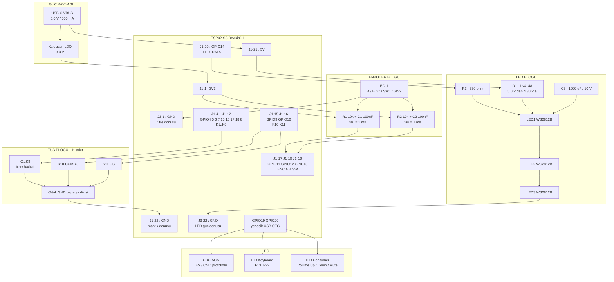

---

## 3. Tuş Devresi

11 anahtarın tamamı **birbirinin aynısıdır**: **Cherry MX Blue `MX1A-E1NN`**
(clicky, 3 pinli plate-mount, 50 g tetikleme, 2.2 mm ön hareket).
Aktif LOW, dahili pull-up, matris yok, diyot yok.

> **Anahtar tipi devre topolojisini değiştirmez.** MX Blue, GPIO ile GND
> arasındaki kuru mekanik kontaktır; MX Brown ile hem elektriksel hem
> boyutsal olarak birebir aynıdır (plaka deliği 14.00 mm kare, adım 19.05 mm,
> gövde flanşı 15.6 mm). Değişen tek şey firmware'deki tuş debounce süresidir:
> **5 ms → 8 ms** (gerekçe: `docs/01-DONANIM-PIN-SEMASI.md` bölüm 5.1.4).

### 3.1 ASCII

```
       ESP32-S3 IC YAPISI                      HARICI DEVRE
   +---------------------------+
   |                           |
   |          3V3              |
   |           |               |
   |         [ 45k ]  <-- dahili pull-up
   |           |               |
   |           +---------------o  GPIOxx  o------+
   |           |               |   (J1-n)        |
   |     +-----+-----+         |                 |
   |     | Schmitt   |         |            MX anahtar
   |     | trigger   |         |             bacak 1
   |     +-----------+         |                 |
   |           |               |               \
   |     yazilim okur          |                \   <-- mekanik kontak
   |     digitalRead()         |                 |
   |                           |             bacak 2
   +---------------------------+                 |
                                                 |
                                        ORTAK GND PAPATYA HATTI
                                                 |
                                              J1-22 (GND)


   DURUM TABLOSU
   +-------------+----------+--------------------+--------------+
   | Tus durumu  | Kontak   | GPIO gerilimi      | Okunan deger |
   +-------------+----------+--------------------+--------------+
   | Serbest     | Acik     | 3.3 V (pull-up)    | HIGH  (1)    |
   | Basili      | Kapali   | 0.0 V (GND)        | LOW   (0) ** |
   +-------------+----------+--------------------+--------------+
     ** aktif seviye
```

### 3.2 Pin eşlemesi

| Tuş | GPIO | Header | Tel |
|---|---|---|---|
| K1 | GPIO4 | J1-4 | W01 |
| K2 | GPIO5 | J1-5 | W02 |
| K3 | GPIO6 | J1-6 | W03 |
| K4 | GPIO7 | J1-7 | W04 |
| K5 | GPIO15 | J1-8 | W05 |
| K6 | GPIO16 | J1-9 | W06 |
| K7 | GPIO17 | J1-10 | W07 |
| K8 | GPIO18 | J1-11 | W08 |
| K9 | GPIO8 | J1-12 | W09 |
| K10 (COMBO) | GPIO9 | J1-15 | W10 |
| K11 (OS) | GPIO10 | J1-16 | W11 |

### 3.3 Mermaid

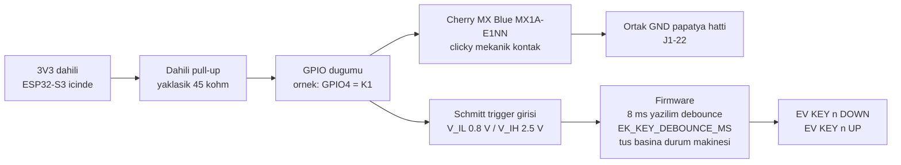

### 3.4 Neden matris ve diyot yok

| Ölçüt | Doğrudan bağlantı *(seçilen)* | 4×3 matris + diyot |
|---|---|---|
| GPIO sayısı | 11 | 7 |
| Ek eleman | **0** | 11 × 1N4148 |
| Tel sayısı | 11 sinyal + 11 GND | 7 sinyal + 11 diyot bacağı |
| 3 tuş aynı anda (combo!) | **Sorunsuz** | Diyotsuz hayalet tuş, diyotla sorunsuz |
| Firmware | `digitalRead()` × 11 | Satır tarama döngüsü + zamanlama |
| Toplam eleman maliyeti | 0 TL | ≈ 22 TL + montaj |

Combo özelliği K10 + iki işlev tuşunun **aynı anda** basılı olmasını
gerektirir (çekirdek spesifikasyon 6.2). Bu, matrisin en zayıf olduğu
senaryodur. Doğrudan bağlantıda hayalet tuş sorunu **hiç doğmaz**.

---

## 4. EC11 Enkoder + RC Debounce

### 4.1 ASCII — kanal A (kanal B birebir aynı)

```
        3V3  (J1-1)
         |
         |
       +-+-+
       |   |
       |R1 |  10 kohm    <-- harici pull-up + filtre direnci
       |   |
       +-+-+
         |
         +-------------------------------o  ENC_A  (GPIO11, J1-17)
         |                               |
         |                               |   ESP32-S3 icinde ayrica
         |                               |   45 kohm dahili pull-up
       +-+-+                             |   -> paralel esdeger 8.18 kohm
       |   |                             |
       |C1 |  100 nF                     |
       |   |                             |
       +-+-+                             |
         |                               |
         +---------------o EC11 pin A ---+
         |                     |
         |                    \    <-- enkoder ic kontagi
         |                     |
         |               EC11 pin C (ortak)
         |                     |
        GND -----------------  +  ---------> J3-1 (GND)


      ZAMAN SABITI
      ------------------------------------------------
      tau_nominal = R1 x C1 = 10 000 x 100e-9 = 1.00 ms
      R_paralel   = (10k x 45k) / (10k + 45k) = 8.18 k
      tau_gercek  = 8.18k x 100n              = 0.82 ms
      f_kesim     = 1 / (2 x pi x 8.18k x 100n) = 195 Hz
      ------------------------------------------------
      EC11 kontak sicramasi: 0.1 - 1 ms  -> BASTIRILIR
      En hizli cevirme: 20 tik/s = 50 ms  -> KACAN TIK YOK
```

### 4.2 ASCII — enkoder butonu (RC yok)

```
        ENC_SW (GPIO13, J1-19)  o------ EC11 SW1
                                            |
                                           \    <-- push buton
                                            |
                                        EC11 SW2
                                            |
                                          RC.GND ------> J3-1 (GND)

   Dahili pull-up + 5 ms yazilim debounce yeterlidir.
   Buton mekanigi enkoder kontagindan cok daha temizdir.
```

> **Enkoder butonu 5 ms'te KALIR — tuşlar 8 ms'e çıktı.** Fark bilinçlidir:
> EC11'in gömülü butonu tek parçalı kubbe/kontak mekanizmasıdır; MX Blue'daki
> gibi ayrı bir click jacket yoktur, dolayısıyla bırakışta ek sıçrama üretmez.
> Sabitler: `EK_ENC_SW_DEBOUNCE_MS = 5`, `EK_KEY_DEBOUNCE_MS = 8`
> (`firmware/src/config.h`).

### 4.3 EC11 pin yerleşimi

```
        EC11 ALTTAN GORUNUS
     (mil size bakiyor, 3 pinli taraf altta)

        SW1  o           o  SW2      <-- 2 pinli taraf: entegre buton
             |           |
        +----+-----------+----+
        |                     |
        |      [ EC11 ]       |
        |                     |
        +--+-------+-------+--+
           |       |       |
           o       o       o
           A       C       B         <-- 3 pinli taraf: quadrature cikis
                (ortak)
```

| EC11 pini | Bağlantı | GPIO | Tel |
|---|---|---|---|
| A | `RC.NA` | GPIO11 | W25 |
| C (ortak) | `RC.GND` | — | W28 |
| B | `RC.NB` | GPIO12 | W27 |
| SW1 | doğrudan MCU | GPIO13 | W29 |
| SW2 | `RC.GND` | — | W30 |

### 4.4 Quadrature dalga şekli

EC11, detent (tık) başına **tam bir quadrature çevrimi** üretir.
Bu yüzden çözücü `1 tık = 1 event` verir.

```
   SAGA CEVIRME (CW)                    SOLA CEVIRME (CCW)

   A  ---+     +-----+     +---         A  ------+     +-----+     +
         |     |     |     |                     |     |     |     |
         +-----+     +-----+                     +-----+     +-----+

   B  ------+     +-----+     +         B  ---+     +-----+     +---
            |     |     |     |               |     |     |     |
            +-----+     +-----+               +-----+     +-----+

      A once duser -> CW                  B once duser -> CCW
      EV ENC CW gonderilir                EV ENC CCW gonderilir

   BIR DETENT (TIK)  |<--------->|
   Durum sirasi CW : 11 -> 01 -> 00 -> 10 -> 11
   Durum sirasi CCW: 11 -> 10 -> 00 -> 01 -> 11
```

Firmware, `(A,B)` ikilisinin önceki ve yeni değerini birleştirip
**4 adımlı durum tablosundan** yön çıkarır (çekirdek spesifikasyon 6.1).
Geçersiz geçişler (örneğin `11 -> 00`) yok sayılır — RC filtresi bunların
sayısını zaten neredeyse sıfıra indirir.

### 4.5 Mermaid

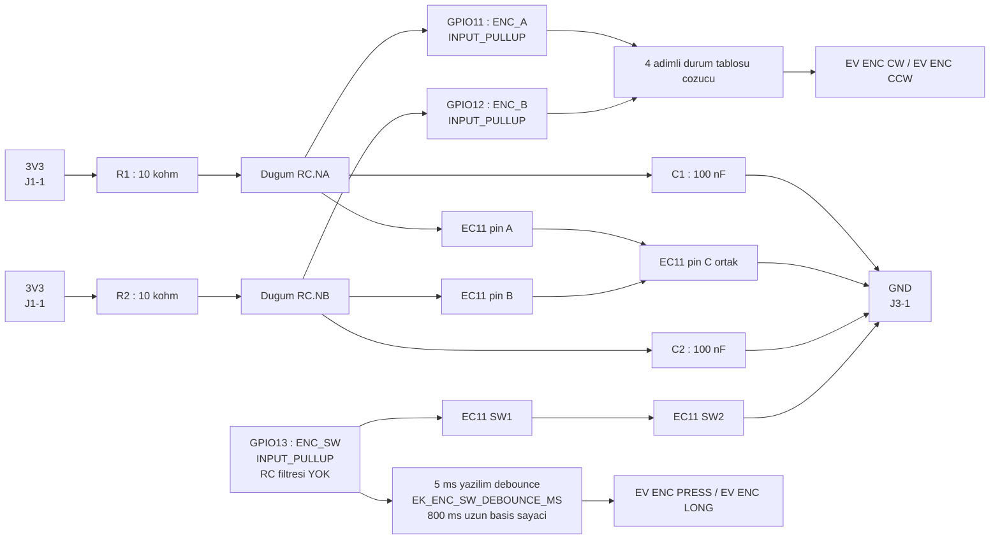

---

## 5. WS2812B LED Zinciri

### 5.1 ASCII

```
  J1-21 (5V)              D1 = 1N4148
     o-------------------------|>|--------------+
                             anot   katot       |
                                                |
                                                |  LED BESLEME RAYI
                                                |  VDD = 5.0 - 0.70 = 4.30 V
                                    +-----------+-----------+-----------+
                                    |           |           |           |
                                  +-+-+         |           |           |
                                  |   |         |           |           |
                                  |C3 | 1000uF  |           |           |
                                  | + | 10 V    |           |           |
                                  |   |     +---+---+   +---+---+   +---+---+
                                  +-+-+     | LED1  |   | LED2  |   | LED3  |
                                    |       | WS2812|   | WS2812|   | WS2812|
                                    |       |  B    |   |  B    |   |  B    |
                                    |       +-+-+-+-+   +-+-+-+-+   +-+-+-+-+
                                    |         | | |       | | |       | | |
                                    |    VDD -+ | |  VDD -+ | |  VDD -+ | |
                                    |    GND ---+ |  GND ---+ |  GND ---+ |
                                    |    DIN/DOUT-+  DIN/DOUT-+  DIN/DOUT-+
                                    |         |           |           |
  J3-22 (GND)                       |         |           |           |
     o------------------------------+---------+-----------+-----------+


  VERI HATTI
  ----------
  J1-20 (GPIO14)    R3 = 330 ohm
     o-------------[========]--------> LED1.DIN
                                       LED1.DOUT ---> LED2.DIN
                                                      LED2.DOUT ---> LED3.DIN
                                                                     LED3.DOUT (bos)

     ^ direnc MCU cikisina MUMKUN OLDUGUNCA YAKIN
```

### 5.2 1N4148 gerilim hesabı (neden zorunlu)

```
  WS2812B veri sayfasi:   V_IH(min) = 0.7 x VDD
  ESP32-S3 GPIO cikisi:   V_OH      = 3.3 V

  +--------------------+---------+-----------+---------+-------------+--------+
  | Senaryo            | I_LED   | 1N4148 VF | VDD_LED | V_IH gerekli| Marj   |
  +--------------------+---------+-----------+---------+-------------+--------+
  | DIYOT YOK          |    -    |     -     |  5.00 V |   3.50 V    | -0.20  |  HATA
  | Parlaklik 60/255   |  45 mA  |   0.70 V  |  4.30 V |   3.01 V    | +0.29  |  OK
  | Tam beyaz 255/255  | 180 mA  |   0.95 V  |  4.05 V |   2.84 V    | +0.46  |  OK
  +--------------------+---------+-----------+---------+-------------+--------+

  Marj = V_OH - V_IH = 3.3 - (0.7 x VDD_LED)

  Diyotsuz devrede 3.3 V, gereken 3.5 V esiginin ALTINDA kalir.
  Bu "bazen calisiyor" tipi bir arizadir: yeni LED ile calisir, sicaklik
  degisince veya farkli parti LED ile rastgele renk atar.
```

### 5.3 Eleman gerekçeleri

| Eleman | Değer | Görev | Hesap |
|---|---|---|---|
| **D1** | 1N4148 | 5.0 V → 4.30 V; V_IH eşiğini 3.50 V'tan 3.01 V'a indirir | `V_IH = 0.7 × 4.30 = 3.01 V < 3.3 V` ✓ |
| **R3** | 330 Ω | Yansıma sönümleme, GPIO koruma, EMI azaltma | Arıza akımı `5 V / 330 Ω = 15 mA < 40 mA` GPIO sınırı |
| **C3** | 1000 µF / 10 V | Anahtarlama tepe akımını yerel karşılar | `C = I·t/V = 0.177 × 0.00125 / 0.1 = 2 212 µF` en kötü hâl; 60/255'te `525 µF` gerekir |

### 5.4 Akım hesabı

```
  Tek WS2812B, tam beyaz  = 3 kanal x 20 mA        =  60 mA
  Uc LED,      tam beyaz  = 3 x 60 mA              = 180 mA
  Parlaklik 60/255        = 180 x (60/255)         =  42.35 mA
  Surucu IC bekleme       = 3 x 1 mA               =   3 mA
  ---------------------------------------------------------------
  Normal calisma LED akimi                         =  45 mA
```

### 5.5 Renk atamaları (çekirdek spesifikasyon 6.4)

| LED | Durum | Renk | HEX |
|---|---|---|---|
| **LED1** | OS = Windows | Mavi | `#1E90FF` |
| | OS = macOS | Beyaz | `#FFFFFF` |
| **LED2** | Combo kapalı | Sönük | — |
| | Combo modu açık (K10 basılı) | Turuncu | `#FF9500` |
| | Combo tetiklendi (150 ms flaş) | Yeşil | `#2CC985` |
| **LED3** | PC uygulaması bağlı | Yeşil | `#2CC985` |
| | Uygulama yok / HID yedek | Kırmızı | `#E04F5F` |
| | Tuş aktivitesi (80 ms flaş) | Mavi | `#3B8ED0` |

Varsayılan parlaklık **60/255**.

### 5.6 Mermaid

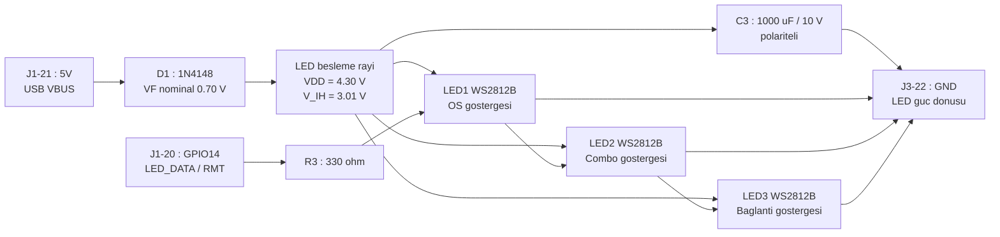

---

## 6. Güç Ağacı

### 6.1 ASCII

```
   USB-C  "USB" portu  (native OTG)
   VBUS = 5.0 V, USB 2.0 sonrasi 500 mA
        |
        |  [kart uzeri Schottky - iki portun birbirine akim basmasini onler]
        |
        +-----------------------------------------------+
        |                                               |
        v                                               v
   J1-21  "5V" pini                            Kart uzeri 3.3 V LDO
        |                                               |
        |                                               +--> ESP32-S3-WROOM-1
        v                                               |    modul beslemesi
   D1 = 1N4148                                          |    80 mA tipik
   V_F = 0.70 V @ 45 mA (nominal)                       |
        |                                               v
        v                                        J1-1 / J1-2  "3V3"
   LED besleme rayi 4.30 V                              |
        |                                               +--> RC.3V3
        +--> LED1 / LED2 / LED3                         |    R1 + R2 pull-up
        |    45 mA tipik, 180 mA tepe                   |    0.7 mA
        |                                               |
        +--> C3  1000 uF / 10 V                         +--> tus dahili pull-up
                                                             1.0 mA


   GUC BUTCESI
   -------------------------------------------------------
   ESP32-S3 aktif, WiFi/BLE kapali        =  80 mA
   Kart uzeri LDO kaybi + guc LED'i       =   6 mA
   WS2812B x3 surucu bekleme              =   3 mA
   WS2812B x3 isik, parlaklik 60/255      =  42 mA
   Dahili pull-up akimlari (14 hat)       =   1 mA
   -------------------------------------------------------
   TOPLAM (normal)                        = 132 mA
   USB siniri                             = 500 mA
   Kalan pay                              = 368 mA  (%73.6)
   -------------------------------------------------------
   TOPLAM (en kotu: uc LED tam beyaz)     = 302 mA  (%60.4)
```

### 6.2 Mermaid

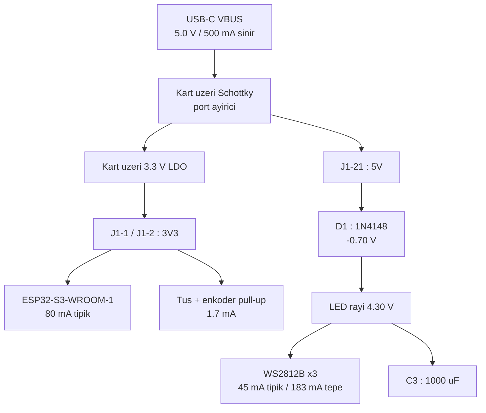

---

## 7. Topraklama Topolojisi

DevKitC-1'de dört GND pini vardır ve hepsi kart üzerinde aynı bakır alana
bağlıdır. Ancak **telleri ayırmak** yüksek akımlı LED dönüşünün hassas
sinyal referanslarını bozmasını engeller. Bu **yıldız topraklama**dır.

### 7.1 ASCII

```
                    ESP32-S3-DevKitC-1
                   +-------------------+
                   |   GND BAKIR ALANI |
                   |   (kart uzerinde  |
                   |    zaten ortak)   |
                   +--+-----+-------+--+
                      |     |       |
              J1-22   |  J3-1    J3-22
                      |     |       |
       0.8 mA <-------+     |       +-------> 45 mA tipik
                            |                 180 mA tepe
                       0.7 mA
                            |
   +------------------+  +--+-------------+  +-------------------+
   | 11 anahtarin     |  | RC filtre      |  | WS2812B zinciri   |
   | GND papatya      |  | karti GND rayi |  | LED1/2/3 GND      |
   | dizisi           |  | + EC11 C pini  |  | + C3 eksi bacagi  |
   |                  |  | + EC11 SW2     |  |                   |
   | SINYAL TOPRAGI   |  | FILTRE REFERANS|  | GUC TOPRAGI       |
   +------------------+  +----------------+  +-------------------+


   NEDEN AYRI?
   -----------
   LED akimi 800 kHz veri hiziyla anahtarlanir ve 45 mA'dan
   180 mA'ya siçrar. Bu akim, ortak bir tel uzerinden dondugunde
   telin direnci (26 AWG, 30 cm = 40 mohm) uzerinde

        V = 0.180 A x 0.040 ohm = 7.2 mV

   gurultu gerilimi olusturur. Bu, 100 nF filtre kondansatorunun
   referansini kaydirir ve enkoder cozucusunde sahte tik uretebilir.
   Ayri tellerle bu yol tamamen kesilir.
```

### 7.2 Mermaid

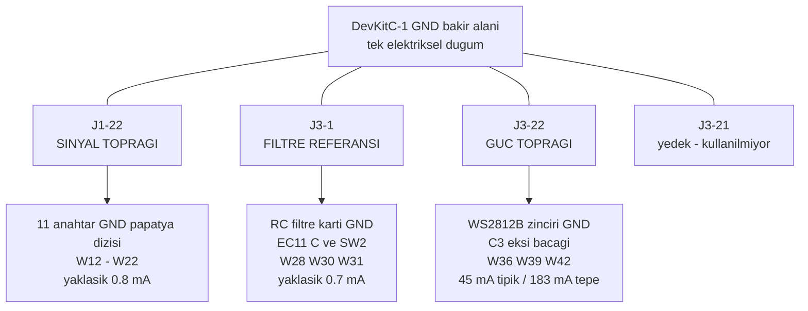

---

## 8. Fiziksel Yerleşim

### 8.1 Ön yüz (çekirdek spesifikasyon bölüm 2)

```
   Plaka dis olcu 88.20 x 69.15 mm, bezel 6.00 mm, tus adimi 19.05 mm

   +------------------------------------------------------------------+
   |                                                                   |
   |     (LED1)        (LED2)        (LED3)      <- UST BEZEL          |
   |      o3.00         o3.00         o3.00         aralik 8.00 mm     |
   |     #1E90FF       #FF9500       #2CC985                           |
   |                                                                   |
   |   +-----------+-----------+-----------+-----------+               |
   |   |           |           |           |    ( )    |               |
   |   |    K1     |    K2     |    K3     |    ENC    |  <- o7.20     |
   |   |  GPIO4    |  GPIO5    |  GPIO6    | GPIO11/12 |     EC11      |
   |   |           |           |           |   /13     |               |
   |   +-----------+-----------+-----------+-----------+               |
   |   |           |           |           |           |               |
   |   |    K4     |    K5     |    K6     |    K10    |  <- COMBO     |
   |   |  GPIO7    |  GPIO15   |  GPIO16   |   GPIO9   |               |
   |   |           |           |           |           |               |
   |   +-----------+-----------+-----------+-----------+               |
   |   |           |           |           |           |               |
   |   |    K7     |    K8     |    K9     |    K11    |  <- WIN/MAC   |
   |   |  GPIO17   |  GPIO18   |  GPIO8    |  GPIO10   |               |
   |   |           |           |           |           |               |
   |   +-----------+-----------+-----------+-----------+               |
   |                                                                   |
   |   o M3                                              o M3          |
   +------------------------------------------------------------------+
     |<------------------- 88.20 mm ------------------->|

   MX plaka deligi: 14.00 x 14.00 mm  (tolerans 13.95 - 14.05)
   Plaka kalinligi: 1.50 mm  (MX klips tutmasi icin ZORUNLU)
```

> **MX Blue ile bu ölçülerin hiçbiri değişmez.** Cherry MX Blue boyutsal
> olarak tüm MX ailesiyle birebir aynıdır. Yalnızca **3 pinli (plate-mount)**
> varyant kullanılır; 5 pinli varyanttaki 2 plastik konumlandırma ayağı için
> bu düz plakada delik yoktur.

### 8.2 Yan kesit

```
                   Keycap
                  +-------+
                  |       |
   ===============+=======+===============  <- Ust plaka 1.50 mm
                  | MX SW |
                  +-------+
   |                                    |
   |   +--------------------------+     |
   |   | ESP32-S3-DevKitC-1       |     |   Ic yukseklik 18.00 mm
   |   +--------------------------+     |
   |   +--------+  teller           |   |
   |   | RC krt |                   |   |
   |   +--------+                   |   |
   |                                    |
   ======================================  <- Taban 2.50 mm
       o                            o        M3 x 12 vida
      ---                          ---       silikon ayak

   Toplam govde yuksekligi: 1.50 + 18.00 + 2.50 = 22.00 mm
   Duvar kalinligi: 3.00 mm
   Ic bosluk (cavity): 82.20 x 63.15 mm
```

> **Akustik dolgu (MX Blue).** Yukarıdaki kesitte görülen 18.00 mm'lik boş
> kovuk, clicky anahtarla birlikte rezonans odası gibi çalışır ve sese
> "çınlamalı / boşluklu" (hollow) bir karakter verir. **Ölçüler değişmez**,
> kovuk *doldurulur*: tabanın iç yüzeyine 2–3 mm poron/EVA sünger yapıştırılır,
> kalan serbest hacim sünger veya kesilmiş kaymaz dolap altlığı ile
> **DevKit'i ve kabloları sıkıştırmadan** gevşekçe doldurulur. Ayrıntı:
> `docs/01-DONANIM-PIN-SEMASI.md` bölüm 5.1.7; malzeme: `hardware/BOM.csv`
> "Poron/EVA sünger levha 3 mm".

### 8.3 Yerleşim Mermaid

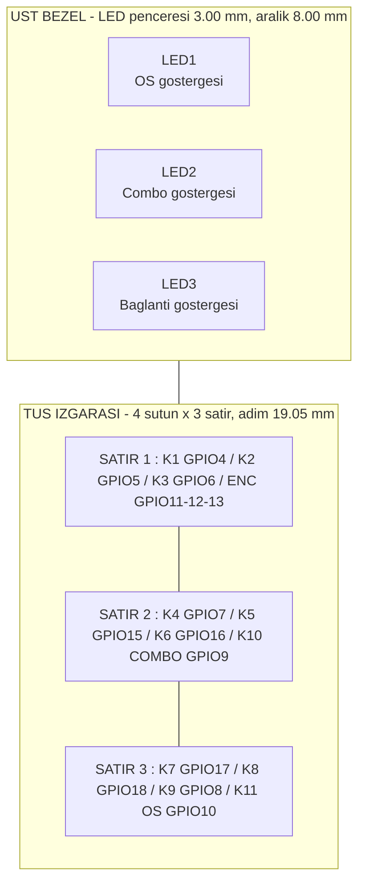

---

## 9. Firmware Durum Makineleri

Donanım ile birebir ilişkili oldukları için burada da verilmiştir.
Kaynak: çekirdek spesifikasyon bölüm 6.

### 9.1 Combo durum makinesi (K10 + iki işlev tuşu)

Bu durum makinesi **donanım tasarımını doğrudan belirler**: aynı anda üç
tuşun basılı olabilmesi gerektiği için matris kullanılamaz (bkz. bölüm 3.4).

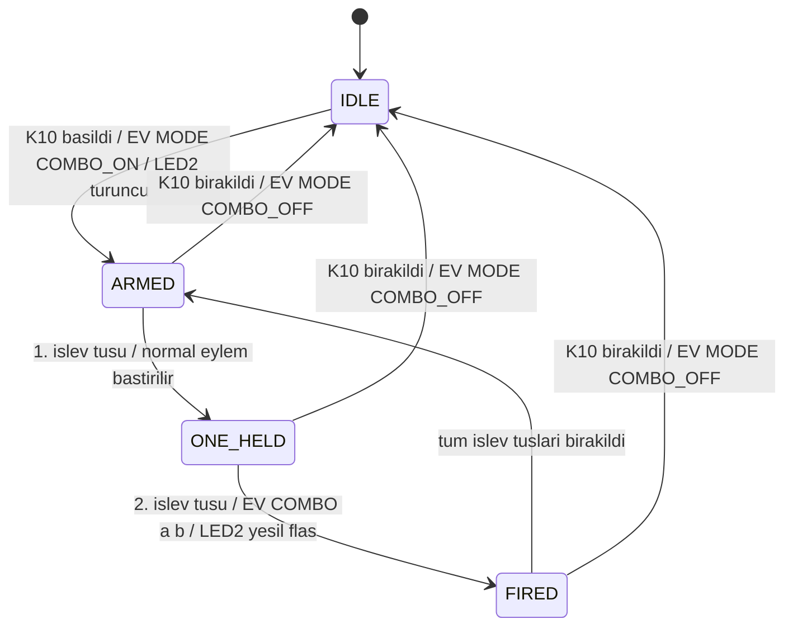

**Kritik kural:** K10 basılıyken `K1..K9`'un normal `EV KEY` eventleri ve
HID kodları **gönderilmez**. Combo sırası önemsizdir; `a < b` olacak şekilde
normalize edilir (`2+5` ve `5+2` ikisi de `C_2_5`).

Kombinasyon sayısı: `C(9,2) = 36`.

### 9.2 OS tuşu (K11) durum makinesi

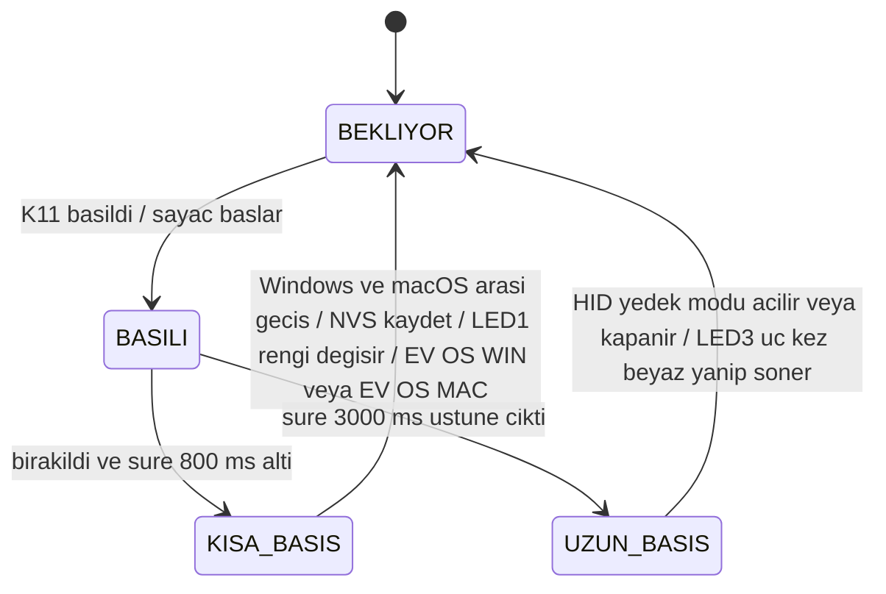

### 9.3 Enkoder çözücü

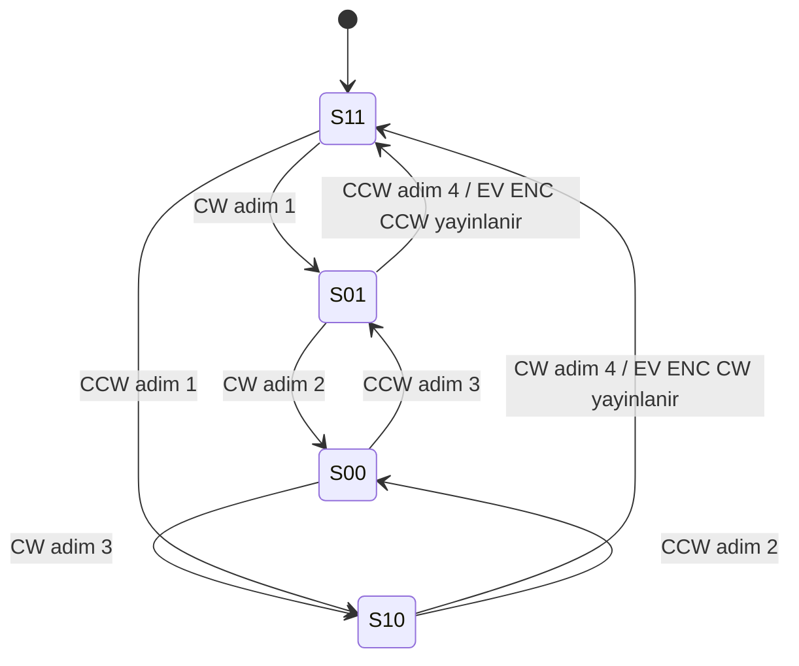

Durum adları `S<A><B>` biçimindedir: `S11` = A HIGH, B HIGH (dinlenme).
EC11 detent başına tam bir çevrim ürettiği için her tıkta tam olarak bir
event yayınlanır. RC filtresi geçersiz geçişleri kaynağında yok eder.

### 9.4 Bağlantı durumu ve HID yedek modu

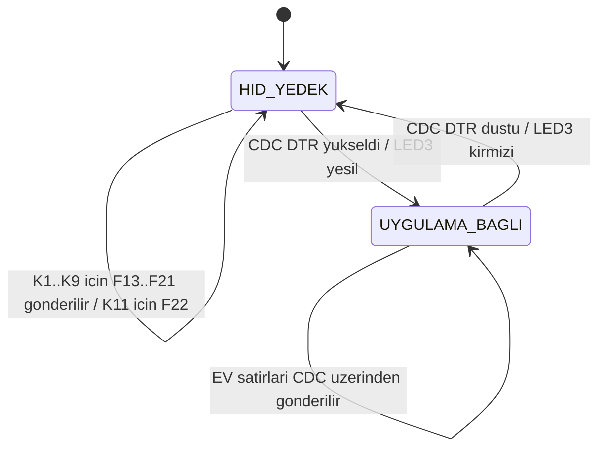

Enkoder HID modu **her zaman aktiftir** — uygulama olmadan da
Consumer Control ile ses kontrolü çalışır.

---

## 10. Düğüm Listesi (Netlist)

Şematiğin makine okunur özeti. Her satır bir elektriksel düğümdür;
o düğüme bağlı **tüm** uçlar listelenmiştir.

| Düğüm | Bağlı uçlar | Tip |
|---|---|---|
| `NET_3V3` | `J1-1`, `R1.1`, `R2.1` | Güç 3.3 V |
| `NET_5V` | `J1-21`, `D1.anot` | Güç 5.0 V |
| `NET_VLED` | `D1.katot`, `C3.+`, `LED1.VDD`, `LED2.VDD`, `LED3.VDD` | Güç 4.30 V |
| `NET_GND` | `J1-22`, `J3-1`, `J3-22`, `C1.2`, `C2.2`, `C3.-`, `EC11.C`, `EC11.SW2`, `LED1.GND`, `LED2.GND`, `LED3.GND`, `K1.2` … `K11.2` | Toprak |
| `NET_K1` | `J1-4` (GPIO4), `K1.1` | Sinyal, aktif LOW |
| `NET_K2` | `J1-5` (GPIO5), `K2.1` | Sinyal, aktif LOW |
| `NET_K3` | `J1-6` (GPIO6), `K3.1` | Sinyal, aktif LOW |
| `NET_K4` | `J1-7` (GPIO7), `K4.1` | Sinyal, aktif LOW |
| `NET_K5` | `J1-8` (GPIO15), `K5.1` | Sinyal, aktif LOW |
| `NET_K6` | `J1-9` (GPIO16), `K6.1` | Sinyal, aktif LOW |
| `NET_K7` | `J1-10` (GPIO17), `K7.1` | Sinyal, aktif LOW |
| `NET_K8` | `J1-11` (GPIO18), `K8.1` | Sinyal, aktif LOW |
| `NET_K9` | `J1-12` (GPIO8), `K9.1` | Sinyal, aktif LOW |
| `NET_K10` | `J1-15` (GPIO9), `K10.1` | Sinyal, aktif LOW |
| `NET_K11` | `J1-16` (GPIO10), `K11.1` | Sinyal, aktif LOW |
| `NET_ENCA` | `J1-17` (GPIO11), `R1.2`, `C1.1`, `EC11.A` | Sinyal, RC filtreli |
| `NET_ENCB` | `J1-18` (GPIO12), `R2.2`, `C2.1`, `EC11.B` | Sinyal, RC filtreli |
| `NET_ENCSW` | `J1-19` (GPIO13), `EC11.SW1` | Sinyal, aktif LOW |
| `NET_LEDDATA` | `J1-20` (GPIO14), `R3.1` | Sinyal, 800 kHz seri |
| `NET_DIN1` | `R3.2`, `LED1.DIN` | Sinyal, 800 kHz seri |
| `NET_DIN2` | `LED1.DOUT`, `LED2.DIN` | Sinyal, 800 kHz seri |
| `NET_DIN3` | `LED2.DOUT`, `LED3.DIN` | Sinyal, 800 kHz seri |
| *(bağlanmaz)* | `LED3.DOUT` | Boş |

**Toplam:** 22 elektriksel düğüm, 15 GPIO, 3 güç rayı.

### 10.1 Eleman listesi

| Referans | Değer | Paket | Düğüm 1 | Düğüm 2 |
|---|---|---|---|---|
| `R1` | 10 kΩ | Eksenel 1/4 W | `NET_3V3` | `NET_ENCA` |
| `R2` | 10 kΩ | Eksenel 1/4 W | `NET_3V3` | `NET_ENCB` |
| `R3` | 330 Ω | Eksenel 1/4 W | `NET_LEDDATA` | `NET_DIN1` |
| `C1` | 100 nF | Seramik 2.54 mm | `NET_ENCA` | `NET_GND` |
| `C2` | 100 nF | Seramik 2.54 mm | `NET_ENCB` | `NET_GND` |
| `C3` | 1000 µF / 10 V | Elektrolitik radyal | `NET_VLED` (+) | `NET_GND` (−) |
| `D1` | 1N4148 | DO-35 | `NET_5V` (anot) | `NET_VLED` (katot) |
| `K1`–`K11` | Cherry MX Blue `MX1A-E1NN` | Plate-mount, **3 pinli** | `NET_Kn` | `NET_GND` |
| `EC11` | EC11 enkoder | Panel montaj | A/B/C/SW1/SW2 | — |
| `LED1`–`LED3` | WS2812B | 5050 | `NET_VLED` / `NET_DINn` | `NET_GND` |
| `U1` | ESP32-S3-DevKitC-1 | 2 × 22 pin header | — | — |

---

## 11. Sürüm Geçmişi

| Sürüm | Tarih | Değişiklik |
|---|---|---|
| 3.0.0 | 2026-08-04 | İlk yayın. Çekirdek spesifikasyon v3.0.0 ile hizalı. |
| 3.0.1 | 2026-08-04 | Anahtar tipi **Cherry MX Blue `MX1A-E1NN`** olarak belirtildi (clicky, 3 pinli, 50 g). Tuş debounce 5 ms → **8 ms** (enkoder butonu 5 ms'te kaldı). 18.00 mm kovuk için akustik dolgu notu eklendi. **Devre topolojisi, düğüm listesi, pin numaraları ve ölçüler değişmedi.** |
